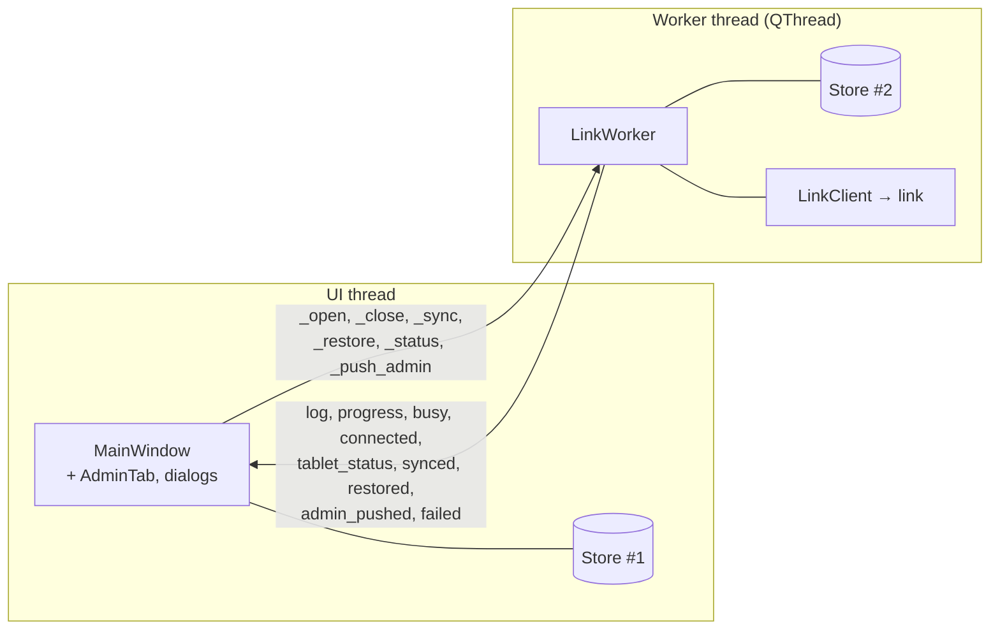

# Companion: window

`companion/chicken_companion/ui/`: the window (`main_window.py`), the
background worker (`worker.py`), the Admin tab (`admin_tab.py`), and two
dialogs (`import_dialog.py`, `radio_dialog.py`). Read
[Python and Qt crash course](../how/python-qt-primer.md) first.

## The two threads



- The **window** owns everything you see, and its own `Store`.
- The **worker** owns the link and client, and a second `Store` for writing
  synced records. Two connections to the same SQLite file is fine; SQLite
  handles the locking.
- They talk only through **signals** ([Pattern 13](patterns.md)). A signal
  connected across threads is *queued*: the receiver runs it on its own
  thread, one at a time, in order. This is also why two jobs never run at
  once.

## `main_window.py`: `MainWindow`

### Construction

`__init__(db_path)`:

1. Make the UI thread's `Store`.
2. Make a `QThread` and a `LinkWorker`, and `moveToThread` the worker onto
   it (its slots now run on that thread).
3. Connect the window's request signals (`_open`, `_close`, `_sync`,
   `_restore`, `_status`, `_push_admin`, `_init_store`) to worker slots, and
   the worker's result signals to window methods.
4. Start the thread and emit `_init_store`, so the worker makes its `Store`
   *on its own thread*.
5. `_build_ui()`, then fill the tables.

### Building the screen

| Method | Builds |
|---|---|
| `_build_ui()` | The connection bar (LoRa: port, refresh, Radio settings; TCP: host, port), then the tabs. `_mode_changed` shows the right half of the bar. |
| `_sync_tab()` | Tablet info, Sync now, auto-sync, progress bar, tablets table, activity log. |
| `_data_tab()` | Season and event filters, team filter, the records table (`QTableView` over a `QStandardItemModel`, with a `QSortFilterProxyModel` for sorting and filtering), Import and Export buttons. |
| `_seasons_tab()` | Seasons list and their fields. |
| `_restore_tab()` | Event picker and Send to tablet. |
| `AdminTab` | Its own class (below). |

### Reacting

| Method | What it does |
|---|---|
| `_toggle_connect()` | Disconnect if connected; otherwise build a target (serial port, `SIMULATOR`, or `tcp:host:port`) and emit `_open`. Saves choices in `QSettings`. |
| `_on_connected(ok, port)` | Update the button and label; enable or disable the connection controls; ask for status. |
| `_on_status(s)`, `_on_synced(new, received)`, `_on_failed(msg)` | Show results. A failure shows a message box, unless auto-sync is on (it would pop up every minute). |
| `_set_busy(busy)` | Disable the buttons while a job runs. |
| `_toggle_auto()` / `_auto_sync()` | A `QTimer` that emits `_sync` every N seconds if connected and not busy. |
| `_refresh_data()`, `_refresh_events()`, `_refresh_table()` | Rebuild the season and event lists, then the table. `blockSignals(True)` stops "selection changed" signals while the lists are refilled, so the table isn't rebuilt half-way through. |
| `_refresh_table()` | Records → `csv_export.build_rows` → table cells. Numbers are also stored as numbers (`Qt.ItemDataRole.UserRole`) so sorting is numeric (2 < 10), not alphabetical ("10" < "2"). |
| `_import_legacy()`, `_export_csv()`, `_do_restore()` | Open the import dialog / save CSV / confirm and emit `_restore`. |
| `closeEvent(event)` | Stop the timer, close the link, stop the thread cleanly. |

## `worker.py`: `LinkWorker`

| Member | What it does |
|---|---|
| `tcp_target(host, port)` / `parse_tcp_target(text)` | Pack TCP details into one string (`"tcp:192.168.4.20:5810"`) so `open_link` can take one argument for every kind of link. |
| `init_store()` | Make this thread's `Store`. |
| `_run(job)` | Run one job: emit `busy(True)`; catch `LinkError` (expected: show its message), `OSError` (connection problems) and anything else (print the traceback, show the error), so one failure never kills the thread; if the TCP link was closed by the tablet, tidy up; finally `busy(False)`. |
| `open_link(port, air_bps)` | TCP → `TcpLink` + client (3 s timeout, 2 retries). Simulator → `SimulatedRadio` with a `TabletResponder` on `fake_store()` (10% loss). Serial → `SerialLink` paced at `air_bps`, with a timeout long enough for a full frame plus the tablet's turnaround. |
| `close_link()` | Close and forget the link. |
| `sync()` | [Walkthroughs](walkthroughs.md), section 5. Starts from 0 if the tablet's counter went backwards (a reinstalled app). |
| `status()` | Ask the tablet; remember its settings version. |
| `_note_admin(version, devices)` | Store what the master reported (settings version, tablets). |
| `push_admin()` | [Walkthroughs](walkthroughs.md), section 6. Afterwards checks the master's version and raises a clear error if it didn't take the settings (an old tablet app). |
| `restore(event_key)` | Send an event's records with `client.restore`. |

## `admin_tab.py`: `AdminTab`

A `QWidget` with a status line, **Send to tablets** (emits `push_requested`;
the window forwards it to the worker), and four pages in a `QTabWidget`.

| Group | Methods |
|---|---|
| Status | `set_link(connected, busy)`, `_update_status()` (compares `Admin.version` with `pushed_version`), `refresh()` (reload every page), `refresh_link_info()` (after a sync or push, reload only tablets and status, so unsaved edits on other pages aren't lost) |
| Team & settings | `_team_page`, `_load_team`, `_current_event_key` (the event key typed or chosen), `_save_team`. The TBA key is saved in `QSettings`, not the database. |
| Scouts | `_scouts_page`, `_load_scouts`, `_scout_toggled` (tick = active), `_add_scouts` (one per line), `_rename_scout`, `_remove_scouts`, `_sort_scouts`, `_names_from_data` |
| Events | `_events_page`, `_load_events`, `_event_send_toggled`, `_tba_events`, `_add_event`, `_tba_schedule`, `_import_schedule`, `_remove_event`. Slow web calls run inside `_busy_cursor` (an hourglass). |
| Tablets | `_tablets_page`, `_load_tablets` (a combo box per row for station and side), `_assign`, `_tablet_renamed`, `_forget_tablet` |

```{admonition} A Python trap, avoided
:class: note
In `_load_tablets`, each combo box's signal is connected with
`lambda _, did=d.id, c=station: self._assign(did, station=c.currentData())`.
The `did=d.id` default captures the value *now*. A plain
`lambda: self._assign(d.id, …)` would use whatever `d` is when the lambda
runs, which after the loop is the *last* tablet, for every row.
```

## `import_dialog.py`: `ImportDialog`

| Method | What it does |
|---|---|
| `_browse()` / `_scan()` | Pick a folder; run `legacy_import.scan` (wait cursor) and remember the folder. |
| `_show_plan()` | Fill the events table (each row has an Import tick box), the summary and the problems list. |
| `_selected_events()` | The ticked events. |
| `_update_buttons()` | The Import button's text and whether it's enabled ("Add 412 new record(s)"). |
| `_import()` | `legacy_import.run(...)`, store the result, close. |

## `radio_dialog.py`: `RadioDialog`

Shows the `RadioSettings` fields, the resulting frequency and speed
(`_update`), and **Write to dongle** (`_apply`). Writing takes a few seconds,
so `_apply` runs `apply_settings` on a plain Python thread, and that
thread reports back through the dialog's own signals (`_log`, `_done`),
never touching widgets directly. It's the same rule as the worker, in
miniature.
