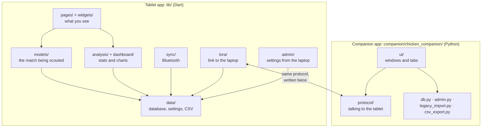

# Code guide

This section is a guided tour of the code itself: what every file, class and
method does, **why** it was built that way, and how the pieces call each
other. It's written as a learning guide. If this is the biggest program
you've ever opened, that's expected. Nobody reads 15,000 lines front to
back; you learn to *navigate*, and this section teaches you how.

```{admonition} Before you start
:class: tip
Read [The big picture](../start/big-picture.md) and
[Architecture](../how/architecture.md) first. They explain *what* the
system does. This section explains *how the code does it*.
```

```{rubric} Table of contents
```

```{toctree}
:maxdepth: 1

reading-code
patterns
design-decisions
walkthroughs
tablet-screens
tablet-widgets
tablet-data
tablet-sync-and-link
tablet-admin
tablet-dashboards
companion-protocol
companion-data
companion-ui
exercises
```

## How the code is laid out



Arrows point from code that *uses* to code that *is used*. Notice that
nothing points *into* `pages/`: the screens sit on top and nothing below
them knows they exist. That's deliberate (see
[Patterns and ideas](patterns.md)).

## Suggested reading order

**If you're brand new to programming**, go in this order and take your time:

1. [How to read code](reading-code.md): the tools that make a big codebase
   manageable.
2. [Walkthroughs](walkthroughs.md), *Scouting a match*: follow one tap all
   the way to the database.
3. [Tablet data layer](tablet-data.md): records and the database, which
   everything else is built on.
4. [Tablet screens](tablet-screens.md) and
   [Tablet widgets](tablet-widgets.md).
5. [Patterns and ideas](patterns.md): now the repeated ideas will make
   sense.
6. Then whichever part you'll work on.
7. [Exercises](exercises.md): practise.

**If you've programmed before**, read [Patterns and ideas](patterns.md) and
[Design decisions](design-decisions.md), skim [Walkthroughs](walkthroughs.md),
then go to the part you need.

## The pages

| Page | Covers |
|---|---|
| [How to read code](reading-code.md) | Navigating, searching, debugging, reading tests, naming conventions |
| [Patterns and ideas](patterns.md) | The programming ideas used everywhere, explained with this project's code |
| [Design decisions](design-decisions.md) | Each big choice: the problem, the options, what we picked and the trade-off |
| [Walkthroughs](walkthroughs.md) | Step-by-step traces through the code for the main things the system does |
| [Tablet: start-up and screens](tablet-screens.md) | `main.dart`, every page, how navigation and state work |
| [Tablet: widgets](tablet-widgets.md) | The input widgets: counters, path drawing, selectors |
| [Tablet: data layer](tablet-data.md) | `ScoutRecord`, `ScoutDatabase`, `ScoutData`, settings, CSV, The Blue Alliance |
| [Tablet: Bluetooth and the link](tablet-sync-and-link.md) | Bluetooth sync (Dart and Kotlin), frames, bundles, the responder, LoRa/TCP |
| [Tablet: admin settings](tablet-admin.md) | `AdminService` and the override rule, line by line |
| [Tablet: dashboards](tablet-dashboards.md) | Metrics, `EventData`, the grid layout, tiles, charts |
| [Companion: protocol](companion-protocol.md) | Framing, transfers, links, the client and the reference tablet |
| [Companion: data](companion-data.md) | The database, admin, legacy import, CSV, radio settings |
| [Companion: window](companion-ui.md) | The window, the worker thread, the Admin tab and dialogs |
| [Exercises](exercises.md) | Practice tasks, from reading to building |
