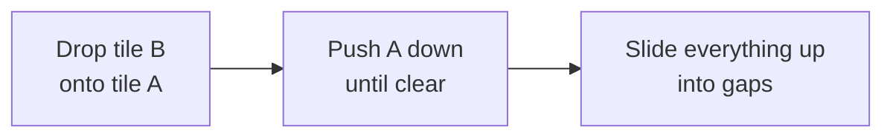

# Tablet: dashboards

The dashboards are the most "computer science" part of the tablet app:
statistics, sorting, a grid layout engine and custom charts. Read
[Dashboards inside](../how/dashboards-internals.md) for the overview and
[Walkthroughs](walkthroughs.md), section 7, for the flow.

| File | Holds |
|---|---|
| `analysis/metrics.dart` | What a stat is and how per-match values become one number |
| `analysis/event_data.dart` | One event's records + schedule, and the questions tiles ask |
| `dashboard/dashboard_model.dart` | Tile types, tile positions, dashboards, the layout rules, saving |
| `dashboard/dashboard_board.dart` | The grid on screen and the drag/resize gestures |
| `dashboard/tiles.dart` | What each tile draws |
| `dashboard/tile_settings.dart` | A tile's settings dialog |
| `dashboard/viz.dart` | Chart colours and chart widgets |
| `pages/dashboard_page.dart` | The screen: toolbar, palette, loading and saving |

## `metrics.dart`

**`MetricKind`**: `count`, `rating`, `level`, `flag`. It decides which
summaries make sense (`Agg.forKind`).

**`Metric(key, label, kind, read, {higherIsBetter})`**: one stat. `read`
is a function from a record's `data` to a number or `null`; `valueOf(record)`
calls it. Helpers `_section`, `_num`, `_flag`, `_climbLevel` and `_brokeDown`
keep each `read` short and safe with missing data.

**`Metrics.all`**: the list of every stat (the thing to edit each season).
`Metrics.byKey` and `Metrics.get(key)` look one up; an unknown key falls
back to the first metric, so a dashboard saved with an old stat still works.

**`Agg`** (aggregation) turns a team's per-match values into one number:

| Value | Calculation |
|---|---|
| `avg` / `rate` | Mean. For yes/no stats stored as 1/0, the mean *is* the % of matches. |
| `recent` | Mean of the last 3 matches |
| `median` | Middle value when sorted (average of the middle two if even) |
| `max` / `min` | Best / worst |
| `stdev` | Sample standard deviation: how spread out the values are. `lowerIsBetter`, because a consistent robot ranks higher. |
| `total` | Sum |

`Agg.fit(requested, kind)` swaps in an allowed summary if a tile asks for
one that doesn't suit the stat. **`formatValue(v, metric, agg)`** shows a
number properly: `75%`, `2.4/3`, `12`, `8.5`.

## `event_data.dart`

**`ScheduledMatch`**: `number`, `red` and `blue` team numbers, `teams`.
**`MatchValue`**: one team's value in one match.

**`EventData`**: built by `EventData.load(eventKey)` from the database and
the schedule file.

| Member | What it does | Notes |
|---|---|---|
| `byTeam` | Records grouped by team, each list in match order | `late final`: worked out the first time it's used, then kept |
| `teams` | Every team in the records or the schedule, sorted | |
| `isScouted(match, team)`, `matchesScouted(team)` | Coverage questions | |
| `values(team, metric)` | `MatchValue`s for one team (matches where `read` returned null are skipped) | |
| `stat(team, metric, agg)` | The summary number, **cached** by `"team|metric|agg"` | Tiles call this many times; caching keeps it fast |
| `ranked(metric, agg)` | Teams with data, best first | Direction from `higherIsBetter` and `lowerIsBetter` |
| `rank(team, metric, agg)` | `(rank, of how many)`; tied teams share a rank | |
| `fieldAverage(metric, agg)` | Average of all teams' summaries (the "event average" line) | |
| `match(number)`, `alliance(record)` | Lookups; alliance comes from the record's station, else the schedule | |
| `isPlayed(match)`, `nextMatch()` | A match is "played" once any robot in it is scouted. Next match: our team's next unplayed, else any unplayed, else the last. | No live score feed exists offline, so scouting data stands in for "has this match happened?" |
| `availableEvents()`, `loadSchedule(event)`, `parseSchedule(text)` | Which events exist; read the schedule file | |

```{admonition} Why build a whole object per event?
:class: tip
Every tile on the screen asks questions about the same event. Loading the
records once into `EventData`, and caching answers there, means 15 tiles
don't each read the database. When data changes, the page simply builds a
fresh `EventData` (and the old cache disappears with it).
```

## `dashboard_model.dart`

**`TileType`** enum: each value carries its label, description, icon,
default size and minimum size; `defaultSettings` gives a new tile's
settings; `parse(name)` reads a saved name back (unknown → `null`, and the
tile is skipped).

**`TileConfig`**: one tile: `id`, `type`, `x`, `y`, `w`, `h` (grid cells)
and `settings`. Immutable; `copyWith(...)` makes a changed copy.
`overlaps(other)` checks whether two rectangles intersect. `toJson` /
`fromJson` save and load it. `TileConfig.create(type)` makes a new tile at
its default size.

**`Dashboard`**: `id`, `name`, `tiles` (mutable list), with `toJson`,
`fromJson`, and `copy(name: …)` (deep copy through JSON with new IDs).

### The layout engine

Two pure functions keep tiles from overlapping:

**`compactLayout(tiles, {keepId})`**: sort tiles top-to-bottom, then for
each one: slide it up while the space above is free, then down while it
overlaps something already placed. Result: no gaps, no overlaps. `keepId`
pins one tile in place (the one under the finger).

**`resolveLayout(tiles, moved, {compactMoved})`**: put `moved` where it is,
push any tile it overlaps downward one row at a time until clear, then
`compactLayout` everything.



**`placeInFreeSpot(tiles, tile)`**: scan rows top to bottom, columns left
to right, and return the first position where the tile fits. Used when a
palette tile is tapped instead of dragged.

**`DashboardStore`**: `load()` (from the `dashboards` table; skips
unreadable ones; creates the starter dashboards if there are none),
`save`, `saveAll`, `delete`. **`defaultDashboards()`** builds the four
starters with `_t(type, x, y, w, h, settings)`.

## `dashboard_board.dart`: `DashboardBoard`

Inputs: `tiles`, `editing`, `ctx` (`DashContext`), `onTilesChanged`,
`onEditTile`.

| Member | What it does |
|---|---|
| `_cellW(width)` | Column width: (board width − 11 gaps) ÷ 12. Rows are 64 px, gaps 12 px. |
| `_rect(tile, cellW)` | A tile's position in pixels. |
| `_begin(tile, gesture)` | Start a move or resize: remember the original layout and the tile. |
| `_update(offset, cellW)` | Convert the finger's movement into whole grid cells; build the moved/resized tile (clamped to the grid and minimum size); if it actually changed cell, re-run `resolveLayout(..., compactMoved: false)` for a live preview. |
| `_end()` | Final `resolveLayout` (this time compacting the moved tile too) and report it with `onTilesChanged`. The page saves. |
| `_drop(type, position, cellW)` | A palette tile dropped: place it at the nearest cell and resolve. |
| `_activeTile` | While dragging: a dashed placeholder where the tile will land, plus the tile following the finger. |
| `_tileCard(tile, …)` | The card: title, edit buttons (⚙, ✕), resize handle, and `buildTile(...)`. In edit mode the content ignores touches (`IgnorePointer`), so presses go to the move gesture. |
| `_HoldToDrag` | Long-press-then-drag (180 ms) for moving. |
| `_GridPainter` | Draws the faint grid cells in edit mode. |

```{admonition} Why hold before dragging?
:class: note
On a tablet, a normal swipe should scroll the board. Requiring a short hold
before a tile moves means scrolling and moving don't fight. The resize
handle uses a 1 ms hold because it's small and obviously meant for
dragging.
```

## `tiles.dart`

**`DashContext`**: what every tile gets: `data` (`EventData`), `focusTeam`,
`focusMatch`, and `selectTeam`, `selectMatch`, `updateTile` callbacks.

Helpers: `tileMetric(t)`, `tileMetrics(t)`, `tileAgg(t, metric)` read a
tile's settings; `tileTitle(t)` makes its default title ("Top teams · Total
fuel · average").

**`buildTile(t, ctx)`** picks the widget for the tile's type:

| Tile class | Uses | Notes |
|---|---|---|
| `RankedTableTile` | `ranked`, `stat` for several metrics | Stateful: remembers which column is sorted |
| `PickListTile` | `ranked` + saved `order`/`picked` | Saves through `ctx.updateTile`, so the pick list survives restarts |
| `TopTeamsTile` | `ranked`, `stat`, `HBar` | |
| `MatchPreviewTile` | `focusMatch`, `stat` per robot, `_sum` per alliance | "Expected fuel" is a sum of averages |
| `TeamStatTile` | `stat`, `rank` | |
| `TrendTile` | `values`, `fieldAverage`, `TrendChart` | |
| `CompareTile` | up to 4 teams × metrics | Picks the focus team + top teams if none chosen |
| `ClimbTile` | `values` of climb level | |
| `AutonMapTile` | each record's `auton_path` points | `_points` rotates paths drawn on the scoring-table side back to one view |
| `CommentsTile` | records' comments and condition | |
| `CoverageTile` | schedule × `isScouted` | |

Tapping a team anywhere calls `ctx.selectTeam(team)`; the page updates the
focus team, and every tile redraws around it.

## `tile_settings.dart`

`editTileSettings(context, tile)` opens a dialog that shows only the
options a tile type uses (one metric, several metrics, a summary, a team
count, chosen teams, clearing a pick list) and returns the updated tile, or
`null` on Cancel.

## `viz.dart`

**`Viz`**: chart colours with light and dark versions (`Viz.dark` is set by
the page from the theme). Charts use these, not the app theme, because the
palette was chosen so series colours stay distinguishable for colour-blind
viewers. Text uses `ink`/`ink2`/`muted`, never series colours, so text
always has enough contrast.

| Item | What it is |
|---|---|
| `niceScale(max)` | Rounds an axis maximum up to a "nice" number (1, 2 or 5 × 10ⁿ steps), e.g. 37 → 40 in steps of 10 |
| `Swatch` | A small coloured square beside text, so colour is never the only clue |
| `HBar` | One horizontal bar, value at the tip |
| `TrendChart` + `_TrendPainter` | A line chart with gridlines, an average line and tap-to-inspect (`nearestIndex`) |
| `SegmentedBar` | One bar split into parts (climb levels) |

## `pages/dashboard_page.dart`

State: `_dashboards`, `_current`, `_editing`, `_events`, `_eventKey`,
`_data`, `_ourTeam`, `_focusTeam`, `_focusMatch`, the `changes`
subscription and its debounce timer.

| Method | What it does |
|---|---|
| `initState` / `dispose` | Start / stop listening to `ScoutDatabase.changes` (debounced 500 ms). |
| `_init()` | Our team and current event from settings, the event list, the saved dashboards; then `_reload`. |
| `_reload()` | `EventData.load(...)`; keep the focus team and match if still valid, else pick sensible ones. Checks the event hasn't changed while loading (`key != _eventKey`). |
| `_setTiles(tiles)` / `_updateTile(t)` | Change the current dashboard's tiles and save it. |
| `_editTile(t)`, `_addTile(type)` | Tile settings; add a tile in the first free spot. |
| `_menu(action)` | New, rename, duplicate, delete, add the starters. |
| `_pickTeam()`, `_pickMatch()` | The Team and Qual dialogs. |
| `_toolbar()`, `_palette()`, `_paletteItem()` | The bar under the app bar; the tile palette in edit mode (each item is a `Draggable`). |
