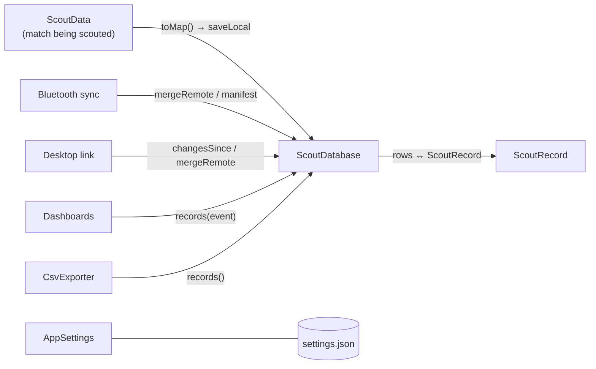

# Tablet: data layer

Everything the tablet stores goes through a few classes in `lib/data/` and
`lib/models/`. They're the foundation for everything else, so they're
worth knowing well. For the tables themselves, see
[Tablet database](../database/tablet-database.md).

## `data/scout_record.dart`: `ScoutRecord`

An immutable value: one robot in one match. All fields are `final`, so a
record never changes after it's made; to "change" one, you make a new one.
This makes records safe to pass around between services.

| Member | What it does |
|---|---|
| `id`, `eventKey`, `matchNumber`, `teamNumber`, `scoutName`, `station`, `deviceId`, `updatedAt`, `data` | See the table in [Tablet database](../database/tablet-database.md). |
| `makeId(event, match, team)` (static) | `"<event>_Match<match>_<team>"`. See [Pattern 1](patterns.md). |
| `toRow()` / `fromRow(row)` | To and from a database row. `data` is stored as JSON *text* (`jsonEncode`), because SQLite has no JSON column type. |
| `toJson()` / `fromJson(json)` | To and from the format sent over Bluetooth and the desktop link. Here `data` stays a map. |

Why both `toRow` and `toJson`? They differ in one detail (`data` as text
vs as a map), and keeping them separate means changing the database can't
break sync, or the other way round.

## `data/scout_database.dart`: `ScoutDatabase`

The **only** class that touches `chicken_scratch.db`. It's a singleton
(`ScoutDatabase.instance`, [Pattern 4](patterns.md)).

### Opening and upgrading

| Member | What it does | Why |
|---|---|---|
| `db` (getter) | Opens the database the first time it's needed, then reuses it (`_db ??= await _open()`). | "Lazy" opening: no cost until something needs it, and only one connection. |
| `_open()` | `openDatabase(..., version: 3, onCreate: …, onUpgrade: …)`. `onCreate` builds a fresh database; `onUpgrade` runs only the missing steps for an older one. | See [Pattern 18](patterns.md). |
| `_createDashboardsTable(db)` | Version 2 step. | |
| `_addChangeCounter(db)` | Version 3 step: adds `local_rev`, numbers existing rows by `rowid` (their insert order), adds an index. | Existing data must get sensible change numbers so the first laptop sync gets everything. |

### Writing records

| Method | What it does | Why |
|---|---|---|
| `saveLocal({event, match, team, scoutName, station, data})` | Makes a `ScoutRecord` stamped with this tablet's `deviceId` and *now*, writes it in a **transaction** with the next `local_rev`, then announces it on `localChanges` and `changes`. Returns the record. | The transaction makes "find the highest number, write the next one" happen as one step, so two saves can't get the same number. |
| `mergeRemote(records)` | For each incoming record (in one transaction): look up the stored `updated_at`/`device_id`; skip if ours is the same or newer (`_isNewer`); otherwise write it with the next `local_rev`. Returns the records **accepted**. Announces on `changes` (not `localChanges`). | Returning the accepted ones lets the caller pass on only what was new (the master relays them). Not announcing on `localChanges` stops Bluetooth sending received records straight back. |
| `_isNewer(aTime, aDevice, bTime, bDevice)` (static) | The newest-wins rule ([Pattern 2](patterns.md)). | |
| `_nextRev(txn)` (static) | `MAX(local_rev) + 1`, read *inside* the transaction. | |

### Reading records

| Method | Returns | Used by |
|---|---|---|
| `record(id)` | One record or `null` | `ScoutData.readFile`, match list |
| `records({eventKey})` | All records (or one event's), sorted by event, match, team | Dashboards, CSV, Bluetooth |
| `eventKeys()` | Events that have records | Pickers, status |
| `count({eventKey})` | How many | Sync screens |
| `currentRev()` | The highest change number | Desktop link status |
| `changesSince(rev)` | `(rev, record)` pairs above `rev`, oldest first | Desktop link polls ([Pattern 11](patterns.md)) |
| `manifest()` | `{id: [updated_at, device_id]}` for every record | Bluetooth ([Pattern 12](patterns.md)) |
| `recordsNewerThan(peerManifest)` | Records the peer lacks or has older | Bluetooth |

### Streams

| Stream | Fires when | Listened to by |
|---|---|---|
| `localChanges` (`Stream<ScoutRecord>`) | `saveLocal` saved a record on this tablet | `BluetoothSyncService` (sends it to peers immediately) |
| `changes` (`Stream<void>`) | Any change: local save or accepted merge | Dashboard page (reloads after 0.5 s) |

### Other storage

| Method | What it does |
|---|---|
| `dashboardsJson()`, `saveDashboard(id, position, json)`, `deleteDashboard(id)` | The `dashboards` table (used by `DashboardStore`). |
| `getMeta(key)`, `setMeta(key, value)` | The `meta` key/value table (used by `AdminService`). |
| `deviceId` (getter) | This tablet's random 16-hex-character ID: read from `meta`, or made with `Random.secure()` on first use and saved. Cached in `_deviceId` after the first read. |

## `models/scout_data_model.dart`: `ScoutData`

The match **currently being scouted**: one plain field per input. All five
scouting pages share one instance.

| Group | Fields |
|---|---|
| Identity | `matchNum`, `teamNum`, `eventKey`, `studentName`, `station`, `onScoreTableSide`, `filePath` |
| Auton | `startingPos`, `startingPosNormalized`, `autonPath`, `autonFuelScored`, `autonClimb` |
| Teleop | `teleopFuelScored` |
| Endgame | `climbLevel`, `outpostCollect`, `condition`, `comments`, `defenseScore`, `defenseAgainstScore`, `drivingScore`, `playedDefense`, `defensePlayedAgainst` |
| UI only | `showFiveButtons` (Good robot mode; not saved) |

| Method | What it does | Why |
|---|---|---|
| constructor | Stores identity, builds `filePath`, calls `readFile()`. | |
| `getXxx` / `setXxx` | Read/write a field. | Older style from earlier seasons; plain field access (`scoutData.teleopFuelScored`) works too and newer code uses it. |
| **`toMap()`** | The `data` JSON: `auton`, `teleop`, `endgame` sections plus `name`. **This defines what gets saved.** | One place lists the saved fields; see [Scouting data by season](../database/scouting-data.md). |
| **`writeFile()`** | `toMap()` → the per-match file, then `ScoutDatabase.saveLocal(...)`. | The file is a readable backup; the database feeds sync and analysis. |
| `readFile()` | Loads from the database if it has the record (it may have come from another tablet), else from the file. | The database copy is always at least as new as the file. |
| `_applyMap(map)` | The reverse of `toMap()`: sets every field from saved JSON, with defaults for missing keys. Accepts older key names too (`path`, `fuel_scored`, `outpost_collect`). | Records saved by earlier versions must still open. |
| `_doubleList(v)` | Safely turns `[x, y]` into two doubles. | JSON numbers may come back as ints. |
| `_localFile` (getter) | The match file, created from `assets/config/default_match.json` if missing. | |
| `parseEvents(list)` | Leftover from 2024 (not used). | |

## `data/app_settings.dart`: `AppSettings`

| Method | What it does | Why |
|---|---|---|
| `_file()` | `settings.json` in app storage, created from `assets/config/default_settings.json` if missing. | |
| `read()` | The whole file as a map, guaranteeing `master` and `local` sections exist. | Callers can read `settings['local']['station']` without checking for null sections. |
| `update(section, values)` | **Merges** `values` into one section and writes the file. | Many pages save different keys; merging means one page can't wipe another's settings. |

Some older pages (Home, Settings, Match list) still read the file directly
with their own `_localFile` getters. They work the same way; newer code
uses `AppSettings`.

## `data/csv_exporter.dart`: `CsvExporter`

| Method | What it does |
|---|---|
| `buildCsv(records)` | Header of fixed columns, then every `data` field flattened (`_flatten`), in first-seen order, one row per record. `name` is dropped (it's `scout_name`). |
| `_flatten(value, prefix, out)` | Nested maps → `section_field`; short lists of plain values → numbered columns (`_1`, `_2`); anything else → JSON text. |
| `_escape(s)` | Wraps a value in quotes if it contains a comma, quote or newline, doubling quotes inside (the CSV rules). |
| `export({eventKey})` | Writes `exports/scouting_<event>_<time>.csv` and returns the file. |

The companion's `csv_export.py` does exactly the same, so both CSVs have the
same columns, and a test checks this.

## `models/match_model.dart`: `FRCMatch`

One scheduled match: `eventKey`, `matchNumber`, `matchType` (`qm`, `sf`,
`f`), `redAlliance`, `blueAlliance` (lists like `["frc217", …]`).

| Member | What it does |
|---|---|
| `FRCMatch.fromJson(tba)` | From The Blue Alliance's format. **Swaps red and blue.** |
| `toJson()` | Writes `red_alliance` / `blue_alliance` from the (swapped) fields. |
| `FRCMatch.fromProcessedJson(file)` | Reads the `MatchSchedules` file, **swapping back**. |
| `toString()` | The old one-line text form. |

The double swap is a historical quirk; read the warning in
[Files on the tablet](../database/files.md) before touching it.

## `models/tba.dart`

`fetchEvents(teamKey, year)` and `fetchMatches(eventKey)` call The Blue
Alliance's web API with `package:http` and turn the JSON into `Event` /
`FRCMatch` objects. They throw an `Exception('Request Failed')` on any
non-200 answer. The API key is written in this file, which is a
[known issue](../maintain/known-issues.md).

## `models/globals.dart`

Built-in values: `queenPassword` (the default passcode) and `studentList`
(the default scouter list, starting with "Select Student Name").
`AdminService` replaces both at start-up when the laptop has sent its own.
`ScoringStation` is a leftover from 2024.

## `models/events_model.dart`, `student.dart`, `score_event_model.dart`

`Event` is an event from The Blue Alliance (key, name, year), used by
**Get Matches**. `Student` and `ScoreEvent` are leftovers from earlier
seasons.
