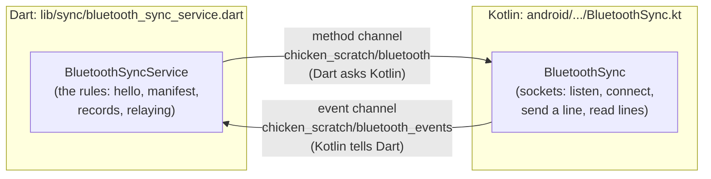
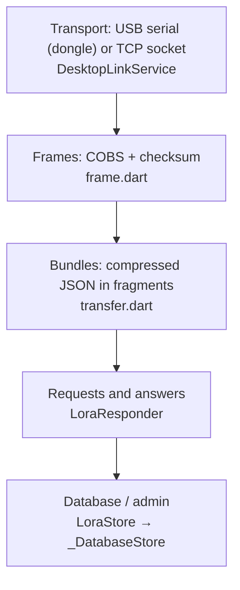

# Tablet: Bluetooth and the link

This page covers the two ways the tablet talks to other devices:
**Bluetooth sync** with other tablets (`lib/sync/` + Kotlin), and the
**desktop link** with the laptop (`lib/lora/`). Read
[Bluetooth sync](../how/bluetooth-sync.md) and
[Desktop link](../how/desktop-link.md) first for the big picture.

---

## Part 1: Bluetooth sync

### The split between Kotlin and Dart



A **method channel** is like a phone call from Dart to Kotlin: Dart calls
`invokeMethod('send', {...})` and gets an answer. An **event channel** is a
stream the other way: Kotlin pushes events (`connected`, `data`,
`disconnected`, `error`) whenever they happen. See
[Design decision D3](design-decisions.md) for why Kotlin does so little.

### Kotlin: `BluetoothSync.kt` and `MainActivity.kt`

`MainActivity.configureFlutterEngine` creates one `BluetoothSync` when the
app starts, and forwards permission answers to it.

| Kotlin member | What it does |
|---|---|
| `onMethodCall` | Handles each Dart request: `requestPermission`, `state`, `bondedDevices`, `startServer`, `stopServer`, `connect`, `send`, `disconnect`, `disconnectAll`. |
| `requestPermission` | On Android 12+, asks for "Nearby devices" (`BLUETOOTH_CONNECT`); the answer arrives later in `onPermissionResult`. |
| `startServer` | Opens a listening RFCOMM socket with our service UUID and accepts connections on a background thread until stopped. |
| `connect(address)` | On a background thread: up to 3 attempts (waiting longer each time) to connect to the master; replies with the connection ID. |
| `addConnection(socket)` | Wraps a socket in a `Connection`; if that tablet was already connected, closes the old connection first. |
| `Connection.start` | Emits `connected`, then a thread reads lines and emits each as a `data` event. |
| `Connection.send(line)` | Writes the line plus `\n` on a single-thread executor, so writes never interleave. |
| `Connection.close` | Closes once (`@Synchronized`, `closed` flag) and emits `disconnected`. |
| `emit(event)` | Posts to the main thread before sending to Dart (Flutter channels must be used from the main thread). |

Messages are **lines of text**: each JSON message is one line. Newlines
mark where one message ends and the next begins.

### Dart: `BluetoothSyncService`

**State:** `peers` (connected tablets, keyed by connection ID: Bluetooth
address), `log`, `hosting`, `connecting`, `station`, and `_queue`.

**`SyncPeer`** tracks one connected tablet: `name`, `station`, `status`
(syncing or synced), counts `sent`/`received`, and two flags `_sentAll` /
`_receivedAll` for the first exchange.

| Method | What it does |
|---|---|
| constructor | Listens to Kotlin's event stream (through `_queue`), to `ScoutDatabase.localChanges`, and to `AdminService.updates`. |
| `ensureReady()` | Permission granted and Bluetooth on? Returns an error message or null. |
| `bondedDevices()` | Paired devices from Android. |
| `startHosting()` / `stopHosting()` | Master: start or stop accepting connections. |
| `connectToMaster(device)` / `disconnect()` | Scouting tablet: connect or drop all connections. |
| `_send(id, msg)` | `jsonEncode` → method channel `send`. Errors are logged, not thrown, so one bad connection doesn't stop the rest. |
| `_sendRecords(id, records)` | Sends records in chunks of 25 (`_chunkSize`) per `records` message. |
| `_onEvent(raw)` | Handles a Kotlin event: `connected` (new `SyncPeer`, send `hello` and `manifest`), `disconnected`, `error`, `data` (→ `_onMessage`). |
| `_onMessage(id, msg)` | Handles a peer's message by its `t` field: `hello`, `manifest`, `records`, `done`, `admin`. See [Walkthroughs](walkthroughs.md), section 4. |
| `_checkSynced(peer)` | Once both flags are set, marks the peer synced and logs the totals. |
| `_onLocalSave(record)` | A new local save → send to every peer. |
| `shareRecords(records)` | Records that arrived another way (a laptop restore) → send to every peer. |
| `_sendAdmin(id)` / `_shareAdmin()` | Send admin settings and schedules to one peer / all peers. |

```{admonition} Relaying without loops
:class: note
On the master, records accepted from tablet A are sent to every *other*
peer (`peers.keys.where((k) => k != id)`). Tablet B merges them, and since
they came from sync, not a local save, B doesn't announce them on
`localChanges`, so nothing bounces back. Even if something did, the merge
rule would ignore it (same version = not newer).
```

---

## Part 2: The desktop link

### Layers



Each layer only knows the one below it. The responder doesn't know whether
bytes came by radio or network; frames don't know what's inside them.

### `frame.dart`: frames on the wire

**`MsgType`**: message type numbers (`poll` 0x01, `statusReq` 0x02, `status`
0x03, `data` 0x10, `ack` 0x11, `ackReq` 0x12, `error` 0x7F).

**`Frame`**: `type`, `session`, `transfer`, `index`, `count`, `payload`
(bytes). `Frame.json(...)` makes a frame whose payload is JSON; the `json`
getter reads it back.

| Function | What it does |
|---|---|
| `jsonBytes(obj)` | Compact JSON as UTF-8 bytes, identical to Python's `json.dumps(separators=(",", ":"))`. |
| `crc16(data)` | CRC-16/CCITT-FALSE checksum. Its standard check: `crc16("123456789") == 0x29B1`. |
| `cobsEncode` / `cobsDecode` | Remove / restore every 0x00 byte (below). |
| `encodeFrame(f)` | 8-byte header + payload + CRC → COBS → add a 0x00 at the end. |
| `decodeFrame(packet)` | The reverse; returns `null` if the COBS or the CRC is wrong. |
| `FrameReader.feed(bytes)` | Collects bytes until a 0x00, then decodes a frame. Drops anything corrupt, and gives up on a "frame" over 512 bytes (garbage) so it resyncs. |

**COBS, worked through.** A frame must end with 0x00 so the receiver knows
where it stops, which means the frame itself can't contain any 0x00. COBS
replaces each zero with a count of how far away the next zero is:

```text
data:     11 22 00 33
COBS:  03 11 22 02 33        then the end marker 00
       ↑        ↑
       "next zero is 3 bytes on"   "next zero is 2 bytes on (end)"
```

**A whole frame, worked through.** A `STATUS_REQ` with session 0x1234:

```text
header  : 01 02 12 34 00 00 00 00   version 1, type 0x02, session 0x1234, transfer 0, index 0, count 0
payload : (none)
crc16   : 02 22
COBS    : 05 01 02 12 34 01 01 01 03 02 22
end     : 00
```

### `transfer.dart`: bundles

A **bundle** is a JSON object, compressed with zlib and split into up to 64
fragments of up to 190 bytes.

| Function / class | What it does | Why |
|---|---|---|
| `packBundle(obj)` / `unpackBundle(bytes)` | JSON ↔ compressed bytes. | Scouting JSON shrinks about 4×, and LoRa is slow. |
| `splitBundle(bytes)` | Cuts into ≤190-byte pieces (refuses more than 64). | One piece per radio packet. |
| `fitRecords(header, records)` | The largest number of records (in order) that fit in one bundle, found by **binary search**: try half, then half of the remainder, … | Compressed size isn't predictable, so it has to try. Binary search needs about 7 tries for 100 records, instead of 100. |
| `bitmap(received, count)` / `parseBitmap(payload)` | Which fragments arrived, one bit each (below). | |
| `Outgoing` | A bundle being sent: its fragments, and `frames(session, [indexes])` to (re)send all or some. | Kept until the other side has everything. |
| `Incoming` | A bundle being received: `add(frame)`, `complete`, `ack(session)`, `data()`. | |

**The ACK bitmap, worked through.** 10 fragments, fragment 3 missing:

```text
0a          count = 10
f7          fragments 0–7: 1111 0111  (read right to left: 0,1,2 ✓, 3 ✗, 4,5,6,7 ✓)
03          fragments 8–9: 0000 0011
```

### `lora_responder.dart`: answering the laptop

**`LoraStore`** (interface, [Pattern 8](patterns.md)) is what the responder
needs from a database: `dbId`, `currentRev`, `changesSince`, `merge`,
`recordCount`, `eventKeys`, and the admin methods `receiveAdmin`,
`receiveSchedule`, `adminVersion`, `devices`.

**`LoraResponder`** state: `_out` (the bundle last sent, kept for resends),
`_incoming` (bundles being received, by transfer ID), `_merged` (transfers
already applied).

| Message in | What `handle` does |
|---|---|
| `statusReq` | Reply `status` with ID, name, rev, record count, events and settings version. |
| `poll` | `_poll`: `changesSince(since)` (or everything, if the laptop's `db` isn't ours) → `fitRecords` → new `Outgoing` → send all fragments. |
| `ack` | Resend only the fragments the bitmap says are missing. |
| `data` | Add the fragment to its `Incoming`. |
| `ackReq` | If that transfer is complete and not yet applied: unpack and act on its `kind` (`restore` → merge; `schedule`; `admin`). Always answer with an `ack`. |

```{admonition} Why remember applied transfers?
:class: note
The laptop may send `ackReq` several times (if an `ack` gets lost). Without
`_merged`, a restore would be applied each time. Remembering applied
transfers makes repeated requests harmless: idempotence again.
```

### `desktop_link_service.dart`: the transports

**`LinkMode`**: `lora` or `tcp`.

**`_DatabaseStore`** implements `LoraStore` with the real database
(`ScoutDatabase`) and `AdminService`. Its `merge` also calls
`BluetoothSyncService.shareRecords`, so a laptop restore reaches every
tablet.

**`DesktopLinkService`** (singleton, `ChangeNotifier`):

| Member | What it does |
|---|---|
| `resume()` | At start-up: restore the mode; restart TCP or reconnect the remembered dongle. |
| `setMode(mode)` | Switch transport (stops the current one). |
| `devices()` | USB devices plugged in. |
| `connect(device)` | Open the dongle: try the plugin's driver, then plain CDC; set DTR/RTS and 115200 8N1; create the responder; listen for bytes; remember the dongle's VID/PID. |
| `_onUsbEvent(e)` | Dongle unplugged → disconnect. The remembered dongle plugged in (in LoRa mode) → connect. |
| `startTcp([port])` | Listen on all network interfaces (default 5810). |
| `_onTcpClient(socket)` | A laptop connected: replace any previous one, turn off Nagle's algorithm (`tcpNoDelay`, so small frames go out immediately), reset the frame reader, listen. |
| `localAddresses()` | This tablet's IP addresses, to show on screen. |
| `disconnect()` | Close whatever is open. |
| `_onBytes(data)` | Bytes in → `FrameReader` → each frame queued to the responder ([Pattern 10](patterns.md)). |
| `_send(frame)` | TCP: write and flush. LoRa: wait until the previous frame's estimated airtime has passed, write, then work out this frame's airtime. |

**Pacing, explained:** the dongle can hold 960 bytes waiting to be
transmitted, and transmits at roughly 4,400 bits per second. Writing
frames faster than that would overflow its buffer and lose data. So after
each frame, `_send` computes `bytes × 8 ÷ bits-per-second` (+15% and 30 ms
margin) and waits that long before the next.

### `memory_store.dart`: `MemoryLoraStore`

The same rules as the real database, kept in memory: newest wins, each
write gets the next number, admin settings only if newer, schedules only
if the fingerprint changed. Used by `test/lora_test.dart` and
`tool/lora_stdio_responder.dart` (which lets the Python tests talk to the
real Dart responder).
