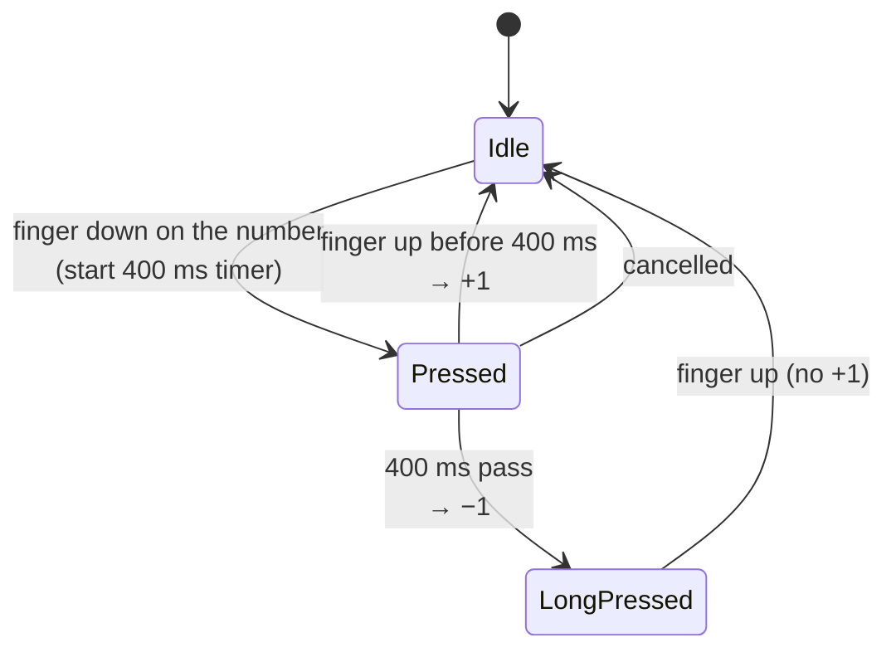

# Tablet: widgets

`lib/widgets/` holds the reusable pieces the scouting pages are built from.
They share one design rule:

```{admonition} Data down, events up
:class: tip
A widget **receives** its current value (`value: …`) and **reports**
changes through a callback (`onChanged: …`). It never saves anything
itself. The page decides what a change means, updates `ScoutData`, and
calls `setState`. This keeps widgets reusable: the same `FuelCounterWidget`
counts auton fuel and teleop fuel because it doesn't know which it is.
```

## `fuel_counter_widget.dart`: `FuelCounterWidget`

The big number with − and + buttons, used on Auton and Teleop.

**Inputs:** `scoutData` (only to read `showFiveButtons`), `label`, `value`,
`min` (0), `max` (999), `onChanged`.

**How touches work:**



| Member | What it does | Why |
|---|---|---|
| `_onPointerDown` / `_onPointerUp` / `_onPointerCancel` | The tap-vs-hold logic on the number (diagram above). A raw `Listener` is used instead of `GestureDetector` because it reacts instantly, without waiting to see whether the touch becomes a scroll. | Scouts tap fast during a match; every millisecond of delay loses counts. |
| `_increment(n)` / `_decrement(n)` | Clamp to `min`/`max`, buzz (`HapticFeedback`), play the shrink animation, call `onChanged`. | Haptics confirm the tap without looking. |
| `_animateTap()` | Shrinks the number to 90% and back in 110 ms (`ScaleTransition` driven by an `AnimationController`). | Visual feedback. The class is `with SingleTickerProviderStateMixin` because animations need a "ticker" (a once-per-frame clock). |
| `build()` | Label, the number (error colours at the max), the −/+ row, an optional −5/+5 row, and a hint line. | |
| `_WideButton` | A −/+ button: tap = once; hold 400 ms = repeat every 100 ms until released (`_initialTimer`, `_repeatTimer`). | Counting 30 fuel by tapping is slow. |

**Things to notice:** every `Timer` is cancelled in `dispose()`. The number
uses `FontFeature.tabularFigures()` so digits are all the same width and the
number doesn't wobble as it changes.

## `auton_path_widget.dart`: drawing the auton path

The biggest widget. Two parts: **data classes** and the **drawing widget**.

### `AutonPathPoint` and `AutonPath` (the data)

```dart
class AutonPathPoint { final double x, y; ... }   // 0.0–1.0 across the image
class AutonPath { final List<AutonPathPoint> points; ... }
```

| Member | What it does | Why |
|---|---|---|
| `x`, `y` in 0–1 | Positions as a *fraction* of the image width and height, not pixels. | Tablets have different screen sizes; 0.5 is "the middle" on every one. |
| `toJson()` / `fromJson()` | `{"points": [{"x":…, "y":…}, …]}` for the database. | |
| `toCompactBase64()` | Each point → 2 bytes (x × 255, y × 255) → Base64 text. About 12× smaller. | Fits in a QR code. |
| `fromCompactBase64()` | The reverse (bytes ÷ 255). The companion's `decode_compact_path` does the same in Python. | |

### `AutonPathWidget` (the drawing)

State: `_pts` (the points), `_dragIndex` (which point is being moved, or
none), `_activePointerId` (the finger in use).

| Member | What it does | Why |
|---|---|---|
| `initState` / `didUpdateWidget` / `_applyStartingPoint` | Load the saved path; make point 0 the Pre-match starting position. `didUpdateWidget` only reacts when the *starting point* changes. | Reacting to `initialPath` changes would loop: the widget reports a change, the parent passes it back, the widget reports again… |
| `_toNorm(offset, size)` / `_toPx(point, size)` | Pixels ↔ 0–1 fractions. | |
| `_hitTest(offset, size)` | The point within 22 px of the finger (`_hitRadius`), nearest first. | Fingers are fat; 22 px makes points easy to grab. |
| `_onPanStart` | Ignores a second finger. If the finger is on a point, start dragging it; otherwise add a point there (seeding the start point first if the path is empty). | One finger at a time keeps palm touches from drawing. |
| `_onPanUpdate` | Dragging a point: move it. Drawing: add a point, but only if it's at least 10 px from the last (`_minSpacing`). | Without spacing, a slow finger would add hundreds of points. |
| `_onPanEnd` | Releases the finger. | |
| `_undo()` / `_clear()` | Remove the last point / all points (keeping the start). | |
| `_notify()` | `onPathChanged(AutonPath(points: List.unmodifiable(_pts)))` | An *unmodifiable* copy, so the parent can't accidentally change the widget's list. |
| `_canvas()` | The field image (rotated on the scoring-table side), the `CustomPaint` with `_PathPainter`, and the "Tap & drag" hint. | |
| `_PathPainter` | Draws the path lines, direction arrows, the green start dot and the point being dragged. `shouldRepaint` returns true only if the points or drag index changed. | `CustomPaint` is how Flutter draws shapes freely; `shouldRepaint` avoids redrawing needlessly. |

```{admonition} Why doesn't drawing swipe the page?
:class: note
The scouting pages sit in a `PageView`, which swipes on any horizontal
drag. The canvas is wrapped in two things: a `Listener` (raw touches, which
do the actual drawing) and a `GestureDetector` with empty horizontal *and*
vertical drag handlers. Flutter gives each touch to one competitor in a
"gesture arena"; the canvas's detector enters and wins, so the `PageView`
never sees the drag. The comments in `_canvas()` explain this too.
```

## `climb_selector_widget.dart`

**`enum ClimbLevel`** (`didNotClimb`, `level1`, `level2`, `level3`) with:

| Member | Returns |
|---|---|
| `label` | Text shown: `LEVEL 3`, …, `DID NOT CLIMB` |
| `jsonValue` | Text stored: `level_3`, …, `none` |
| `fromJson(value)` | Stored text → the enum (unknown → `didNotClimb`) |

```{admonition} Why separate "label" and "jsonValue"?
:class: tip
What people read and what's stored are different jobs. You can reword a
label freely; changing a `jsonValue` would make old records unreadable
(metrics compare against `level_1`, etc.).
```

**`ClimbSelectorWidget`** lists the levels top to bottom, highest first,
like rungs on a ladder; `_ClimbOption` is one row (radio icon, label,
`_LevelBars`, a small signal-strength picture of the level).

## `robot_condition_widget.dart`

**`_options`** is a list of `_ConditionOption`s, each with a stored `value`
(e.g. `'A mechanism broke (elaborate in comments)'`), a shown `label`, an
icon and a `_Severity` (`good`, `minor`, `bad`), which picks the colours
(`colors(context)` → success / warning / error tones from the theme).
`initState` sets "No" (working fine) as the default if nothing was saved,
so every record has a condition. Same label-vs-value rule as climb.

## `defense_widget.dart`: `Defense`

Three groups: **Defense played** and **Defense against** (each a No/Yes
switch, `_ToggleRow`, plus a 1–3 star rating, `_RatingRow`), and
**Driving** (stars only). The rating is dimmed and ignores touches while
its switch is off (`ignoreGestures: !enabled`). Each change is written
straight to `ScoutData` (`setPlayedDefense`, `setDefenseScore`, …).

## `scout_ui.dart`: the shared look

| Widget | Use |
|---|---|
| `SectionHeader('Auton')` | Page title with a divider line |
| `ScoutCard(child: …)` | The rounded card inputs sit in |
| `CardLabel('Climbed?', icon: …)` | Icon + title at the top of a card; `center: true` to centre |
| `Caption('…')` | Small grey helper text |

New scouting pages should use these so everything matches the theme. See
[Look and feel](../how/theme.md).

## `home_tile.dart` and `match_tile.dart`

- **`HomeTile`**: a card with an icon badge and label. `primary: true`
  makes it the strong green "main action"; `busy: true` swaps the icon for a
  spinner and ignores taps. **`HomeTileGrid`** wraps tiles in rows and
  scrolls (so pull-to-refresh works).
- **`MatchTile`**: one match row: number badge, red and blue team chips
  (in alliance colours), the outlined `myTeam`, and a chevron or check.
  `_teams` strips the `frc` prefix from team keys.

## Unused: `counter_box_widget.dart`

An older counter (uses the `number_inc_dec` package). Not used anywhere.
