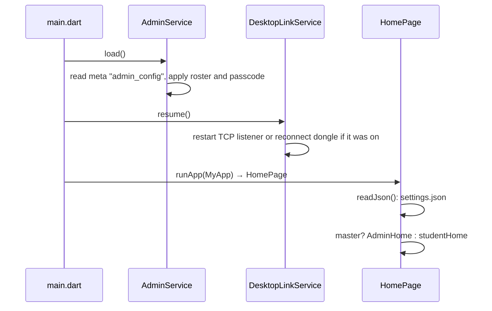
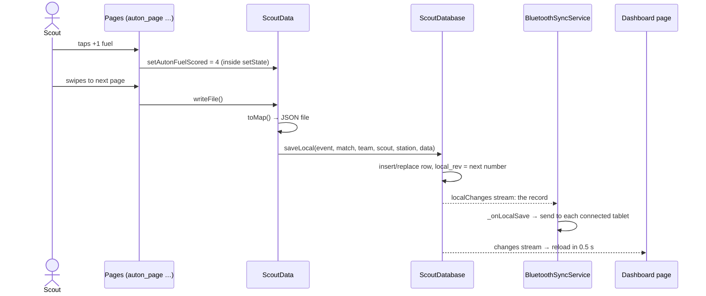
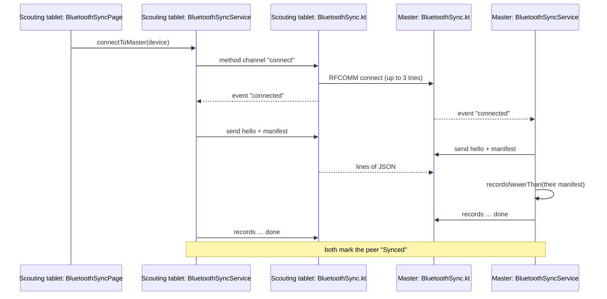
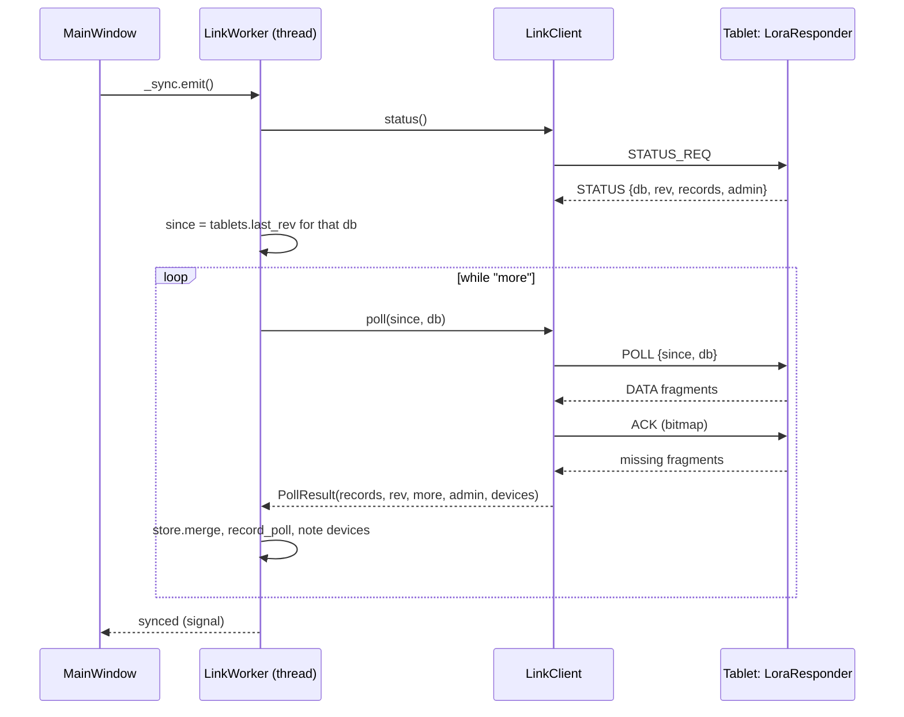

# Walkthroughs

Each walkthrough follows one thing the system does, step by step through
the code, naming the file and method at every step. Open the files as you
read and use **F12** to jump along (see [How to read code](reading-code.md)).

Read them in order the first time: each builds on the one before.

1. App start-up
2. Opening a match to scout
3. Scouting and saving a match
4. Bluetooth: two tablets meet
5. The laptop syncs over LoRa or TCP
6. The laptop pushes admin settings
7. A dashboard tile gets its numbers
8. Importing legacy files

---

## 1. App start-up



1. **`main()`** in `lib/main.dart` runs first. `WidgetsFlutterBinding.ensureInitialized()`
   must come before anything that uses plugins (files, database).
2. **`AdminService.instance.load()`** (`lib/admin/admin_service.dart`) reads
   the settings the laptop last sent from the database's `meta` table and
   calls `_applyGlobals`, which replaces the scouter list
   (`globals.studentList`) and the passcode (`globals.queenPassword`). It's
   wrapped in `try`/`catch` so a problem here can never stop the app
   starting.
3. **`DesktopLinkService.instance.resume()`** (`lib/lora/desktop_link_service.dart`)
   reads `settings.json`. If TCP listening was on, it calls `startTcp()`;
   if a dongle was remembered and is plugged in, it calls `connect()`. It is
   *not* awaited, so the app doesn't wait for it.
4. **`runApp(const MyApp())`**. `MyApp.build` creates a `MaterialApp` with
   `AppTheme.light` / `AppTheme.dark`, `ThemeMode.system`, and `HomePage` as
   the first screen.
5. **`_HomePageState.initState`** (`lib/pages/home_page.dart`) calls
   `readJson()`, which finds (or creates, from
   `assets/config/default_settings.json`) `settings.json`, reads
   `master.isMaster`, `teamNumber` and `year`, and calls `setState`.
6. **`build`** shows `AdminHome` (`admin_home_page.dart`) if this is the
   master, otherwise `studentHome(...)` (`student_home_page.dart`).

**Notice:** services are started in `main`, not in pages, so they're
running before any page needs them.

---

## 2. Opening a match to scout

1. **View Events** → `EventsPage` (`lib/pages/events_page.dart`).
   `getEvents()` lists the files in `MatchSchedules/`, one per event.
2. Tap an event → `Navigator.push(... MatchListPage(eventKey: ...))`.
3. **`_MatchListPageState.initState`** (`lib/pages/match_list_page.dart`)
   calls `readJson()` (this tablet's station and scoring-table side), then
   `getMatches(eventKey)`:
    - reads `MatchSchedules/<event>.json`, splits it into one JSON object
      per match with a regular expression (the file has no `[` `]`),
    - turns each into an `FRCMatch` with `FRCMatch.fromProcessedJson`
      (which swaps red and blue back; see
      [Files on the tablet](../database/files.md)),
    - keeps qualification matches (`qm`) and sorts them,
    - for each match, works out the team this tablet scouts from its
      station (e.g. `Red 2` → the second red team) and checks whether
      that record exists in the database (`ScoutDatabase.record`) or as a
      file. Found → **Completed**, else **To do**.
4. `build` shows each match as a `MatchTile` (`lib/widgets/match_tile.dart`).
   `_myTeam(match)` decides which team chip is outlined.
5. Tap a match → confirm dialog → `Navigator.push(MatchScoutPage(...))`,
   followed by `.then((value) => _refreshPage())`, so the list refreshes
   when the scout comes back.
6. **`_MatchScoutPageState.initState`** (`lib/pages/match_scout_page.dart`):
    - splits the station (`"Red 2"` → alliance `Red`, index 1) and picks
      the team number from the match's alliance list,
    - `getMatchFile(team)` makes sure the per-match file exists,
    - creates **`ScoutData(match, team, event, station: ...)`**, whose
      constructor calls `readFile()`: if the database already has this
      record (scouted before, or received by sync), it loads that;
      otherwise the file.
7. `build` shows a `PageView` with the five pages: Pre-match, Auton,
   Teleop, Endgame, Submit. They all share **the same `ScoutData`
   object**.

**Notice:** one `ScoutData` object is passed to all five pages. Each page
changes its fields; nothing is saved until a page change or Submit. That
object is the "model" (the data) and the pages are the "view".

---

## 3. Scouting and saving a match



1. **Inputs change `ScoutData`.** Every page wires its widgets to
   `ScoutData` fields inside `setState`, e.g. in `auton_page.dart`:

    ```dart
    FuelCounterWidget(
      value: widget.scoutData.autonFuelScored,
      onChanged: (v) {
        setState(() => widget.scoutData.setAutonFuelScored = v);
        widget.notifyParent();
      },
    )
    ```

    The widget doesn't store the number itself; it shows `value` and
    reports changes through `onChanged`. The page decides what to do.
    This "data down, events up" style is how all the inputs work.
2. **Pre-match locks swiping.** `_isPreMatchLocked` in `match_scout_page.dart`
   is true until a name is chosen and a start position tapped; the
   `PageView`'s `physics` becomes `NeverScrollableScrollPhysics`. The
   Pre-match page calls `notifyParent` (the parent's `refresh`) after each
   change so the parent re-checks.
3. **Swiping saves.** `PageView.onPageChanged` calls
   `scoutData.writeFile()`.
4. **`ScoutData.writeFile()`** (`lib/models/scout_data_model.dart`):
    - `toMap()` builds the `data` JSON (auton / teleop / endgame / name),
    - writes it to `<event>/<event>_Match<n>_<team>.json`,
    - calls **`ScoutDatabase.instance.saveLocal(...)`**.
5. **`saveLocal`** (`lib/data/scout_database.dart`):
    - builds a `ScoutRecord` with `ScoutRecord.makeId`, this tablet's
      `deviceId` and the current time as `updatedAt`,
    - in a **transaction**, inserts it (replacing any old version) with
      `local_rev` = `_nextRev` (highest + 1). The transaction makes the
      "read the highest number, then write" pair safe from interruption,
    - adds the record to **`localChanges`** and pings **`changes`**.
6. **Bluetooth** hears `localChanges` (`_onLocalSave` in
   `bluetooth_sync_service.dart`) and sends the record to every connected
   tablet.
7. **Dashboards** hear `changes` and reload half a second later.
8. **Submit** (`submit_data_page.dart`, `_submit`) shows a confirmation,
   calls `writeFile()` once more, and `Navigator.pop` returns to the match
   list, whose `.then` refreshes it, so the match moves to **Completed**.

**The QR code** on the Submit page: `_buildQrMap()` builds a compact copy
of the data (auton path squeezed with `toCompactBase64`), then
`compute(_encodeMap, map)` turns it into text on a **separate isolate**
(Dart's word for a background worker) so the page doesn't stutter.
Typing comments regenerates it after 0.8 s of quiet (a debounce).

---

## 4. Bluetooth: two tablets meet



1. On the master, **Start Hosting** → `startHosting()` → method channel
   `startServer` → Kotlin `startServer()` opens a listening socket and
   loops on `server.accept()` on a background thread.
2. On a scouting tablet, **Connect & Sync** → `_toggleConnection()` in
   `bluetooth_sync_page.dart` → `ensureReady()` (permission, Bluetooth on)
   → `connectToMaster(device)` → method channel `connect` → Kotlin
   `connect(address)` tries up to three times, then calls `addConnection`.
3. **`Connection.start()`** (Kotlin) emits a `connected` event and starts a
   thread reading lines; each line becomes a `data` event.
4. **Dart `_onEvent`** (`bluetooth_sync_service.dart`) handles events one at
   a time through `_queue` ([Pattern 10](patterns.md)). On `connected`:
   creates a `SyncPeer`, sends `hello` (device ID, station, settings
   version) and `manifest` (`ScoutDatabase.manifest()`).
5. **`_onMessage`** handles each line:
    - `hello` → remember the peer's station; `AdminService.noteDevice` records
      it for the laptop; if our settings are newer, `_sendAdmin`.
    - `manifest` → `recordsNewerThan(theirs)` → `_sendRecords` (25 per
      message) → `done`.
    - `records` → `mergeRemote` (newest wins); **on the master**, pass the
      accepted records on to every *other* peer.
    - `done` → `_checkSynced`: once we've both sent and received
      everything, mark the peer **Synced**.
    - `admin` → `AdminService.receiveSchedule` / `receiveConfig`.
6. From then on, each new local save goes out immediately (walkthrough 3,
   step 6).

---

## 5. The laptop syncs over LoRa or TCP



**Laptop side** (`companion/chicken_companion/`):

1. **Sync now** → `MainWindow` emits `_sync` → **`LinkWorker.sync`** runs on
   the worker thread (`ui/worker.py`).
2. `client.status()` (`protocol/client.py`) sends a `STATUS_REQ` frame and
   waits for `STATUS`, resending if nothing comes back.
3. It looks up how far it read last time: `store.tablet(db).last_rev`.
4. Loop: **`client.poll(since, db)`** sends `POLL`, then `_collect` gathers
   `DATA` fragments into an `Incoming`, and `_repair` sends `ACK` bitmaps
   until every fragment has arrived. `unpack_bundle` decompresses the JSON.
5. **`store.merge(records)`** applies the newest-wins rule;
   **`store.record_poll`** saves the new `last_rev`; `_note_admin` stores the
   master's settings version and the tablets it reported.
6. Repeat while the reply says `more`; then emit `synced` → the window
   refreshes its tables.

**Tablet side** (`lib/lora/`):

1. Bytes arrive from the USB dongle (`usb_serial`) or the TCP socket →
   **`DesktopLinkService._onBytes`** → `FrameReader.feed` cuts the stream
   into frames at `0x00` bytes and drops any with a bad checksum.
2. Each frame is queued (`_queue`) to **`LoraResponder.handle`**.
3. `STATUS_REQ` → reply with the database ID, change number, record count,
   events and settings version.
4. `POLL` → `_poll`: `store.changesSince(since)` (the change counter,
   [Pattern 11](patterns.md)) → `fitRecords` packs as many as fit in one
   bundle → `Outgoing` cuts it into frames → `send`.
5. `ACK` → resend only the fragments the bitmap says are missing.
6. **`_send`** writes each frame: over TCP straight away; over LoRa it
   waits for the previous frame's estimated airtime first so the dongle's
   buffer never overflows.

---

## 6. The laptop pushes admin settings

1. Admin tab → **Send to tablets** → `AdminTab.push_requested` →
   `MainWindow._push_admin` → **`LinkWorker.push_admin`**.
2. `Admin.ensure_version()` then `Admin.payload()` (`admin.py`) build the
   settings dictionary and one schedule per ticked event.
3. **`client.push_admin`**: each schedule as a `{"kind":"schedule"}` bundle,
   then the settings as `{"kind":"admin"}`, each via `_send_bundle` (DATA
   frames, `ACK_REQ`, resend until the `ACK` bitmap is complete).
4. **Tablet:** `LoraResponder.handle` → on `ACK_REQ` with a complete
   bundle, `unpackBundle` → by kind:
    - `schedule` → `store.receiveSchedule` → `AdminService.receiveSchedule`:
      save in `meta`, write `MatchSchedules/<event>.json` unless the tablet
      replaced it,
    - `admin` → `AdminService.receiveConfig`: if the version is newer, save,
      `_applyGlobals` (roster, passcode), `_applySettings` (settings.json,
      respecting overrides), and announce on **`updates`**.
5. `BluetoothSyncService` hears `updates` → `_shareAdmin` → sends
   `{"t":"admin", config, schedules}` to every connected tablet, which
   applies them the same way.
6. Back on the laptop, `client.status()` confirms the master now reports the
   new settings version; `note_tablet_version` stores it and the Admin tab
   shows ✓.

---

## 7. A dashboard tile gets its numbers

1. **`_DashboardPageState.initState`** (`lib/pages/dashboard_page.dart`) →
   `_init()`: reads our team and current event from settings, lists events
   (`EventData.availableEvents`), loads saved dashboards
   (`DashboardStore.load`, which adds the starter dashboards if there are
   none), then `_reload()`.
2. **`_reload`** → `EventData.load(eventKey)`: all the event's records
   (`ScoutDatabase.records`) plus the schedule (`loadSchedule`). It picks a
   focus team and the next unplayed match.
3. **`build`** sets `Viz.dark` from the theme and shows a `DashboardBoard`
   with the dashboard's tiles and a **`DashContext`** (the data, focus team
   and match, and callbacks).
4. The board places each tile on the 12-column grid and calls
   **`buildTile(tile, ctx)`** (`tiles.dart`), which picks the tile widget by
   type.
5. Say it's **Top teams** (`TopTeamsTile`):
    - `tileMetric(t)` → `Metrics.get(settings['metric'])`, e.g. *Total fuel*,
    - `tileAgg(t, m)` → e.g. *Average*,
    - `ctx.data.ranked(metric, agg)` sorts teams by `stat(team, metric, agg)`,
    - `stat` → `values(team, metric)` (one number per match, via the
      metric's `read` function on each record's `data`) → `agg.apply(...)`.
      Answers are cached, so each is worked out only once per reload,
    - it draws an `HBar` (from `viz.dart`) per team.
6. A new record arrives → `ScoutDatabase.changes` → debounce → `_reload` →
   the tiles rebuild with new numbers.

---

## 8. Importing legacy files

1. Data tab → **Import legacy JSON…** → `MainWindow._import_legacy` opens an
   **`ImportDialog`** (`ui/import_dialog.py`).
2. **Scan** → **`legacy_import.scan(root, store)`**:
    - walks every folder for `.json` files, sorted so originals come before
      copies like `x(1).json`,
    - **`parse_file`** on each: read as UTF-8, take event/match/team from
      inside the file or from its name, check they agree, decode a compact
      auton path, record which format it was,
    - same ID seen twice: identical → listed as a duplicate; different →
      keep the newer file, report the other,
    - counts records per event and asks the store which IDs already exist
      (`existing_ids`).
3. The dialog shows the plan; nothing has been written yet. This is called a
   **dry run**, and it's why `scan` and `run` are separate functions.
4. **Import** → **`legacy_import.run(plan, store, replace, events)`** →
   **`store.import_records`**: adds missing records (or replaces, if
   ticked), then `refresh_fields` rebuilds the season data dictionary.
