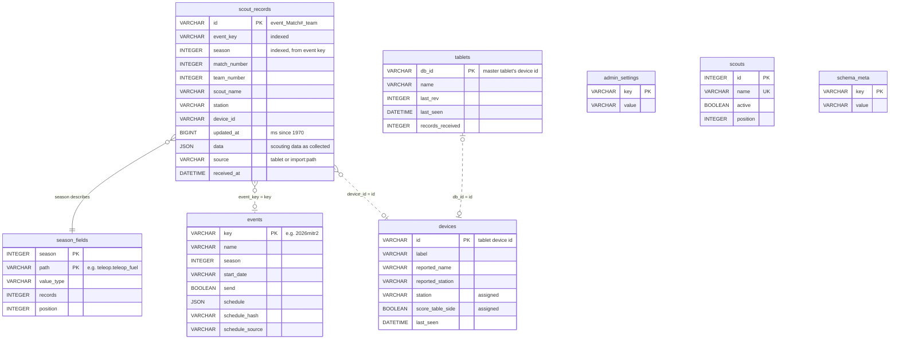

# Companion database

The laptop's database is the **long-term record**: every season, every
event. It's a SQLite file, by default **`~/ChickenScratch/scouting.db`**
(on Windows, `C:\Users\<you>\ChickenScratch\scouting.db`). Open it with DB
Browser for SQLite to look around. **Back it up after every event.**

The tables are defined as Python classes in
`companion/chicken_companion/db.py` using SQLAlchemy.

**Schema version: 3**

## Tables at a glance

Dotted lines are *loose* links: the values match, but the database doesn't
enforce them, so records can exist for events or tablets the Admin tab
doesn't list (for example imported legacy data).

The tables fall into four groups:

| Group | Tables | Purpose |
|---|---|---|
| Scouting data | `scout_records`, `season_fields` | The records, and what fields each season has |
| Syncing | `tablets` | How far the laptop has read from each tablet |
| Admin | `admin_settings`, `scouts`, `events`, `devices` | What the laptop pushes to the tablets |
| Housekeeping | `schema_meta` | Schema version |

## `scout_records`

The same record as on the tablet (see
[Tablet database](tablet-database.md#scout_records)), plus three laptop-only
columns.

| Column | Type | Meaning | Example |
|---|---|---|---|
| `id` | VARCHAR, **primary key** | `<event_key>_Match<n>_<team>` | `2025mimcc_Match10_453` |
| `event_key` | VARCHAR, indexed | Event key | `2025mimcc` |
| `season` | INTEGER, indexed | **The year**, taken from the first four digits of `event_key`. Lets the app show one season at a time. Empty if the key doesn't start with a year. | `2025` |
| `match_number` | INTEGER | Match number | `10` |
| `team_number` | INTEGER | Team | `453` |
| `scout_name` | VARCHAR | Scout | `Scout 4` |
| `station` | VARCHAR | Station (empty for imported files, which don't record it) | `Blue 1` |
| `device_id` | VARCHAR | Tablet that last edited it; `import` for legacy files | `a1b2c3d4e5f60718` |
| `updated_at` | BIGINT | Last edit, ms since 1970. For imports, the file's modified time. | `1741459200000` |
| `data` | JSON | The scouting data **exactly as collected that season**. See [Scouting data by season](scouting-data.md). | `{"auton":{…},…}` |
| `source` | VARCHAR | Where it came from: `tablet`, or `import:<path of the file>` | `import:2025_Data/Macomb/Raw_JSON/2025mimcc_Match10_453.json` |
| `received_at` | DATETIME | When the laptop last stored it | `2026-03-21 14:02:11` |

Written by `Store.merge()` (tablet syncs, newest edit wins) and
`Store.import_records()` (legacy files: adds missing records, replaces only
if asked).

## `season_fields`

The **data dictionary**: for each season, every field found inside `data`.
It's rebuilt automatically whenever that season's records change, so it
always matches what's stored. The **Seasons** tab shows it.

| Column | Type | Meaning | Example |
|---|---|---|---|
| `season` | INTEGER, **primary key (part 1)** | Year | `2026` |
| `path` | VARCHAR, **primary key (part 2)** | The field's location in `data`, with dots between levels | `teleop.teleop_fuel` |
| `value_type` | VARCHAR | `int`, `float`, `bool`, `text`, `list`, or `mixed` if records disagree | `int` |
| `records` | INTEGER | How many records have this field | `1415` |
| `position` | INTEGER | Order first seen, so columns keep the order scouts filled them in | `6` |

Why it's useful: a CSV export or analysis script can ask "which fields did
2025 have?" without opening every record, and you can spot fields that were
added partway through a season (low `records`).

## `tablets`

One row per **tablet database the laptop has polled** (normally just the
master).

| Column | Type | Meaning |
|---|---|---|
| `db_id` | VARCHAR, primary key | The polled tablet's database ID (its device ID). |
| `name` | VARCHAR | Name the tablet reported, e.g. `Master tablet (Blue 3)`. |
| `last_rev` | INTEGER | Highest change number read. The next sync asks for changes after this. **Re-read everything** sets it to 0. |
| `last_seen` | DATETIME | Last successful poll. |
| `records_received` | INTEGER | Running total received from it. |

## `admin_settings`

Key/value settings for the Admin tab.

| Key | Meaning |
|---|---|
| `team_number`, `season`, `current_event`, `passcode` | Team & settings page. `passcode` empty = the app's built-in one. |
| `version` | Settings version: the time of the last admin change in ms. Goes up on **every** change; tablets accept settings only if this is newer than theirs. |
| `tablet_version` | The version the master tablet last reported having. The status line compares the two. |

(The Blue Alliance API key is *not* stored here; it's in the laptop's user
settings, so the database file can be shared safely.)

## `scouts`

The roster sent to the tablets.

| Column | Type | Meaning |
|---|---|---|
| `id` | INTEGER, primary key | Auto-numbered |
| `name` | VARCHAR, unique | As shown on the tablet, e.g. `Doe, Jane` |
| `active` | BOOLEAN | Only active scouts are sent |
| `position` | INTEGER | List order (**Sort A–Z** renumbers) |

## `events`

Events and their match schedules.

| Column | Type | Meaning |
|---|---|---|
| `key` | VARCHAR, primary key | Event key, e.g. `2026mitr2` |
| `name` | VARCHAR | Short name, e.g. `Troy 2` |
| `season` | INTEGER | Year from the key |
| `start_date` | VARCHAR | `YYYY-MM-DD` from The Blue Alliance |
| `send` | BOOLEAN | Ticked = pushed to tablets |
| `schedule` | JSON | `[{"level":"qm","n":1,"red":["frc217",…],"blue":[…]}, …]`, sorted quals first |
| `schedule_hash` | VARCHAR | Fingerprint of `schedule`; tablets compare it to skip unchanged schedules |
| `schedule_source` | VARCHAR | Where it came from: `The Blue Alliance` or a file name |

## `devices`

Tablets, for station assignments. Rows appear when the master reports the
tablets it knows, or when records mention a tablet.

| Column | Type | Meaning |
|---|---|---|
| `id` | VARCHAR, primary key | The tablet's device ID |
| `label` | VARCHAR | Your name for it, e.g. `Tablet 3` (laptop only, never pushed) |
| `reported_name` | VARCHAR | Its Bluetooth name |
| `reported_station` | VARCHAR | The station it reported using |
| `station` | VARCHAR | **Assigned** station (`Red 1` … `Blue 3`); empty = leave the tablet's own |
| `score_table_side` | BOOLEAN | **Assigned** scoring-table side; empty = leave |
| `last_seen` | DATETIME | Last time the master reported it |

## `schema_meta`

| Key | Value |
|---|---|
| `version` | Schema version (`3`) |

## Version history

| Version | Change |
|---|---|
| 1 | `scout_records`, `tablets` |
| 2 | Added `season` and `source` to `scout_records` (existing rows: season worked out from the event key, source `tablet`); added `season_fields` and `schema_meta` |
| 3 | Added `admin_settings`, `scouts`, `events`, `devices` |

Upgrades happen automatically in `Store._migrate()` when the app opens a
database. New *tables* are created by SQLAlchemy; new *columns* on existing
tables need an explicit `ALTER TABLE` there (see the version 2 code).

## Changing this schema

1. Change the class in `db.py`.
2. If you added a column to an existing table, add an `ALTER TABLE …` step
   in `_migrate()` guarded by "if the column isn't there yet", like the
   `season` and `source` columns.
3. Bump `SCHEMA_VERSION`.
4. Add a test that builds an old-version file and opens it. See
   `test_old_database_is_upgraded_in_place` in `tests/test_legacy_import.py`.
5. Update this page.
