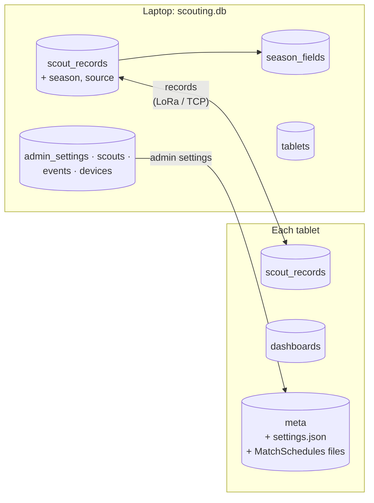

# Database

Chicken Scratch keeps data in **two SQLite databases** and a few plain files.

| Where | File | Holds | Page |
|---|---|---|---|
| Each tablet | `chicken_scratch.db` (private app storage) | This event's records, dashboards, small settings | [Tablet database](tablet-database.md) |
| Laptop | `~/ChickenScratch/scouting.db` | Every season's records, the season data dictionary, roster, events, tablets | [Companion database](companion-database.md) |
| Each tablet | `settings.json`, match JSON files, `MatchSchedules/` | Settings, a per-match copy of each record, schedules | [Files on the tablet](files.md) |

What's inside each record's scouting data, season by season, is in
[Scouting data by season](scouting-data.md). How to ask questions of the
data is in [Querying the data](querying.md).

New to databases? Start with [Database basics](basics.md).

```{rubric} Table of contents
```

```{toctree}
:maxdepth: 1

basics
tablet-database
companion-database
scouting-data
files
querying
```

## The one-picture summary



The same **record** (event, match, team, scout, station, device, edit time,
and a JSON `data` field) exists in both databases and travels between them
unchanged.
