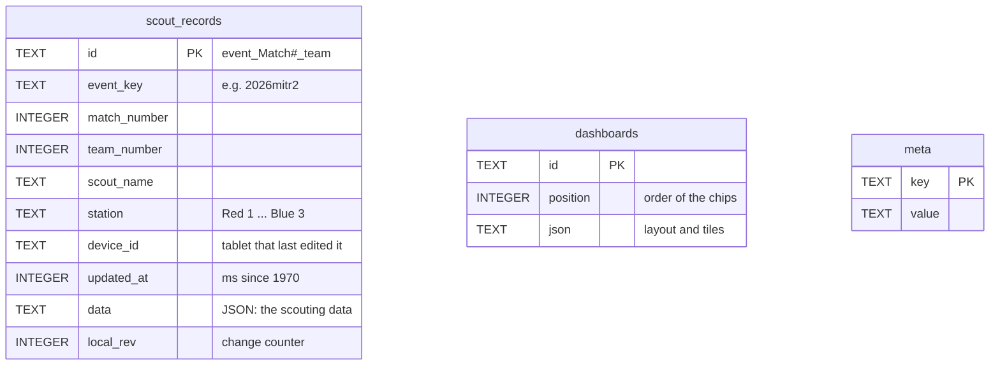

# Tablet database

Each tablet has one SQLite database, **`chicken_scratch.db`**, in the app's
private storage (`/data/data/com.example.chicken_scratch/databases/`). Only
the app can open it. To look inside, export a CSV, sync to the laptop, or
use Android Studio's **App Inspection → Database Inspector** with the tablet
plugged in.

All access goes through one class: **`ScoutDatabase`** in
`lib/data/scout_database.dart`, reached as `ScoutDatabase.instance`.

**Schema version: 3**

## Tables at a glance



The tables don't reference each other. `scout_records` is the data;
`dashboards` and `meta` are this tablet's own settings.

## `scout_records`

One row per robot per match: the **record**.

| Column | Type | Required | Meaning | Example |
|---|---|---|---|---|
| `id` | TEXT, **primary key** | yes | `<event_key>_Match<match_number>_<team_number>`. The same ID on every device, which is how sync knows two copies are the same record. | `2026mitr2_Match12_217` |
| `event_key` | TEXT | yes | The Blue Alliance event key. | `2026mitr2` |
| `match_number` | INTEGER | yes | Match number. | `12` |
| `team_number` | INTEGER | yes | The robot's team. | `217` |
| `scout_name` | TEXT | no | Who scouted it (from the Pre-match page). | `Doe, Jane` |
| `station` | TEXT | no | Which station the scouting tablet was set to. | `Red 2` |
| `device_id` | TEXT | no | Random ID of the tablet that **last edited** this record (see `meta` below). Used to break ties in the merge rule. | `a1b2c3d4e5f60718` |
| `updated_at` | INTEGER | yes | When it was last edited, in milliseconds since 1 Jan 1970 (UTC). **The newest edit wins** during sync. | `1763650000123` |
| `data` | TEXT (JSON) | yes | The game-specific scouting data. See [Scouting data by season](scouting-data.md). | `{"auton":{…},"teleop":{…},"endgame":{…},"name":"Doe, Jane"}` |
| `local_rev` | INTEGER | yes (default 0) | **Change counter.** Each write gets the next number on *this* tablet. The laptop asks for "everything since change N". | `431` |

**Indexes** (for speed):

| Index | Columns | Used by |
|---|---|---|
| `idx_scout_records_event` | `event_key, match_number` | Loading an event's records |
| `idx_scout_records_rev` | `local_rev` | "Changes since N" for the laptop |

### How rows get written

| How | Method | `device_id` / `updated_at` | `local_rev` |
|---|---|---|---|
| A scout saves a match on this tablet | `saveLocal(...)` | this tablet / now | next number |
| A record arrives (Bluetooth, laptop restore, QR scan) | `mergeRemote(records)` | kept from the incoming record | next number, only if accepted |

`mergeRemote` applies the **merge rule**: an incoming record replaces the
stored one only if its `updated_at` is newer (or equal with a "larger"
`device_id`). See [Architecture](../how/architecture.md).

### How rows get read

| Method | Returns | Used by |
|---|---|---|
| `record(id)` | One record | Opening a match to scout or edit |
| `records(eventKey: …)` | All records (for an event) | Dashboards, CSV export |
| `eventKeys()` | Events that have records | Pickers |
| `count(eventKey: …)` | How many | Sync screens |
| `manifest()` | `{id: [updated_at, device_id]}` for every record | Bluetooth sync |
| `recordsNewerThan(manifest)` | Records the other tablet lacks or has older | Bluetooth sync |
| `currentRev()`, `changesSince(n)` | The change counter | Desktop link |

Two streams announce changes: **`localChanges`** (records saved *on this
tablet*; Bluetooth sync sends these straight away) and **`changes`** (any
change at all; dashboards refresh on it).

## `dashboards`

One row per saved dashboard on this tablet. Not synced.

| Column | Type | Meaning |
|---|---|---|
| `id` | TEXT, primary key | Random ID of the dashboard. |
| `position` | INTEGER | Order of the dashboard chips (0 = first). |
| `json` | TEXT (JSON) | The dashboard: name and tiles. |

Example `json`:

```json
{
  "id": "k3j2…",
  "name": "Alliance selection",
  "tiles": [
    {"id": "t1", "type": "rankedTable", "x": 0, "y": 0, "w": 6, "h": 6,
     "settings": {"metrics": ["total_fuel", "auton_fuel", "climb_level"], "agg": "avg"}},
    {"id": "t2", "type": "pickList", "x": 6, "y": 0, "w": 3, "h": 7,
     "settings": {"metric": "total_fuel", "agg": "avg", "order": [217, 33], "picked": [33]}}
  ]
}
```

`type` is a `TileType` name; `x`, `y`, `w`, `h` are in grid cells on the
12-column grid. See [Dashboards inside](../how/dashboards-internals.md).

## `meta`

Small named values, one per row (`key` → `value`, both text).

| Key | Value | Written by |
|---|---|---|
| `device_id` | This tablet's random 16-character ID, made on first use and kept for good. It is the tablet's identity in records (`device_id`), Bluetooth `hello`, the laptop's tablet list and station assignments. Wiping app data makes a new one. | `ScoutDatabase.deviceId` |
| `admin_config` | The last settings received from the laptop (JSON). See [Admin settings](../how/admin-settings.md). | `AdminService` |
| `admin_applied` | Which `settings.json` values the laptop last set, e.g. `{"local.station":"Red 2"}`. Used for the "tablet can override" rule. | `AdminService` |
| `admin_schedule:<event>` | The schedule received from the laptop for that event (JSON). | `AdminService` |
| `admin_schedule_file:<event>` | A fingerprint of the schedule file last written, to notice if it was replaced on the tablet. | `AdminService` |
| `known_devices` | Tablets seen over Bluetooth: `{"<device id>": {"name", "station", "seen"}}`. Reported to the laptop. | `AdminService.noteDevice` |

## Version history

| Version | Change | Upgrade code |
|---|---|---|
| 1 | `scout_records` and `meta` | — |
| 2 | Added `dashboards` | `_createDashboardsTable` |
| 3 | Added `local_rev` and its index; existing rows numbered in insert order | `_addChangeCounter` |

## Changing this schema

1. Add a step to `onUpgrade` in `_open()`:
   `if (oldVersion < 4) await _myChange(db);`
2. Make `onCreate` produce the same result for a brand-new tablet (usually by
   calling the same function).
3. Bump `version: 3` to `version: 4`.
4. Add a test like `test/db_migration_test.dart` that creates a version 3
   database, opens it with the new code, and checks nothing was lost.
5. Update this page.

```{admonition} You usually don't need to
:class: tip
Season changes go in the `data` JSON, not new columns. Only change the
schema for something every season needs.
```
