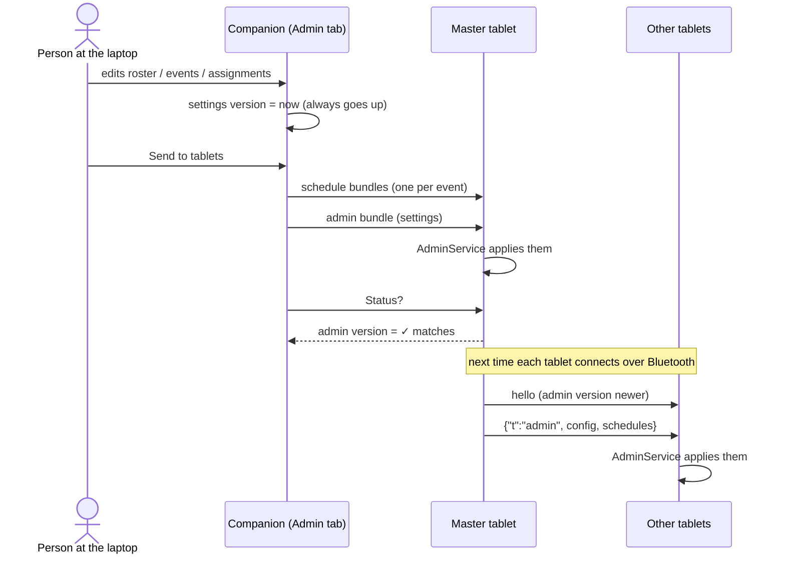
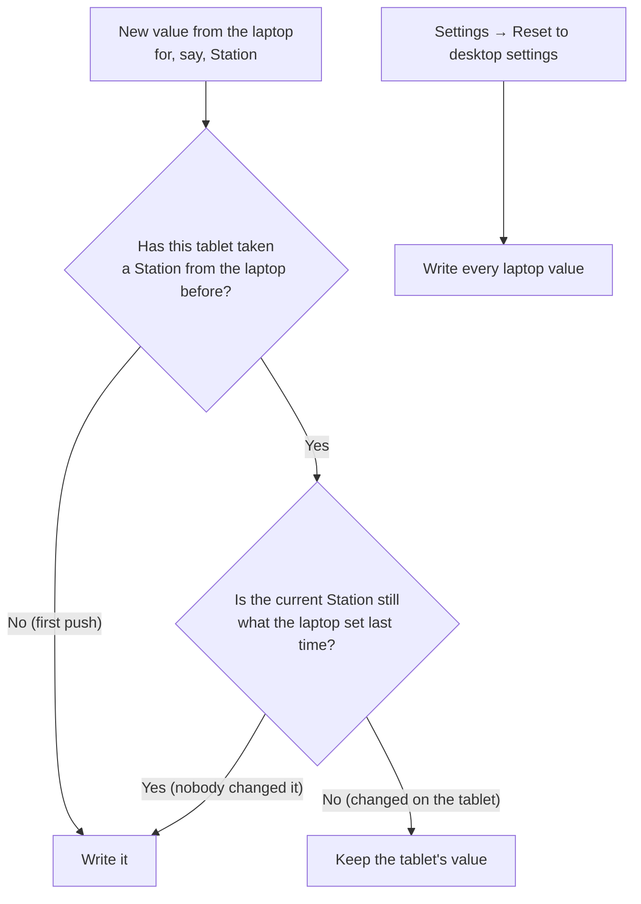

# Admin settings

The laptop is where the season is set up: the scouter roster, team settings,
events and match schedules, and which station each tablet scouts. This page
explains how those reach the tablets and what the tablets do with them.

## The journey



## What's sent

The **settings** (one JSON object):

```json
{
  "version": 1763700000000,
  "team_number": "217",
  "season": "2026",
  "current_event": "2026mitr2",
  "passcode": 1234,
  "scouts": ["Doe, Jane", "Roe, Rick"],
  "assignments": {
    "a1b2c3d4e5f60718": {"station": "Red 1", "score_table_side": false}
  },
  "events": [{"key": "2026mitr2", "name": "Troy 2", "hash": "3f9c…"}]
}
```

and one **schedule** per event:

```json
{"event": "2026mitr2", "name": "Troy 2", "hash": "3f9c…",
 "matches": [{"level": "qm", "n": 1, "red": ["frc217", "frc33", "frc67"],
              "blue": ["frc1114", "frc2056", "frc254"]}]}
```

- **version** is the time of the last change on the laptop, in milliseconds.
  A tablet only accepts settings with a *higher* version than it has, so
  older settings can never overwrite newer ones, however they travel.
- **hash** is a short fingerprint of a schedule. If a tablet already has a
  schedule with that hash, nothing needs doing.
- **assignments** are keyed by each tablet's *device ID* (a random ID the
  tablet makes for itself; see [Tablet database](../database/tablet-database.md#meta)).

## What a tablet does with them

`lib/admin/admin_service.dart`:

| Setting | Goes to |
|---|---|
| `scouts` | The Scout list on the Pre-match page (replaces the built-in list in `globals.dart`; an empty list means "use the built-in list"). |
| `passcode` | The lock on the home screen (empty means the built-in one). |
| `team_number`, `season`, `current_event` | `settings.json` → `master.teamNumber`, `master.year`, `master.currentCompId`. |
| This tablet's `assignments` entry | `settings.json` → `local.station`, `local.onScoreTableSide`. |
| Schedules | `MatchSchedules/<event>.json`, in exactly the format **Get Matches** writes. |

Everything received is also saved in the tablet database's `meta` table, so
it survives restarts and can be passed on to other tablets.

## The "tablet can override" rule

The laptop's values are **defaults**. If someone changes a value on a tablet
after the laptop set it, the tablet keeps its own value. How does a tablet
know a value was changed locally? It remembers what it last took from the
laptop:



Schedules work the same way: if a tablet downloaded its own schedule after
the laptop's arrived (**Get Matches** / **Get Current Matches**), the file
no longer matches what the laptop wrote, so it's kept.

The tablet's **Settings → Desktop settings** shows when settings last arrived
and which values were changed on the tablet. **Reset to desktop settings**
puts the laptop's values back.

## Where the code is

| Side | File |
|---|---|
| Laptop: storage and payload | `companion/chicken_companion/admin.py` |
| Laptop: screen | `companion/chicken_companion/ui/admin_tab.py` |
| Laptop: sending | `push_admin` in `protocol/client.py` and `ui/worker.py` |
| Tablet: applying | `lib/admin/admin_service.dart` (the rule is `applyPushedSettings`) |
| Tablet: receiving from laptop | `lib/lora/lora_responder.dart` (bundle kinds `schedule` and `admin`) |
| Tablet: passing on | `lib/sync/bluetooth_sync_service.dart` (`hello` + `admin` messages) |
| Tablet: settings screen | `lib/pages/settings_page.dart` ("Desktop settings") |

## Adding a new admin setting

Say you want the laptop to set something new on every tablet:

1. **Laptop, storage**: add it to `TeamSettings` in `admin.py` (or a new
   table in `db.py` if it's a list).
2. **Laptop, screen**: add a field in `ui/admin_tab.py`.
3. **Laptop, payload**: add it to the dictionary in `Admin.payload()`.
4. **Tablet**: in `admin_service.dart`, apply it. For a `settings.json`
   value, add a line to `pushedSettings()`, which gives you the override rule
   for free.
5. **Tests**: add to `companion/tests/test_admin.py` and `test/admin_test.dart`.
6. Update this page.
