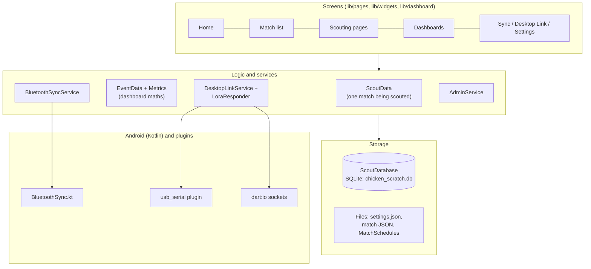
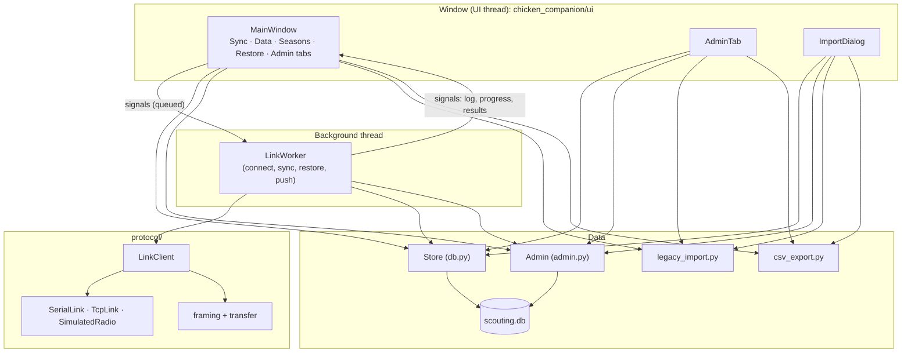
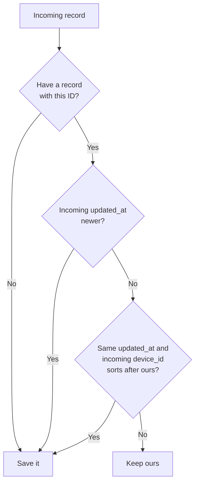

# Architecture

This page shows how each app is built in **layers**. A layer only talks to
the layers next to it. That's what lets you change, say, how data is stored
without touching the screens.

## The tablet app



**Screens** draw things and react to taps. They don't store data
themselves; they call into the logic layer.

**Logic and services**:

- `ScoutData` (`lib/models/scout_data_model.dart`) holds the match currently
  being scouted and saves it.
- `EventData` and `Metrics` (`lib/analysis/`) turn records into the numbers
  the dashboards show.
- `BluetoothSyncService` (`lib/sync/`) keeps tablets in agreement.
- `DesktopLinkService` and `LoraResponder` (`lib/lora/`) answer the laptop.
- `AdminService` (`lib/admin/`) applies rosters, schedules and settings from
  the laptop.

**Storage**: everything goes through `ScoutDatabase`
(`lib/data/scout_database.dart`), plus a few plain files. See
[Tablet database](../database/tablet-database.md) and
[Files on the tablet](../database/files.md).

**Native**: Bluetooth is written in Kotlin (Android's own language) in
`android/app/src/main/kotlin/.../BluetoothSync.kt`, because Flutter has no
built-in Bluetooth Classic support. Dart talks to it through a *method
channel* (`chicken_scratch/bluetooth`) and an *event channel*
(`chicken_scratch/bluetooth_events`).

### Services are singletons

The services exist once for the whole app, reached through `.instance`, for
example `ScoutDatabase.instance` or `BluetoothSyncService.instance`. They
keep running when you leave a page, which is why a Bluetooth connection
survives you going back to the home screen.

### Things that happen at start-up

`lib/main.dart`:

1. `AdminService.instance.load()`: applies the saved roster and passcode
   from the laptop.
2. `DesktopLinkService.instance.resume()`: restarts the TCP listener or
   reconnects the LoRa dongle if it was on last time.
3. Starts the app with the theme from `lib/theme/app_theme.dart`.

## The companion app



The window must never freeze, but radio transfers take seconds or minutes.
So **all link work runs on a background thread** (`LinkWorker` in
`ui/worker.py`). The window asks it to do things by emitting Qt *signals*,
and it reports back with signals (log lines, progress, results). Each thread
has its own `Store` (database connection). See
[Python and Qt crash course](python-qt-primer.md#threads-and-signals).

## How a record is identified everywhere

Every record, on every device and in every format, has the ID:

```text
<event key>_Match<match number>_<team number>      e.g. 2026mitr2_Match12_217
```

The same name is used for the per-match JSON files. Because the ID depends
only on *what* was scouted, two devices always agree which records are the
same.

## The merge rule

When a device receives a record it already has:



`updated_at` is the time of the last edit in milliseconds; `device_id` is a
random ID per tablet, used only to break exact ties consistently. The same
rule is written three times (tablet, laptop, and the Python test version of
a tablet), and the tests check they agree.

## Where each kind of information lives

| Information | Where it is kept | Synced how |
|---|---|---|
| Scouting records | Every tablet's database, and the laptop's | Bluetooth (tablets), LoRa/TCP (laptop) |
| Roster, team settings, schedules, station assignments | Laptop (source); tablets keep a copy | Laptop → master → tablets |
| Dashboards (layouts) | Each tablet | Not synced |
| A tablet's station, master flag | That tablet's `settings.json` | Can be set by the laptop |
| Every season ever | Laptop only | — |
