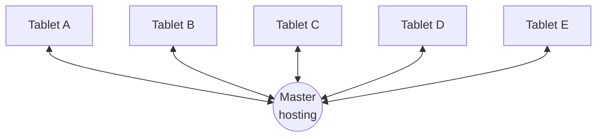
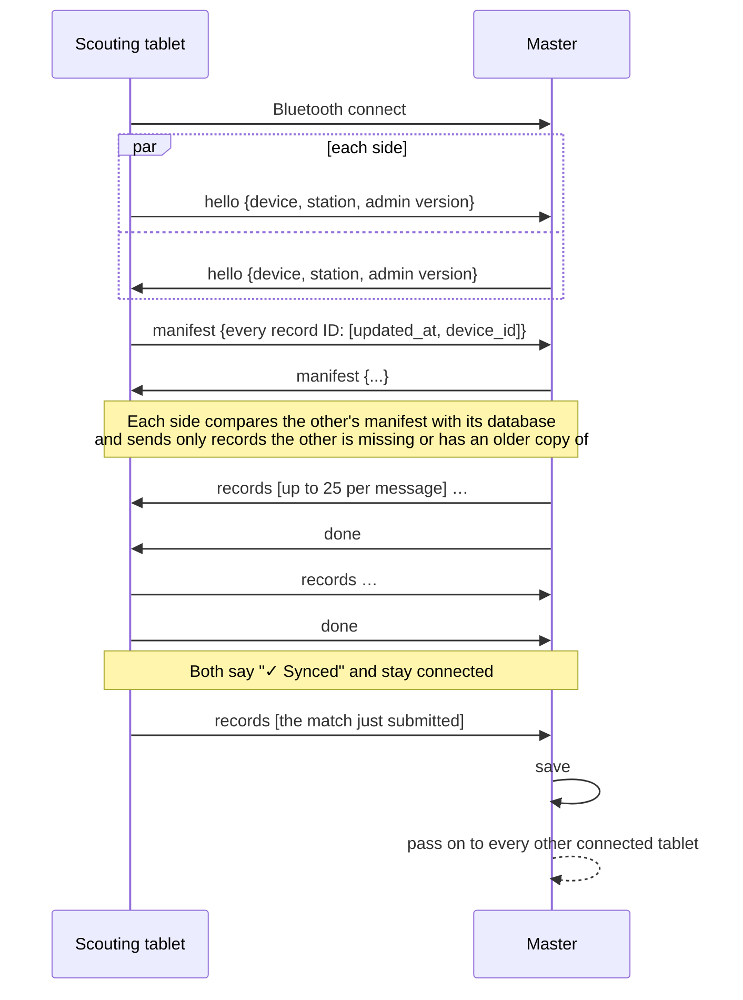

# Bluetooth sync

Bluetooth keeps all six tablets holding the same records, with no network.

## Shape: a star, not a mesh

Android tablets can't form a true Bluetooth mesh, but one tablet can hold
about seven connections at once. So the **master hosts** and every other
tablet **connects to it**. The master passes on anything it receives.



A record scouted on tablet A goes A → master → B, C, D, E.

## What happens when a tablet connects

Messages are lines of JSON text. Each side sends the same things, so this
works the same in both directions:



- The **manifest** is a list of every record's ID with its edit time,
  which is small. Only the differences are then sent, so reconnecting after
  a break is quick.
- While connected, every **Submit** is sent straight away (the database
  announces local saves on its `localChanges` stream).
- **Admin settings** from the laptop ride along: if one side's `hello` has
  an older settings version, the other sends
  `{"t":"admin","config":…,"schedules":[…]}`. See
  [Admin settings](admin-settings.md).

## Message reference

| Message | Meaning |
|---|---|
| `{"t":"hello","device":"<id>","station":"Red 1","admin":<version>}` | Who I am, and which settings version I have. |
| `{"t":"manifest","m":{"<record id>":[updatedAt, deviceId], …}}` | Every record I have, with when it was last edited. |
| `{"t":"records","r":[<record>, …]}` | Records (25 per message). |
| `{"t":"done"}` | I've sent everything from the first exchange. |
| `{"t":"admin","config":{…},"schedules":[…]}` | Newer laptop settings. |

`<record>` is the same JSON as in [Tablet database](../database/tablet-database.md).

## The code

| Layer | File | Job |
|---|---|---|
| Screen | `lib/pages/bluetooth_sync_page.dart` | Buttons, peer list, log; choosing the master tablet. |
| Logic | `lib/sync/bluetooth_sync_service.dart` | The messages above, merging, passing on. |
| Native | `android/.../BluetoothSync.kt` | Bluetooth sockets. Sends and receives lines of text, and nothing more. |

The Kotlin side uses **Bluetooth Classic RFCOMM**, "insecure" sockets (no
PIN prompt once paired), service UUID
`7f3c2a9e-0217-4c5a-9b1e-0c6a1d2f8e17`. Dart calls it through the method
channel `chicken_scratch/bluetooth` (`startServer`, `stopServer`, `connect`,
`send`, `disconnectAll`, `bondedDevices`, `state`, `requestPermission`) and
receives events on `chicken_scratch/bluetooth_events` (`connected`,
`disconnected`, `data`, `error`).

## Common problems

| Symptom | Likely cause |
|---|---|
| Master isn't in the list | Tablets aren't *paired*. Pair them in Android's Bluetooth settings first. |
| "Bluetooth permission was denied" | Allow **Nearby devices** for Chicken Scratch in Android's app settings. |
| Connect fails | The master isn't hosting, or it already has about 7 connections. |
| Data missing on one tablet | It wasn't connected when that match was submitted. Reconnect; the manifest exchange catches it up. |
| Works in testing, not at the venue | Lots of Bluetooth around. Keep tablets near the master; use the QR backup if needed. |

```{admonition} Tested how?
:class: note
The sync rules (manifest differences, merging) are covered by
`test/scout_data_store_test.dart`. The Bluetooth radio itself can only be
tested on real tablets.
```
