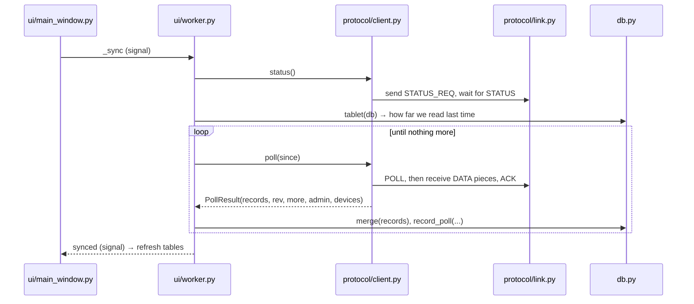

# Companion code tour

Everything for the laptop app is in `companion/`.

```text
companion/
├── chicken_companion/        ← the app's Python code
│   ├── __main__.py           ← entry point: `python -m chicken_companion`
│   ├── db.py                 ← the database (tables, merge, upgrades)
│   ├── admin.py              ← roster, events, schedules, tablets; The Blue Alliance
│   ├── legacy_import.py      ← reads old raw JSON folders
│   ├── csv_export.py         ← CSV in the same layout as the tablet's
│   ├── radio_config.py       ← writes settings into a Waveshare LoRa dongle
│   ├── sim_data.py           ← made-up data for the simulator
│   ├── protocol/             ← how the laptop and tablet talk
│   │   ├── framing.py        ← one message on the wire (COBS + checksum)
│   │   ├── transfer.py       ← big data in many small pieces, compressed
│   │   ├── link.py           ← SerialLink (dongle), TcpLink, SimulatedRadio
│   │   ├── client.py         ← the laptop side: status, poll, restore, push_admin
│   │   └── responder.py      ← a Python copy of the tablet side (tests + simulator)
│   └── ui/
│       ├── main_window.py    ← the window and its tabs
│       ├── worker.py         ← background thread that does the talking
│       ├── admin_tab.py      ← the Admin tab
│       ├── import_dialog.py  ← "Import legacy JSON…"
│       └── radio_dialog.py   ← "Radio settings…"
├── tests/                    ← pytest tests
├── protocol_vectors.json     ← exact example messages both apps are tested against
├── PROTOCOL.md               ← points to docs/reference/protocol.md
├── README.md                 ← short version of the companion pages here
└── requirements.txt          ← Python packages
```

## How a sync flows through the code



## Files in more detail

**`__main__.py`**  
Parses `--db`, `--import-json` and `--replace`, then either imports and
exits or opens the window. The default database is
`~/ChickenScratch/scouting.db`.

**`db.py`**  
The SQLAlchemy table classes and `Store`, which wraps the database:
`merge` (the newest-edit-wins rule), `import_records`, `records`,
`events`, `seasons`, the season data dictionary (`refresh_fields`,
`fields`) and the upgrade code (`_migrate`). Every table is explained in
[Companion database](../database/companion-database.md).

**`admin.py`**  
`Admin` wraps the admin tables: team settings, scouts, events and
schedules, devices, and `payload()`, which builds what gets pushed to the
tablets. Also the helpers for The Blue Alliance and for reading a
tablet's schedule file.

**`legacy_import.py`**  
`scan()` reads every JSON file below a folder into records and reports
duplicates and problems; `run()` writes them to the database.

**`protocol/`**  
See [Desktop link](desktop-link.md). `responder.py` matters even though
the laptop never *answers* anything: it's how the simulator and tests
pretend to be a tablet.

**`ui/worker.py`**  
`LinkWorker`: `open_link`, `close_link`, `sync`, `status`, `restore`,
`push_admin`. Each job runs inside `_run`, which turns errors into a
`failed` signal so the app never crashes on a bad radio day.

## Tests (`companion/tests/`)

| File | Checks |
|---|---|
| `test_protocol.py` | Framing, compression, lossy transfers, the radio settings commands. |
| `test_store.py` | Merging, tablets read, CSV layout. |
| `test_legacy_import.py` | Each legacy file format, duplicates, problems, the season data dictionary, database upgrades. |
| `test_admin.py` | Admin settings, versions, payload, pushing over a lossy radio. |
| `test_tcp.py` | The TCP link, including against the real Dart tablet code. |
| `test_cross_language.py` | The Python laptop talking to the real Dart tablet code over a lossy pipe. Skipped if Dart isn't installed. |
| `make_vectors.py` | Not a test: regenerates `protocol_vectors.json` if the protocol changes on purpose. |
