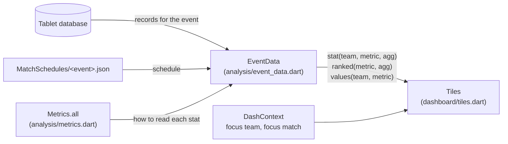

# Dashboards inside

How the dashboards get from records to pictures. For using them, see
[Dashboards](../use/dashboards.md).

## From records to a tile

1. **`EventData.load(eventKey)`** reads every record for the event from the
   database and the schedule file, and groups records by team.
2. A **`Metric`** knows how to pull one number out of a record's `data`, for
   example `data["teleop"]["teleop_fuel"]`. All metrics are listed in
   `Metrics.all`. **This is the main thing to update each season.**
3. An **`Agg`** (aggregation) turns a team's list of per-match numbers into
   one: average, last 3, median, best, worst, standard deviation, total, or
   % of matches.
4. `EventData` gives tiles the answers: `stat(team, metric, agg)`,
   `ranked(metric, agg)`, `values(team, metric)` (match by match),
   `nextMatch()`, and so on. It remembers answers it has worked out, so
   tiles can ask freely.
5. Each **tile** gets a `DashContext`: the `EventData`, the focus team and
   match, and callbacks to change them.

## Metric kinds

| Kind | Example | Allowed summaries |
|---|---|---|
| `count` | fuel scored | average, last 3, median, best, worst, std dev, total |
| `rating` | driving 1–3 | average, last 3, median, best, worst |
| `level` | climb level 0–3 | average, last 3, median, best, worst |
| `flag` | climbed yes/no (stored as 1 or 0) | % of matches, last 3, total |

A metric's `read` function returns `null` when a match doesn't count, for
example "defense rating" for a match where the robot didn't play defense.
Nulls are left out of averages.

## Live updates

`ScoutDatabase` has a `changes` stream that fires whenever records change
(local save, Bluetooth, restore). The dashboard page listens and reloads
`EventData`, so numbers update while you watch.

## The grid

A dashboard is a **12-column grid**; rows are 64 pixels tall with 12-pixel
gaps. Each tile (`TileConfig` in `dashboard_model.dart`) has a type, a
position (`x`, `y`) and size (`w`, `h`) in grid cells, and a `settings` map
(which metric, which summary, …).

- **`resolveLayout`**: when you drop a tile on others, pushes them down so
  nothing overlaps.
- **`compactLayout`**: slides tiles up to fill gaps.

Dashboards are stored as JSON in the tablet database's `dashboards` table
(see [Tablet database](../database/tablet-database.md#dashboards)). They
aren't synced.

## Colours

Charts use their own validated chart palette (`dashboard/viz.dart`, class
`Viz`), not the app theme, so series colours stay distinguishable for
colour-blind readers in both light and dark mode. `Viz.dark` is set from
the app theme when the dashboard page builds. Text in tiles uses the
palette's ink colours, never series colours.

## Adding things

See [Add a metric or dashboard tile](../maintain/add-metric-or-tile.md).
