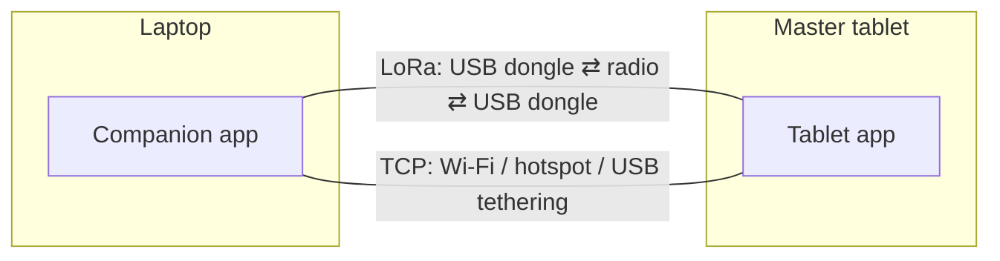
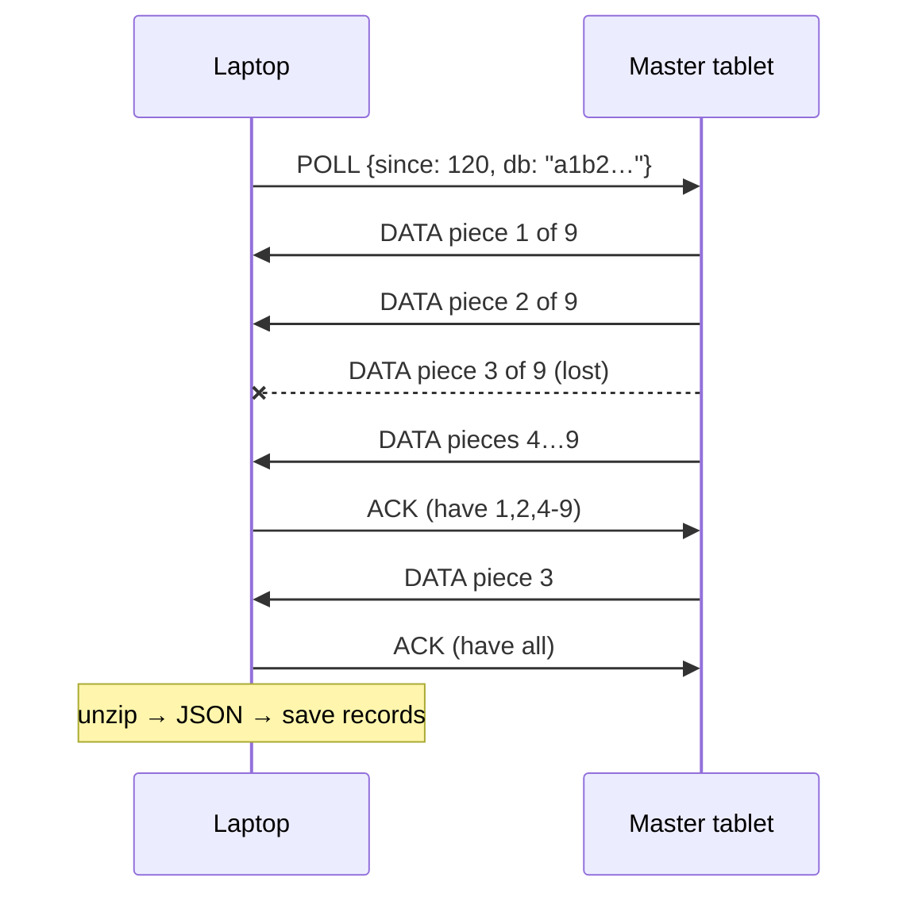

# Desktop link (LoRa and TCP)

The laptop talks to the **master tablet only**. The master already has
everyone's data from Bluetooth sync.

## Two ways to connect, one set of messages



| | LoRa | TCP |
|---|---|---|
| Hardware | Two Waveshare USB-TO-LoRa dongles (one on an OTG adapter for the tablet) | None |
| Range | Across an arena | Same network |
| Speed | About 4–5 kbit/s: first sync of an event takes minutes | Seconds |
| Messages lost? | Sometimes; retries recover them | Never |

Both carry **exactly the same bytes**. Only the delivery differs, so all the
logic is shared.

## The ground rule: the laptop asks, the tablet answers

A LoRa radio can't send and receive at the same time, and both radios share
one channel. If both sides started talking whenever they liked, they'd talk
over each other. So the tablet **never starts a conversation**. It only
replies. The laptop decides when to sync.

## Messages are small "frames"

Radio packets are small (240 bytes), so everything is sent as **frames** of
at most 210 bytes:

```text
┌──────────── 8-byte header ────────────┐┌── up to 190 bytes ──┐┌ 2 bytes ┐
 version type session  transfer index count     payload            checksum
```

- **type** says what it is: STATUS request, POLL, DATA, ACK, …
- **session** ties a reply to its question.
- **checksum** (CRC-16) lets the receiver throw away damaged frames.
- Each frame is wrapped with **COBS** encoding and ends with a zero byte, so
  the receiver can find where frames start and end in a stream of bytes.

## Big data in pieces: bundles

A batch of records is turned into JSON, **compressed** with zlib (scouting
JSON shrinks about 4×), and cut into up to 64 pieces, one per frame. The
receiver says which pieces it got (an **ACK** with a bitmap); the sender
resends only the missing ones.



## "Everything since…": the change counter

Each tablet numbers every write to its database: 1, 2, 3, … (`local_rev`).
The laptop remembers the highest number it has read from each tablet
database and asks for **changes since** that number, so after the first sync
only new or edited records travel. If a tablet is wiped, its database gets a
new ID, and the laptop starts from zero for it automatically.

## What the laptop can ask

| Exchange | What happens |
|---|---|
| **Status** | Tablet's name, database ID, record count, events, settings version. |
| **Poll** | Records changed since N, plus the settings version and known tablets. |
| **Restore** | Laptop sends records; tablet merges them (newest edit wins) and passes them on over Bluetooth. |
| **Admin push** | Laptop sends schedules then settings. See [Admin settings](admin-settings.md). |

## The code

| Side | Files |
|---|---|
| Laptop | `companion/chicken_companion/protocol/` (`framing.py`, `transfer.py`, `client.py`, `link.py`) |
| Tablet | `lib/lora/` (`frame.dart`, `transfer.dart`, `lora_responder.dart`, `desktop_link_service.dart`) |
| Shared examples | `companion/protocol_vectors.json`: exact bytes both sides' tests check |

Because the protocol is written twice (Python and Dart), it's easy for them
to drift apart. Three safety nets stop that:

1. Both test suites check the same example bytes in `protocol_vectors.json`.
2. `companion/tests/test_cross_language.py` runs the real Python laptop code
   against the real Dart tablet code, dropping 25% of messages on purpose.
3. `test_tcp.py` does the same over a real network socket.

**If you change the protocol:** change both sides, run
`python tests/make_vectors.py` in `companion/`, then run both test suites.

The full byte-level specification is in
[Link protocol](../reference/protocol.md).

## LoRa radio settings

Both dongles must use the same frequency and settings. The companion's
**Radio settings…** writes them (Waveshare AT commands). Defaults: channel
65 (915 MHz, the US band), spreading factor 7, 125 kHz bandwidth, 22 dBm.

!!! warning "Check event rules"
    FRC bans teams' Wi-Fi networks. LoRa isn't Wi-Fi, but confirm with the
    event that 900 MHz radios are OK before relying on them. TCP over a
    hotspot *is* Wi-Fi; use a USB cable (tethering) at events instead.
