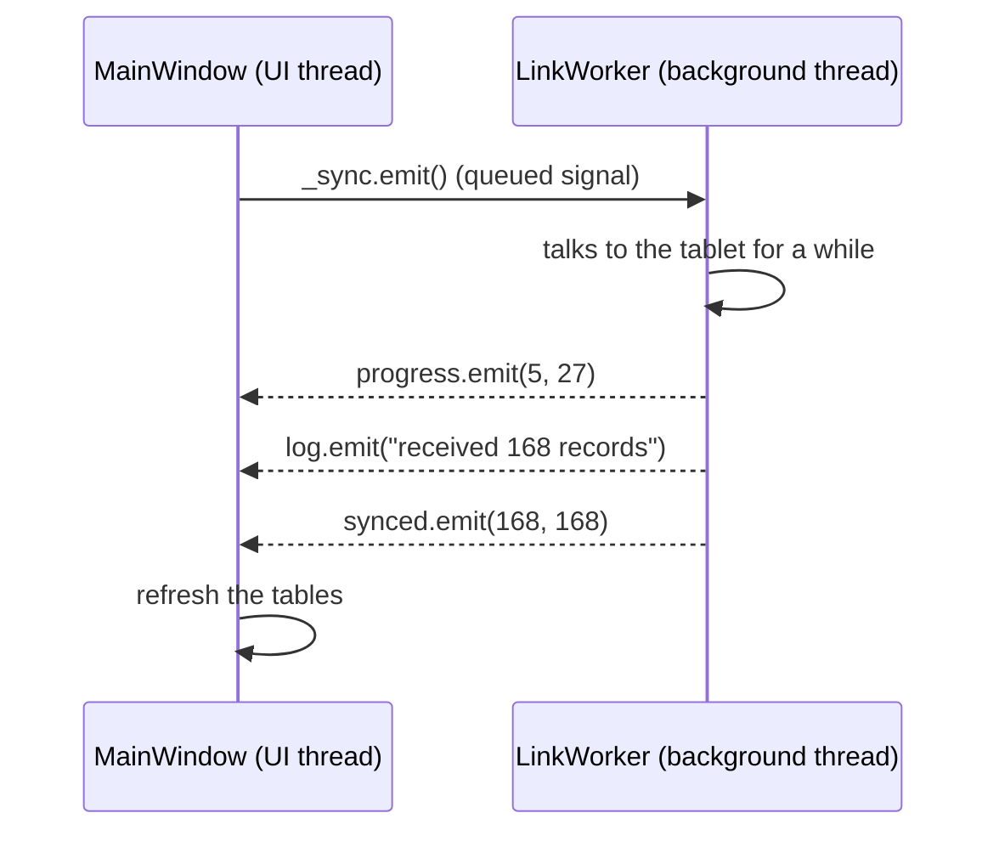

# Python and Qt crash course

Just enough Python, SQLAlchemy and PyQt6 to read and change the companion
app. For more: **docs.python.org/3/tutorial**, the SQLAlchemy **ORM Quick
Start**, and the PyQt6 tutorials at **pythonguis.com**.

## Python in five minutes

```python
team = 217                       # no type needed
name = "Doe, Jane"
teams = [217, 33, 67]            # list
record = {"auton": {"auton_fuel": 6}, "name": "Scout 1"}   # dict (like JSON)

def total(auton: int, teleop: int) -> int:   # ": int" are optional type hints
    return auton + teleop

if total(3, 7) > 5:
    print(f"Team {team} did well")   # f-strings put values in text
```

**Indentation matters**: the lines inside an `if`, `for` or `def` are
indented by 4 spaces. That's how Python knows where blocks end.

```python
for t in teams:
    print(t)

class TeamSettings:              # a simple class
    def __init__(self, number: str):
        self.number = number
```

`from .db import Store` means "from the file `db.py` in this package, get
`Store`". The dot means "this package".

### The virtual environment

`companion/.venv` holds this project's packages (PyQt6, SQLAlchemy,
pyserial, pytest). Always run Python through it:

```powershell
.venv\Scripts\python -m chicken_companion     # run the app
.venv\Scripts\python -m pytest                # run the tests
.venv\Scripts\pip install -r requirements.txt # (re)install packages
```

## SQLAlchemy: the database from Python

Each table is a Python class (in `chicken_companion/db.py`):

```python
class Scout(Base):
    __tablename__ = "scouts"
    id: Mapped[int] = mapped_column(Integer, primary_key=True, autoincrement=True)
    name: Mapped[str] = mapped_column(String, unique=True)
    active: Mapped[bool] = mapped_column(Boolean, default=True)
```

To read or write, open a **session**:

```python
with store.Session() as s:                         # read
    scouts = s.scalars(select(Scout).where(Scout.active.is_(True))).all()

with store.Session.begin() as s:                   # write (saved at the end)
    s.add(Scout(name="Doe, Jane"))
```

`Session.begin()` saves everything when the `with` block ends, or saves
nothing if there's an error, so the database is never left half-changed.

## PyQt6: windows and buttons

A window is built from **widgets** (`QPushButton`, `QLabel`, `QTableWidget`,
…) arranged by **layouts** (`QVBoxLayout` = vertical, `QHBoxLayout` =
horizontal, `QFormLayout` = label/field pairs):

```python
btn = QPushButton("Sync now")
btn.clicked.connect(self._do_sync)      # when clicked, call this method

v = QVBoxLayout(widget)
v.addWidget(QLabel("Hello"))
v.addWidget(btn)
```

`btn.clicked` is a **signal**; `connect` attaches a **slot** (any function)
to it.

### Threads and signals

The window runs on the *UI thread*. If that thread is busy for more than a
moment the window freezes, so slow work (radio transfers) runs in
`LinkWorker` on a second thread. The rule in Qt: **only touch widgets from
the UI thread**. The two threads talk only through signals:



When you add a new job: add a `pyqtSignal` on `MainWindow`, connect it to a
new `@pyqtSlot` method on `LinkWorker`, and report results with the
worker's signals. Never call a worker method directly from the UI.
`push_admin` in `ui/worker.py` is a good example to copy.

## Packages the companion uses

| Package | Used for |
|---|---|
| PyQt6 | The window |
| SQLAlchemy | The database |
| pyserial | Talking to the USB LoRa dongle |
| pytest | Running the tests |

The Python standard library covers the rest: `zlib` (compression), `json`,
`socket` (TCP), `urllib` (The Blue Alliance).
