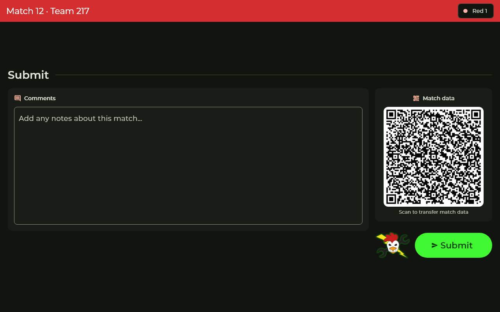

# Look and feel (theme)

The tablet app follows **Material Design 3**, Google's current design system
(m3.material.io). All colours and component styles come from one file:
`lib/theme/app_theme.dart`.

{ width="640" }

## How the colours are made

Instead of picking dozens of colours by hand, Material 3 *generates* a full,
accessible set (a **colour scheme**) from one *seed* colour:

| Seed | Becomes |
|---|---|
| Team green `#00D900` | `primary`: main buttons, the active tab, highlights |
| Brand orange `#FF6B35` | `tertiary`: section icons, star ratings |

The rest (backgrounds, cards, text, outlines) are calm, standard M3 tones
generated from the green. Light and dark versions are generated
automatically, and the app follows the tablet's dark mode setting.

## Using colours in code

**Never** write `Colors.white`, `Colors.black87`, `Color(0xFF00D900)` etc. in
a page. Ask the theme, so dark mode keeps working:

```dart
final scheme = Theme.of(context).colorScheme;
Container(color: scheme.surfaceContainerLow);     // a card background
Text('Hi', style: TextStyle(color: scheme.onSurfaceVariant));   // quiet text
```

Common roles:

| Role | For |
|---|---|
| `surface` / `onSurface` | Page background / normal text |
| `surfaceContainerLow`…`Highest` | Cards and panels, from quietest to strongest |
| `onSurfaceVariant` | Secondary text, captions |
| `primary` / `onPrimary` | Main buttons and their text |
| `primaryContainer` / `onPrimaryContainer` | Strong highlighted areas (e.g. the fuel number) |
| `secondaryContainer` | Selected items in lists |
| `tertiary` | Accent icons, ratings |
| `error` / `errorContainer` | Problems; the "auton over" red |
| `outlineVariant` | Thin dividers and borders |

### Alliance and status colours

`AppColors` (also in `app_theme.dart`) adds colours Material 3 doesn't
have, each in light and dark versions:

```dart
final c = AppColors.of(context);
c.red, c.redContainer, c.onRedContainer       // red alliance
c.blue, c.blueContainer, c.onBlueContainer    // blue alliance
c.success, c.successContainer                 // good
c.warning, c.warningContainer                 // caution
c.alliance('Red')                             // red or blue by name
```

### Shared scouting widgets

`lib/widgets/scout_ui.dart` has `SectionHeader` (page titles like "Auton"),
`ScoutCard` (the cards inputs sit in), `CardLabel` (icon + title in a card)
and `Caption`. Use them on new scouting pages so everything matches.

## Checking your change

`flutter test test/screens_test.dart` renders every main screen in light and
dark mode and fails on layout errors. To *see* them:

```powershell
$env:SCREEN_SHOTS = "C:\temp\shots"; flutter test test/screens_test.dart
```

then look at the PNGs in `C:\temp\shots`. (That's also how the screenshots
in these docs are made. See [Updating these docs](../maintain/updating-docs.md).)
