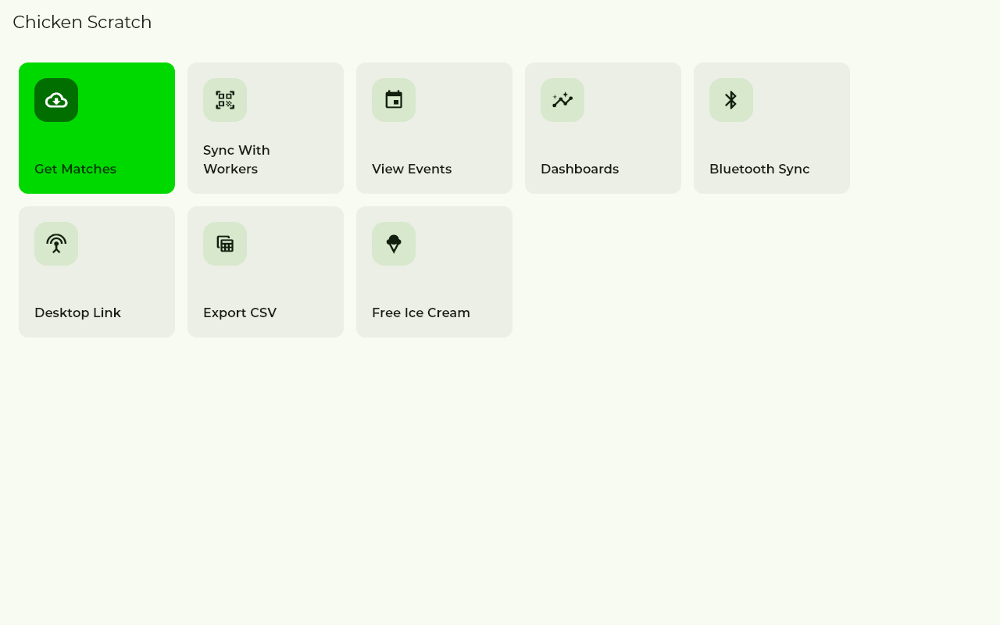

# Chicken Scratch

**Chicken Scratch** is Team 217's scouting system for *FIRST* Robotics
Competition (FRC) events. Students in the stands watch each match on
tablets and record what every robot does. The data is gathered in one place
so the strategy team can rank robots, plan matches and pick alliance
partners.

{ width="720" }

## What's in the project

| Part | What it is | Written in |
|---|---|---|
| **Tablet app** | The app scouts use on six Android tablets, plus dashboards for the strategy team | Flutter / Dart |
| **Companion app** | A desktop program (Windows or Linux) that collects data from the tablets, stores every season's data, and pushes rosters, schedules and settings to the tablets | Python / PyQt6 |
| **This documentation** | What you're reading. It lives in the `docs/` folder | Markdown |

## Where to start

-   :material-school: **New to the project?**

    Read [The big picture](start/big-picture.md), then follow
    [Install the tools](start/install-tools.md) and
    [Your first day](start/first-day.md). No programming experience needed.

-   :material-tablet: **Scouting at an event?**

    [Tablet app](use/tablet-app.md) and the
    [Match day checklist](use/match-day.md).

-   :material-database: **Working with the data?**

    [Database](database/index.md) explains every table and field, and
    [Querying the data](database/querying.md) shows how to ask questions of it.

-   :material-wrench: **Getting ready for next season?**

    [Getting ready for a new season](maintain/new-season.md) is the
    step-by-step checklist.

## How these docs are organised

- **Start here**: what the system is, the words we use, and setting up your
  computer.
- **Using the apps**: every screen, for scouts, the strategy team and whoever
  runs the laptop.
- **How it works**: how the code is put together, with diagrams. Read this
  before changing code.
- **Database**: every table, column and data field, explained.
- **Maintaining**: recipes for the jobs you'll actually do: new season, new
  field, new dashboard tile, building the app, fixing problems.
- **Reference**: lists to look things up in.

!!! tip "You can't break anything by reading"
    Nothing in these docs changes the app unless you follow a step that says
    to edit a file. If you get stuck, every page tries to say *why* things are
    the way they are, so you can make a good guess, and the
    [Troubleshooting](maintain/troubleshooting.md) page lists common problems.
