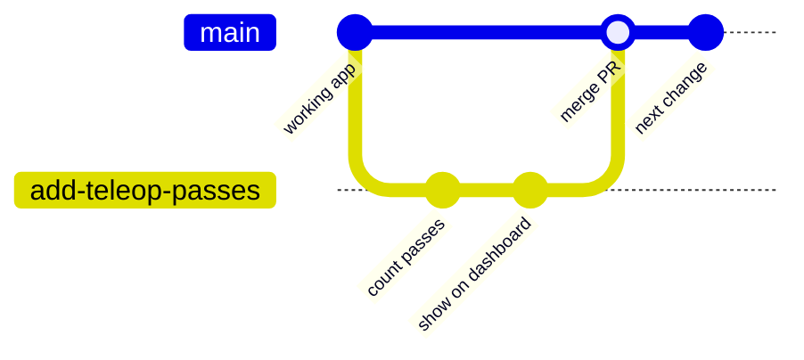

# Git and teamwork

Git records every change to the project, who made it and why, so mistakes
can be undone and several people can work at once. The project lives on
GitHub at **github.com/Team217/chicken_scratch**.

## The idea



- **`main`** is the version that works and goes on the tablets.
- You make a **branch** for each change, commit to it, then **merge** it
  into `main` through a **pull request** (PR) that someone else looks at.

## Day to day

```powershell
# Start: get the latest main, then branch
git checkout main
git pull
git checkout -b my-change-name

# Work, then see what changed
git status
git diff

# Save a snapshot (a commit)
git add -A
git commit -m "Short description of what and why"

# Share it
git push -u origin my-change-name
```

Then on GitHub, open a **pull request** from your branch to `main`. Ask
someone to review it. After it's merged:

```powershell
git checkout main
git pull
git branch -d my-change-name
```

VS Code's **Source Control** panel does all of this with buttons, if you
prefer.

## Good commits

- One idea per commit ("Count teleop passes", not "stuff").
- The message says **what** and **why**.
- Tests pass before you commit.
- Docs updated in the same commit as the code they describe.

## Don't commit

| What | Why |
|---|---|
| `ScoutingData/` | Students' names and photos. It's already in `.gitignore`. |
| `scouting.db` or any `.db` | Real data, and huge. |
| API keys, passwords, credential files | Anyone who can see the repo could use them. |
| `build/`, `companion/.venv/` | Generated; already ignored. |

If you commit a secret by accident, tell a mentor: it must be *changed*
(e.g. a new API key), not just deleted, because Git keeps history.

## Undo

| Oops | Fix |
|---|---|
| Changed a file, want the old version back | `git checkout -- path/to/file` |
| Committed but not pushed, want to change the message | `git commit --amend` |
| Want to see an old version | `git log`, then `git show <commit>:path/to/file` |
| A merged change broke things | `git revert <commit>` makes a new commit that undoes it |
