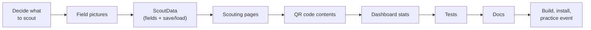

# Getting ready for a new season

Each January FRC announces a new game, and the scouting app has to follow.
This page lists everything that changes. Plan **2–4 weeks** before the first
event, so there's time to test on tablets.



## What does *not* change

Good news first. These handle any season automatically:

- the databases (game data lives in the `data` JSON; see
  [Database basics](../database/basics.md#json-inside-a-column)),
- Bluetooth sync, the LoRa/TCP link, restore,
- CSV export (columns come from whatever fields exist),
- the companion app: storage, the season data dictionary, legacy import,
  admin settings,
- the theme and the shared widgets.

Last season's data stays on the laptop untouched.

## Step 0: decide what to scout

With the strategy team, read the game manual and list what you want to
record in auton, teleop and endgame. For each field decide:

- its **name** (`lower_case_with_underscores`, e.g. `teleop_coral_l4`),
- its **type**: a count, yes/no, a choice from a list, a rating, text,
- **which section** it belongs in (`auton`, `teleop`, `endgame`).

Write the list into [Scouting data by season](../database/scouting-data.md)
as a new section *before* coding. It's your plan, and it becomes the docs.

!!! tip "Reuse what you can"
    The fuel counter, climb selector, robot condition, defense and driving
    widgets can be reused for similar fields with a different label.

## Step 1: make a branch

```powershell
git checkout main
git pull
git checkout -b season-2027
```

## Step 2: field pictures

Replace `assets/images/RedField.png` and `BlueField.png` with the new
field, drawn from each alliance's point of view (same file names, so no code
changes). Update `FRC-RedBot.png` / `FRC-BlueBot.png` if you like.

On the Pre-match page, the tapped position is converted to field feet with
calibration numbers at the top of
`lib/pages/game_periods/prematch_page.dart` (`_multY`, `_offsetY`,
`_multXRed`, `_offsetXRed`, `_multXBlue`, `_offsetXBlue`). If the new
picture's scale or margins differ, recalibrate them: tap two known points
on a tablet, note the pixel and the real feet, and solve
`feet = pixels × mult + offset`.

## Step 3: `ScoutData`, the fields

`lib/models/scout_data_model.dart` holds every field for the match being
scouted. For each new field:

1. Add a variable with a default, e.g. `int teleopCoralL4 = 0;`
2. Add it to **`toMap()`**, in the right section, with its stored name. This
   is what gets saved and synced.
3. Add it to **`_applyMap()`**, so a saved match loads back in. Always give
   a default for when the field is missing (older records won't have it).
4. Remove last season's fields from `toMap()` and `_applyMap()` (old data
   isn't affected; it's already stored).

See [Worked example: add a field](add-a-field.md) for the full pattern.

## Step 4: the scouting pages

`lib/pages/game_periods/`: `auton_page.dart`, `teleop_page.dart`,
`endgame_page.dart` (and `prematch_page.dart` if starting positions change).
Lay out the new inputs with `ScoutCard` and `CardLabel` from
`lib/widgets/scout_ui.dart`, and connect each input to its `ScoutData` field
inside `setState`. Look at how `auton_page.dart` wires up
`FuelCounterWidget`.

Check the pages on a real tablet with `flutter run` and hot reload: real
fingers find layout problems that screenshots don't.

## Step 5: the QR code

`_buildQrMap()` in `lib/pages/game_periods/submit_data_page.dart` lists the
fields that go into the QR code **separately** from `toMap()`. Update it to
match, so the QR backup carries the same data. (Keep `auton_path` compact
with `toCompactBase64()`: QR codes hold little.) If the QR gets too big to
scan, the page shows an error. Drop long free text from the QR or shorten
it.

The master's scanner (`_recordFromQr` in `sync_with_workers_page.dart`) copies
the `auton`, `teleop` and `endgame` sections as they are, so it needs no
change unless you add a new compact encoding.

## Step 6: dashboard stats

1. In `lib/analysis/metrics.dart`, replace last season's entries in
   `Metrics.all` with metrics for the new fields. See
   [Add a metric or dashboard tile](add-metric-or-tile.md).
2. Search for the old metric keys (`total_fuel`, `auton_fuel`,
   `climb_level`, …) in `lib/dashboard/`: the starter dashboards and tile
   defaults (`dashboard_model.dart`), and the match preview and climb tile
   (`tiles.dart`) use them by name. Point them at the new keys.
3. The **Auton map** and **Comments** tiles read `auton.auton_path` and
   `endgame.comments` / `endgame.robot_condition` directly. Keep those names
   if you can.

Tablets keep their saved dashboards, so after updating tell people to use
**⋮ → Add the starter dashboards** (or delete and re-add).

## Step 7: tests

Run `flutter test`. Tests that build fake records will fail where they use
last season's fields. Update them:

- `test/dashboard_test.dart`: `fakeEvent()` builds fake records; give it the
  new fields.
- `test/scout_data_store_test.dart`: CSV expectations.
- `test/screens_test.dart`: should keep passing; look at the screenshots
  (`SCREEN_SHOTS`).

Companion tests don't depend on game fields.

## Step 8: docs

- [Scouting data by season](../database/scouting-data.md): the new season's
  fields (from Step 0) and values.
- [Tablet app](../use/tablet-app.md) and [Dashboards](../use/dashboards.md):
  new screenshots and the stat list. See [Updating these docs](updating-docs.md).

## Step 9: build, install, practise

1. Bump `version:` in `pubspec.yaml` (e.g. `0.2.0`).
2. [Build the APK](build-and-install.md) and install it on all six tablets.
3. On the laptop: Admin → set the **season**, roster, events.
4. Run a practice "event" with old match videos: scout, sync over Bluetooth,
   sync to the laptop, check the dashboards and a CSV export.
5. Merge the branch into `main` ([Git and teamwork](git-workflow.md)).

## Checklist

- [ ] Field list agreed and written in the docs
- [ ] Branch created
- [ ] Field pictures replaced (and calibration checked)
- [ ] `ScoutData`: variables, `toMap()`, `_applyMap()`
- [ ] Auton / Teleop / Endgame pages
- [ ] QR map in `submit_data_page.dart`
- [ ] `Metrics.all` and metric keys in `lib/dashboard/`
- [ ] Tests updated and passing (both suites)
- [ ] Docs updated
- [ ] Version bumped, APK built and installed
- [ ] Practice event run end to end
