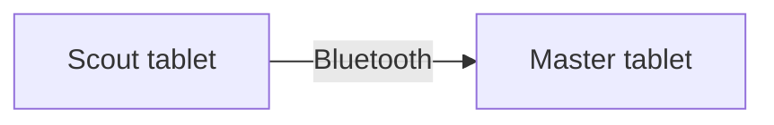

# Updating these docs

These docs are Markdown files in `docs/`, built into a website with
**MkDocs** and the **Material** theme. Read the Docs builds and hosts the
site from the repository.

## Edit a page

1. Find the file: the page's address matches its path, e.g. the page you're
   reading is `docs/maintain/updating-docs.md`.
2. Edit it in VS Code (**Ctrl+Shift+V** previews Markdown).
3. Commit it with the code change it describes.

To add a page, create the file and add it to `nav:` in `mkdocs.yml`, or it
won't appear in the menu.

## Preview the whole site

Once, make a private environment for the doc tools:

```powershell
python -m venv .docs-venv
.docs-venv\Scripts\pip install -r docs/requirements.txt
```

Then:

```powershell
.docs-venv\Scripts\mkdocs serve
```

and open **http://127.0.0.1:8000**. The page reloads as you save. Before
committing, check the build has no warnings:

```powershell
.docs-venv\Scripts\mkdocs build --strict
```

(`.docs-venv` and the generated `site/` folder are git-ignored.)

## Markdown you'll use

````markdown
## A heading

Text with **bold**, `code`, and a [link to another page](../start/glossary.md).

- a list
- of things

| A table | Column |
|---|---|
| cell | cell |


!!! tip "A coloured box"
    Indented text inside it. Also: note, warning, danger, info, success.

```powershell
commands in a code block
```
````

Links between pages use the relative path to the `.md` file.

## Diagrams

Diagrams are written as text with **Mermaid**, inside a ` ```mermaid ` block,
so anyone can edit them:

````markdown

````

Mermaid supports flowcharts, sequence diagrams, entity-relationship diagrams
(the database pages) and Git graphs. Try changes at **mermaid.live**.

## Screenshots

Screenshots are generated by tests, so they always match the current app
and never show real students' data.

**Tablet screens** (written straight into the docs):

```powershell
$env:SCREEN_SHOTS = "$PWD\docs\images\tablet"; flutter test test/screens_test.dart
$env:DASHBOARD_SHOTS = "$PWD\docs\images\dashboards"; flutter test test/dashboard_test.dart
Remove-Item Env:SCREEN_SHOTS, Env:DASHBOARD_SHOTS
```

The test renderer can't draw text on the Settings page (the `settings_ui`
package uses a font the test can't load), so that page is described with a
table instead of a picture.

**Companion screens**: `docs/images/companion/` was made by running the app
offscreen against the simulator with made-up data. To redo them, take your
own screenshots with the **Simulator** (Windows: **Win+Shift+S**) and save
them with the same file names. Use only made-up data.

!!! note "Material for MkDocs end of life"
    The Material theme's makers have announced it reaches end of life in May
    2027, with **Zensical** as its successor (it reads the same `mkdocs.yml`).
    Plan to switch before then; `docs/requirements.txt` is the only place the
    tools are listed.

## Read the Docs

`.readthedocs.yaml` tells Read the Docs to install `docs/requirements.txt`
and build `mkdocs.yml`, failing on warnings. To set up hosting (once): sign
in at **readthedocs.org** with GitHub, **Import a Project**, choose
`Team217/chicken_scratch`. After that, every push to `main` rebuilds the
site.
