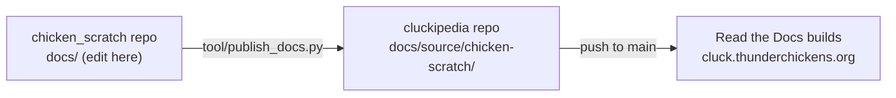
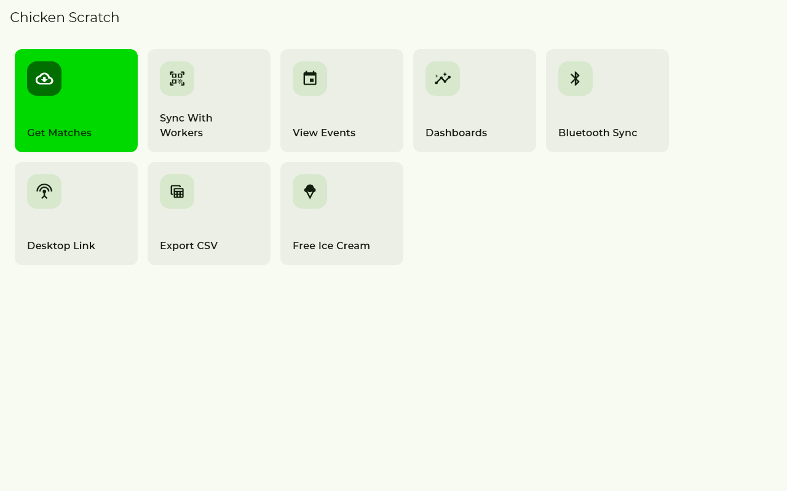
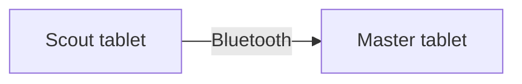

# Updating these docs

These docs are Markdown files in this project's `docs/` folder. They're
published as the **Chicken Scratch** section of **Cluckipedia**, the team's
knowledge base (cluck.thunderchickens.org), which is a separate repository:
github.com/Team217/cluckipedia.



**Always edit here**, in `chicken_scratch/docs/`, next to the code, then copy
to Cluckipedia. Edits made only in Cluckipedia get overwritten by the next
copy.

## How Cluckipedia reads the pages

Cluckipedia is built with **Sphinx** using the **Read the Docs theme**, and
reads Markdown with **MyST**. A few rules follow from that:

- **The sidebar comes from tables of contents.** Each section's `index.md`
  ends with a `toctree` listing its pages. A page that isn't in a `toctree`
  still gets built but **won't appear in the sidebar**.
- **Use MyST syntax for special blocks** (below). Syntax from other tools,
  like MkDocs' `!!! note` or `=== "Tab"`, shows up as plain text.
- **Link to pages, not to headings.** `[Settings](../reference/settings.md)`
  works; `settings.md#tablet` doesn't (Cluckipedia doesn't generate heading
  links).

## Edit a page

1. Find the file: e.g. this page is `docs/maintain/updating-docs.md`.
2. Edit it in VS Code (**Ctrl+Shift+V** previews plain Markdown).
3. Commit it with the code change it describes.

**To add a page**: create the `.md` file, then add its name (without `.md`)
to the `toctree` at the bottom of its section's `index.md`:

````markdown
```{toctree}
:maxdepth: 1

new-season
my-new-page
```
````

## Markdown you'll use

````markdown
# Page title (one per page)

## A heading

Text with **bold**, `code`, and a [link to another page](../start/glossary.md).

- a list
- of things

| A table | Column |
|---|---|
| cell | cell |



```powershell
commands in a code block
```
````

**Coloured boxes** (admonitions):

````markdown
```{note}
A plain note.
```

```{admonition} A title of your choice
:class: tip
Text inside the box. Classes: note, tip, warning, danger, important.
```
````

## Diagrams

Diagrams are written as text with **Mermaid** in a ` ```mermaid ` block, so
anyone can edit them:

````markdown

````

Mermaid supports flowcharts, sequence diagrams, entity-relationship diagrams
(the database pages) and Git graphs. Try changes at **mermaid.live** first:
a diagram with a mistake shows an error box instead of the picture. To write
`<` or `>` inside a label, use `#lt;` and `#gt;`.

## Preview on your computer

Once, make a private environment with the same tools Cluckipedia uses:

```powershell
python -m venv .docs-venv
.docs-venv\Scripts\pip install -r docs/requirements.txt
```

Then build and open the result:

```powershell
.docs-venv\Scripts\python -m sphinx -b html docs docs/_build
start docs\_build\index.html
```

Read the messages: any `WARNING` about a page "not included in any toctree"
means it won't be in the sidebar. `docs/conf.py` holds the preview settings,
which match Cluckipedia's. (`.docs-venv` and `docs/_build` are git-ignored.)

## Publish to Cluckipedia

1. Clone Cluckipedia once (or `git pull` an existing clone):

    ```powershell
    git clone https://github.com/Team217/cluckipedia.git C:\dev\cluckipedia
    ```

2. Copy the docs across. This adds and updates files and removes ones
   deleted here; it skips the preview-only files:

    ```powershell
    python tool/publish_docs.py C:\dev\cluckipedia
    ```

3. In the Cluckipedia clone, review and commit:

    ```powershell
    cd C:\dev\cluckipedia
    git status
    git add docs/source/chicken-scratch
    git commit -m "Update Chicken Scratch docs"
    git push
    ```

Read the Docs rebuilds cluck.thunderchickens.org a few minutes later.
Cluckipedia's main menu (`docs/source/index.rst`) already links to
`chicken-scratch/index`.

## Screenshots

Screenshots are generated by tests, so they always match the current app
and never show real students' data.

**Tablet screens** (written straight into the docs):

```powershell
$env:SCREEN_SHOTS = "$PWD\docs\images\tablet"; flutter test test/screens_test.dart
$env:DASHBOARD_SHOTS = "$PWD\docs\images\dashboards"; flutter test test/dashboard_test.dart
Remove-Item Env:SCREEN_SHOTS, Env:DASHBOARD_SHOTS
```

That writes light and dark versions of every screen; delete the ones no page
uses. The test renderer can't draw text on the Settings page (the
`settings_ui` package uses a font the test can't load), so that page is
described with a table instead of a picture.

**Companion screens**: `docs/images/companion/` was made by running the app
offscreen against the simulator with made-up data. To redo them, take your
own screenshots with the **Simulator** (Windows: **Win+Shift+S**) and save
them with the same file names. Use only made-up data.
