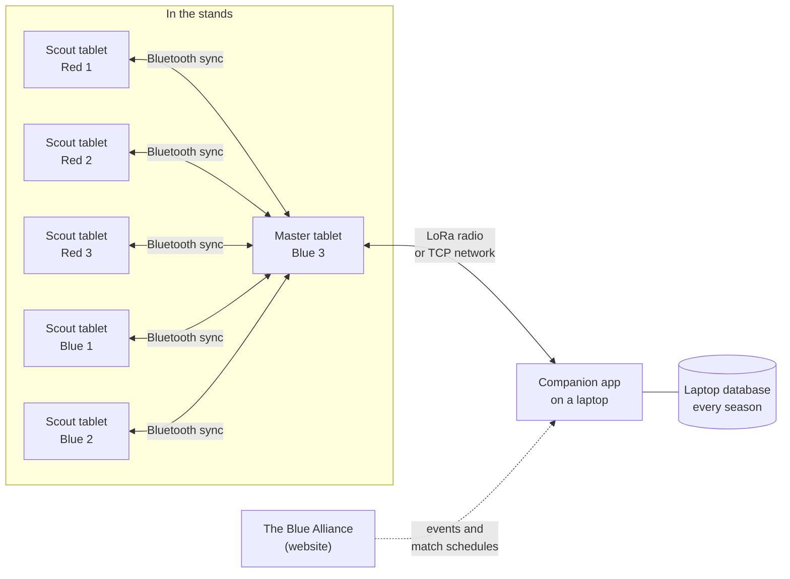
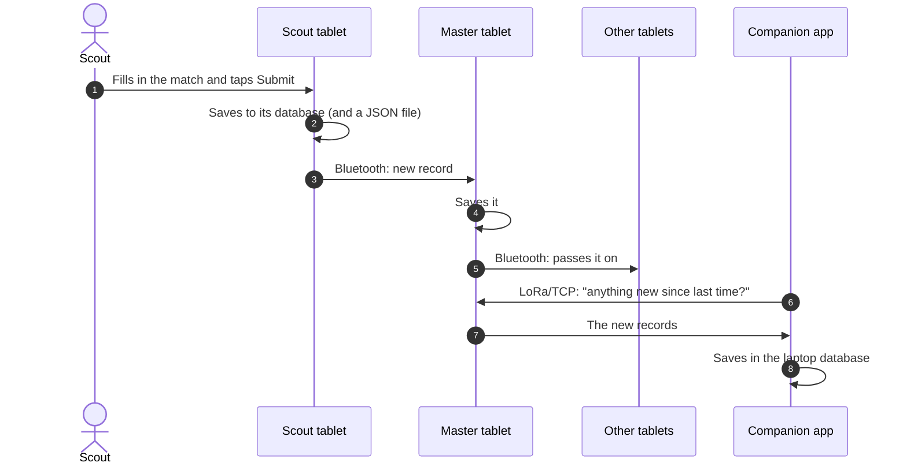

# The big picture

## The job

At an FRC event every match has **six robots**: three on the red alliance
and three on the blue alliance. We want data on *every* robot in *every*
match, so six scouts each watch one robot, each on their own tablet. The
spot a scout watches is called their **station**: Red 1, Red 2, Red 3,
Blue 1, Blue 2 or Blue 3.

For each robot in each match a scout records things like:

- where the robot started and the path it drove in the autonomous period,
- how many game pieces (in 2026, *fuel*) it scored in auton and teleop,
- whether and how high it climbed,
- whether it broke down, played defense, and how well it drove,
- free-text comments.

That one robot-in-one-match entry is called a **record**. A typical event
produces 400–750 records.

## The pieces

**Six tablets** run the **tablet app**. One of them is set as the
**master**; the other five are **scouting tablets** (in the code they're
sometimes called *slaves* or *workers*). Every tablet is used for scouting,
the master included.

**Bluetooth sync** keeps all six tablets holding the same data. Each tablet
connects to the master; the master passes everything it receives on to all
the others. After a sync, any tablet has every match, so any of them can run
the dashboards.

**The companion app** runs on a laptop. It talks to the master tablet either
by **LoRa** (a long-range radio dongle plugged into the tablet and the
laptop) or by **TCP** (a normal network connection over Wi-Fi, a hotspot or
a USB cable). It:

- *collects* all the data and stores it in a database that keeps every
  season, so old data is never lost when tablets are wiped,
- *restores* data back to a tablet (for example, a replacement tablet),
- *manages* the scouter roster, events and match schedules, team settings
  and which tablet scouts which station, and pushes them out to the tablets,
- *imports* old seasons' data from folders of JSON files,
- *exports* CSV files for spreadsheets.

**The Blue Alliance** (thebluealliance.com) is a public website with every
FRC event's match schedule. The laptop downloads schedules from it, so the
tablets don't need internet at the venue.

## What happens to one record

The key idea: **every record has an ID made from the event, match and team**
(for example `2026mitr2_Match12_217`). Whichever tablet a record came from,
everyone agrees it is the same record. If two copies differ, **the most
recently edited one wins**. That one rule is what keeps six tablets and a
laptop in agreement without anyone being "in charge" of the data.

## Backup: QR codes

If Bluetooth isn't working, the Submit screen also shows a **QR code** of
the match data. The master tablet can scan scouts' QR codes with its camera
(**Sync With Workers** on the master's home screen). It's slower, but it
needs no radio at all.

## Why it's built this way

| Decision | Why |
|---|---|
| Tablets work fully offline | Venues rarely have usable Wi-Fi, and FRC rules don't allow teams to run their own Wi-Fi networks. |
| Bluetooth between tablets | It's built into every tablet and needs no network. |
| One master as the hub | Android tablets can't form a true Bluetooth mesh, but one tablet can hold about 7 connections. |
| Laptop keeps every season | Tablets get wiped and reused; the laptop is the long-term record. |
| Game data stored as flexible JSON | The game changes every year. Storing each year's fields as they are means the database doesn't need redesigning each season. See [Database](../database/index.md). |
| LoRa radio option | It reaches across an arena without Wi-Fi. TCP is there for when no dongles are around. |
