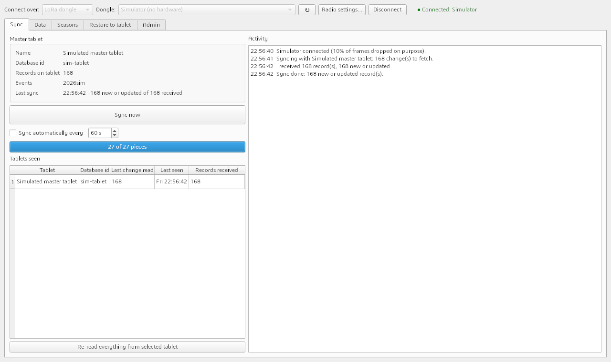

# Your first day

By the end of this page you'll have run the tests, started both apps, made
a small change and seen it work. Do it with the project open in VS Code; use
VS Code's terminal (**Terminal → New Terminal**), which opens in the project
folder.

## 1. Get the tablet app's packages

```powershell
flutter pub get
```

This downloads the Dart packages listed in `pubspec.yaml`. Run it again
whenever `pubspec.yaml` changes.

## 2. Run the tablet app's tests

```powershell
flutter test
```

You should see a long list ending with something like
`+64 -1: Some tests failed.` The one expected failure is
`test/widget_test.dart`, a leftover template test (see
[Known issues](../maintain/known-issues.md)). Anything else failing means
something is wrong with your setup or a recent change.

!!! tip "What did that just do?"
    Each file in `test/` checks part of the app, without a tablet: saving and
    syncing records, the LoRa protocol, the dashboards, the admin settings,
    and rendering every screen. [Testing](../maintain/testing.md) explains
    them.

## 3. Set up and test the companion app

```powershell
cd companion
python -m venv .venv
.venv\Scripts\pip install -r requirements.txt
.venv\Scripts\python -m pytest
```

All tests should pass (about 50). `python -m venv .venv` makes the private
package folder; you only do that once.

## 4. Run the companion app

Still in `companion`:

```powershell
.venv\Scripts\python -m chicken_companion
```

A window opens. Try it with no hardware:

1. **Connect over: LoRa dongle**, **Dongle: Simulator (no hardware)**,
   **Connect**.
2. **Sync now**. A fake master tablet sends 168 made-up records.
3. Look at the **Data**, **Seasons** and **Admin** tabs.



Your data goes to `ChickenScratch\scouting.db` in your home folder. To keep
practice data separate, run with
`--db C:\temp\practice.db`.

## 5. Run the tablet app

You need an Android tablet (or phone) with **USB debugging** on:

1. On the tablet: **Settings → About tablet**, tap **Build number** seven
   times to unlock **Developer options**.
2. **Settings → Developer options → USB debugging**: on.
3. Plug it into the computer and accept the "Allow USB debugging?" prompt.
4. Check Flutter sees it, then run the app:

    ```powershell
    cd ..          # back to the project folder if you're in companion
    flutter devices
    flutter run
    ```

The first build takes several minutes. While `flutter run` is going, press
**r** in the terminal to *hot reload* after editing code: the change appears
on the tablet in about a second without restarting the app.

!!! note "No tablet?"
    You can still do everything else: the tests render every screen, and the
    screenshots in [Tablet app](../use/tablet-app.md) come from those tests.
    The emulator in Android Studio (**Device Manager**) also works, but it has
    no Bluetooth.

## 6. Make a small change

Let's change a label so you can see the whole loop.

1. Open `lib/widgets/fuel_counter_widget.dart`.
2. Find the text `'Tap · hold − / + to repeat'`.
3. Change it to `'Tap the number to add one'` and save.
4. If `flutter run` is running, press **r** and look at the Auton or Teleop
   page. Otherwise run `flutter test test/screens_test.dart`. It still
   passes, because it checks that screens build, not their exact words.
5. Put it back. In VS Code's **Source Control** panel (branch icon on the
   left) right-click the file and **Discard Changes**, or run
   `git checkout -- lib/widgets/fuel_counter_widget.dart`.

## 7. Next steps

- Read [Architecture](../how/architecture.md) and the
  [Tablet code tour](../how/tablet-code-tour.md).
- If you've never used Dart or Python, the crash courses
  ([Flutter and Dart](../how/flutter-dart-primer.md),
  [Python and Qt](../how/python-qt-primer.md)) cover just what this project
  uses.
- Before you change anything for real, read
  [Git and teamwork](../maintain/git-workflow.md).
