# Companion app

The companion app runs on a Windows or Linux laptop. It's the long-term home
of the scouting data and the place to set up rosters, events and tablets.

**Start it** from the `companion` folder:

```powershell
.venv\Scripts\python -m chicken_companion
```

(First time: see [Your first day](../start/first-day.md).)
Data is saved in `ChickenScratch\scouting.db` in your home folder; add
`--db PATH` to use another file.

## Connecting to the master tablet

The bar at the top chooses how to reach the master tablet.

**LoRa dongle**


Plug a LoRa dongle into the laptop, pick its port and **Connect**. The
tablet needs a dongle too (see the tablet's
[Desktop Link](tablet-app.md) page). **Radio
settings…** writes the radio settings into a dongle; both dongles must
match.

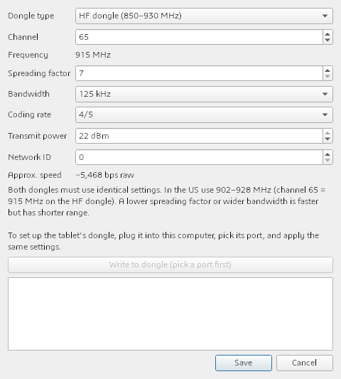

The defaults (channel 65 = 915 MHz, the US band) are right for the US.
Waveshare's factory setting is the EU band, so **write the settings to
both dongles once** before first use.


**TCP (network)**


Put the laptop and tablet on the same network (Wi-Fi, a phone hotspot,
or a USB cable with tethering). On the tablet, Desktop Link → TCP →
**Start listening**, then type its address here and **Connect**.

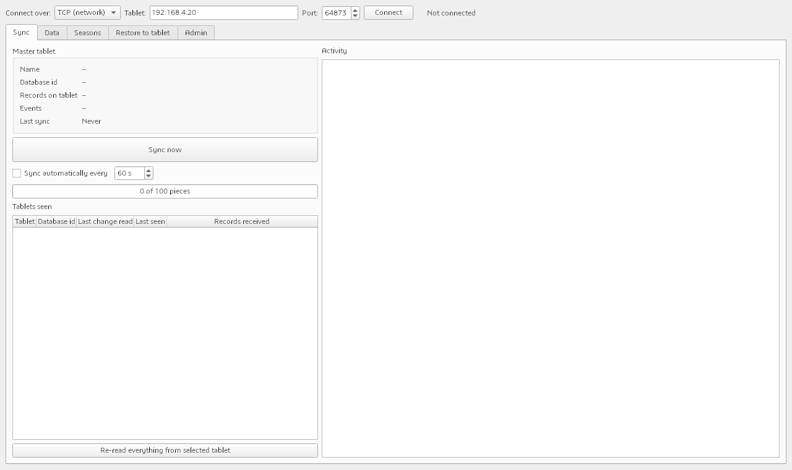


**Simulator**


Pick **Simulator (no hardware)** in the LoRa dongle list. A fake master
tablet with made-up data answers, dropping 10% of messages on purpose.
Great for learning and testing.


## Sync

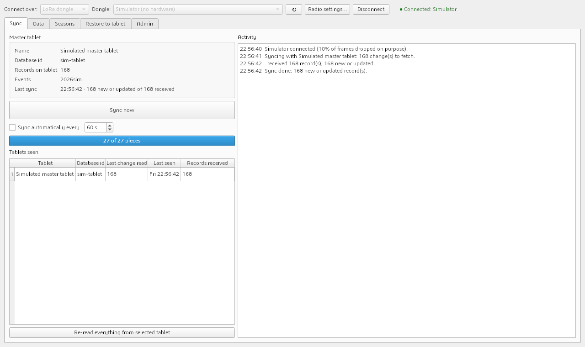

- **Sync now** fetches everything the laptop doesn't have yet. The first
  sync of an event over LoRa takes a few minutes; later ones only fetch
  changes. Over TCP it's seconds.
- **Sync automatically every … s** polls on a timer.
- **Tablets seen** lists each tablet database the laptop has read from.
  **Re-read everything from selected tablet** makes the next sync start from
  the beginning.

## Data

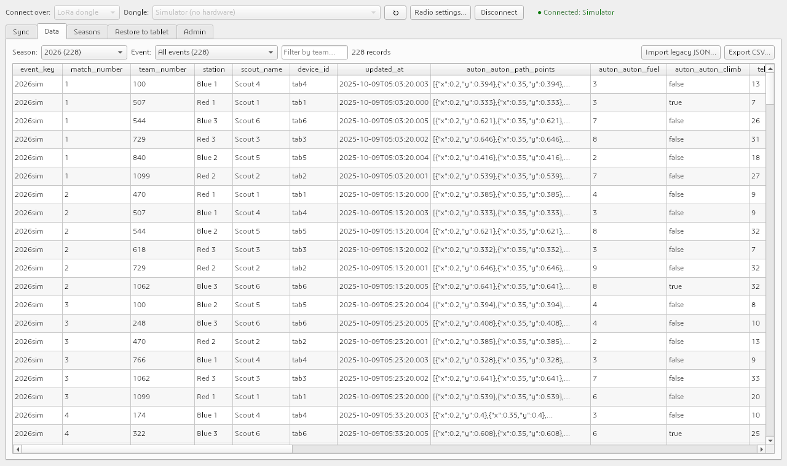

One season at a time, because each season has different columns. Filter by
event and team. **Export CSV…** saves what's shown.

**Import legacy JSON…** loads old seasons from folders of raw match files:

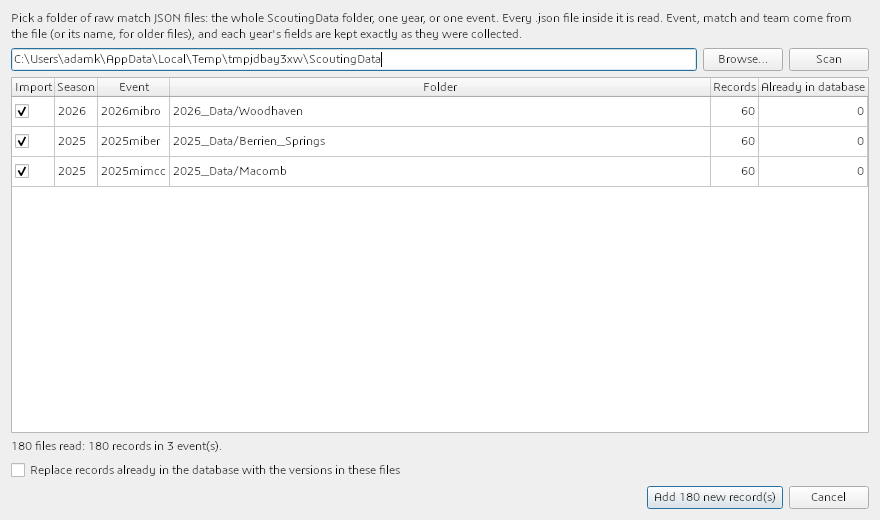

Pick a folder (the whole `ScoutingData` folder, a year, or an event). You'll
see each event found, how many records it has and how many are already in
the database. Records already in the database are kept unless you tick
**Replace**. Identical copies like `..._453(1).json` are skipped. Details:
[Scouting data by season](../database/scouting-data.md).

## Seasons

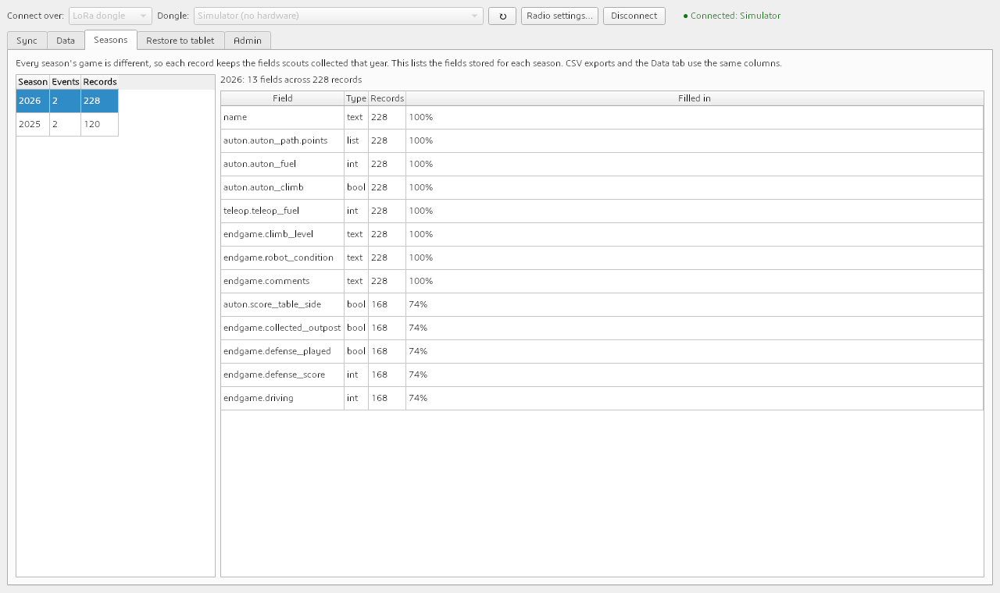

The *data dictionary*: every field each season collected, its type, and how
often it was filled in. See [Companion database](../database/companion-database.md).

## Restore to tablet

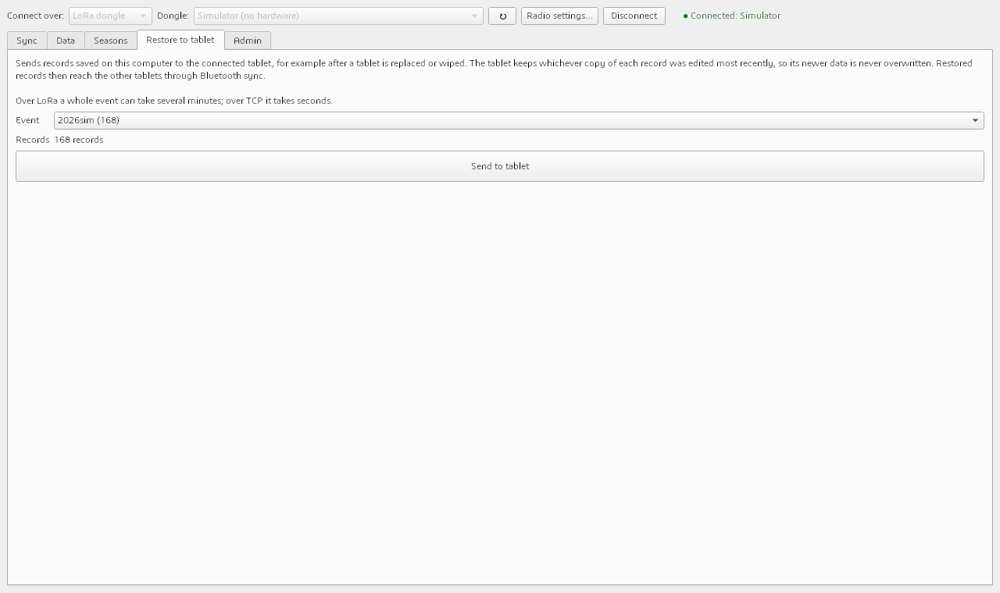

Sends an event's records back to the connected tablet, for example after a
tablet is replaced or wiped. The tablet keeps whichever copy of each record
was edited most recently, so newer tablet data is never overwritten. The
master then passes the records on over Bluetooth.

## Admin

Set up the season here, then **Send to tablets**. The status line says
whether the master tablet has the current settings.

**Team & settings**


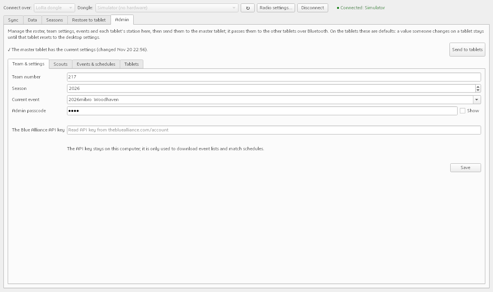

Team number, season, current event and the admin passcode (empty means
the app's built-in one). Also your **The Blue Alliance API key** (get one
free at thebluealliance.com/account). It stays on this computer.


**Scouts**


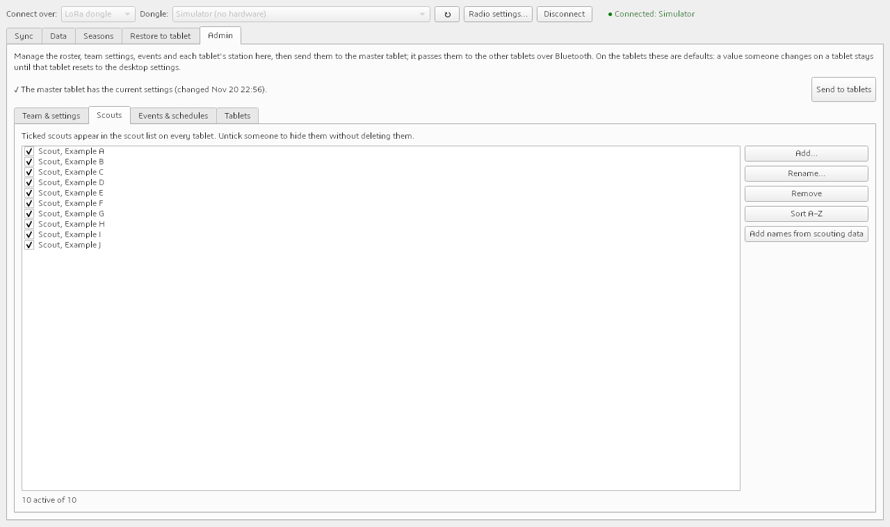

The list scouts pick their name from. **Add…** takes one name per line.
Untick someone to hide them without deleting them. **Add names from
scouting data** builds a roster from names already in a season's records.


**Events & schedules**


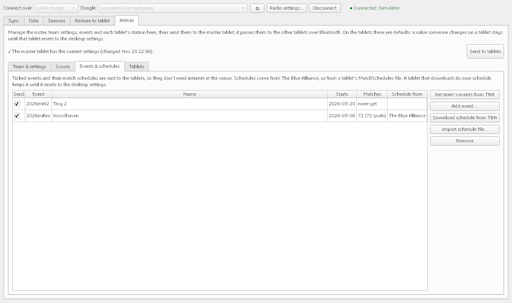

**Get team's events from TBA**, then select an event and **Download
schedule from TBA**. Or **Import schedule file…** from a tablet's
`MatchSchedules` folder. Ticked events are sent to the tablets.


**Tablets**


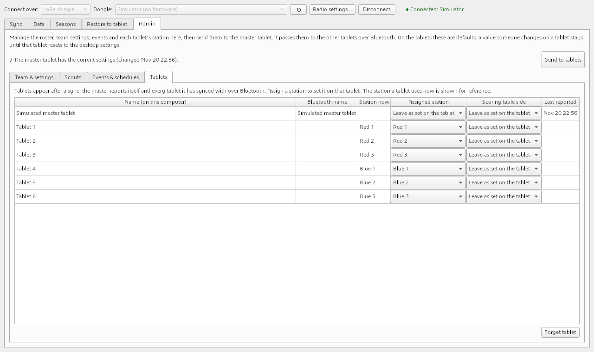

Tablets appear after a sync. Name them (names stay on this computer) and
assign each a station and scoring-table side.


```{admonition} Tablets can override
:class: note
What the laptop sends are *defaults*. If someone changes, say, a tablet's
station on the tablet, that tablet keeps its own value until **Settings →
Reset to desktop settings** on the tablet. Details:
[Admin settings](../how/admin-settings.md).
```

## Without the window

Import legacy data from a terminal:

```powershell
.venv\Scripts\python -m chicken_companion --import-json ..\ScoutingData
```

Add `--replace` to overwrite existing records, and `--db PATH` for another
database file.
