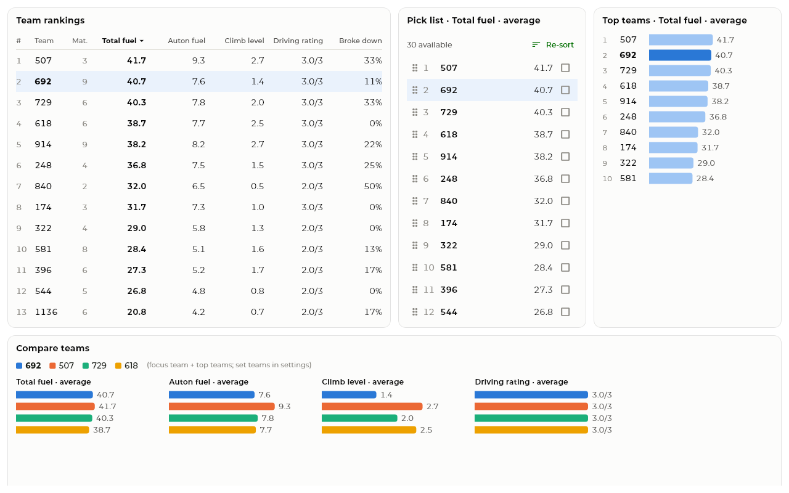
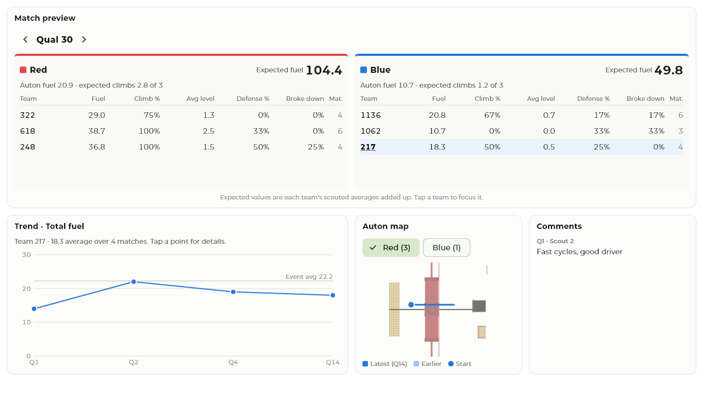
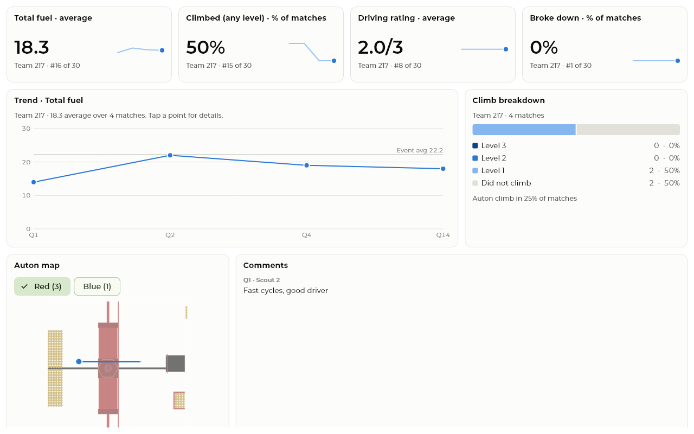
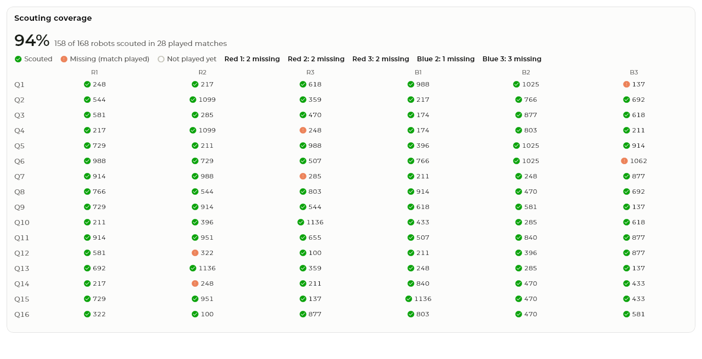
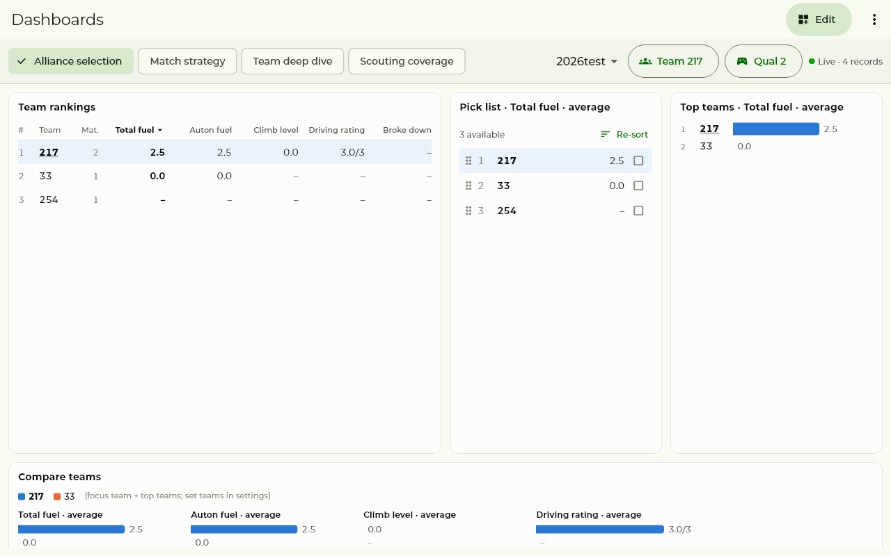
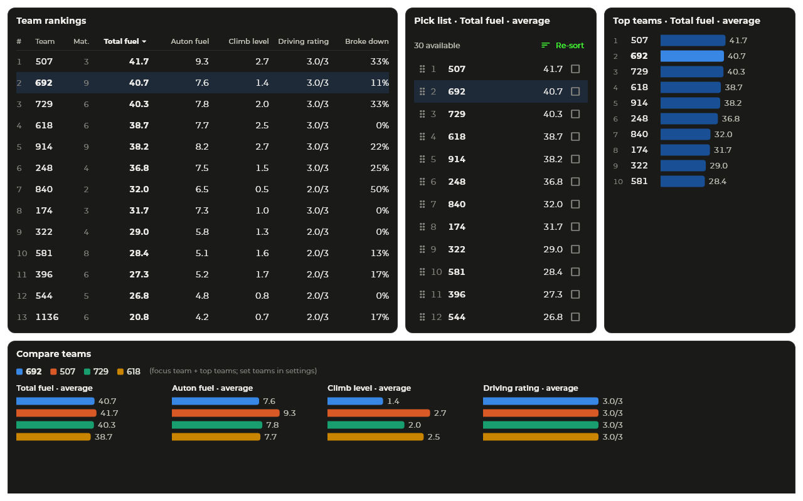

# Dashboards

The dashboards turn the scouting records into rankings, charts and match
previews, live on the tablet. They update by themselves as matches are
submitted or synced. Any tablet can run them; they show whatever data that
tablet has, so sync first.

Open **Dashboards** from the home screen.

## The four starter dashboards

=== "Alliance selection"

    

    Team rankings, a draggable **pick list** (tap a team to mark it picked),
    the top teams for one stat, and up to four teams compared side by side.

=== "Match strategy"

    

    Pick a match: red versus blue with each robot's averages and the
    alliance's expected fuel, plus the focus team's trend, auton map and
    scout comments.

=== "Team deep dive"

    

    Everything about one team: key numbers with their rank, trend over time,
    climb breakdown, auton paths and comments.

=== "Scouting coverage"

    

    Which robots in which matches still have no data, so the head scout can
    spot gaps (a scout who missed a match, a tablet that didn't sync).

## The toolbar

| Control | What it does |
|---|---|
| Dashboard chips | Switch dashboard. |
| Event menu | Which event's data to show. Opens on the *current competition* from Settings. |
| **Team** | The *focus team*. Many tiles show this team, and it's highlighted everywhere. Tapping a team in a table also focuses it. |
| **Qual** | The *focus match* for match previews. Defaults to the next unplayed match. |
| **Live · N records** | How many records the dashboards are using. |
| **Edit** | Rearrange tiles (below). |
| **⋮** | New, rename, duplicate or delete a dashboard; add the starter dashboards back. |

## Editing a dashboard

Tap **Edit**:

- **Add a tile**: drag one from the panel on the left onto the board, or
  tap it.
- **Move**: press and hold a tile, then drag.
- **Resize**: drag the ↘ corner handle.
- **Settings** (⚙ on a tile): choose which stat it shows and how it's
  summarised (average, last 3, best, …).
- **Remove**: ✕ on the tile.

Tap **Done** when finished. Dashboards are saved **on that tablet only**.
They are not synced, so each tablet can have its own.

## Tiles

| Tile | Shows |
|---|---|
| Team rankings | Sortable table of every team for several stats. |
| Pick list | Your alliance-selection order. Drag to reorder; tap to mark picked. |
| Top teams | Bar chart of the best teams for one stat. |
| Match preview | Red vs blue for the focus match. |
| Team stat | One number for the focus team, with its rank. |
| Team trend | The focus team match by match. |
| Compare teams | Up to 4 teams side by side. |
| Climb breakdown | How often the focus team reached each climb level. |
| Auton map | The focus team's start positions and paths. |
| Comments | What scouts wrote about the focus team. |
| Scouting coverage | Which robots still need data. |

## Stats and how they're summarised

Each tile shows one or more **stats** (called *metrics* in the code), worked
out from every match a team played:

| Stat | Kind | Comes from |
|---|---|---|
| Total fuel | count | auton fuel + teleop fuel |
| Auton fuel, Teleop fuel | count | the fuel counters |
| Auton climb | yes/no | auton "Climbed?" |
| Climb level | level 0–3 | endgame climb level |
| Climbed (any level) | yes/no | climb level above 0 |
| Collected from outpost | yes/no | endgame switch |
| Driving rating | rating 1–3 | endgame stars |
| Played defense | yes/no | endgame switch |
| Defense rating (when played) | rating | only matches where it played defense |
| Was defended | yes/no | endgame switch |
| Broke down | yes/no (lower is better) | robot condition other than "working fine" |

…summarised as one of: **Average**, **Last 3 average**, **Median**,
**Best**, **Worst**, **Consistency** (standard deviation; lower means more
consistent), **Total**, or **% of matches** (for yes/no stats).

!!! warning "Expected fuel is a count, not points"
    The match preview adds up each robot's average *fuel count*. It isn't
    a predicted score, because the stats don't know the point values.

## Dark mode

Charts switch to colours chosen for dark backgrounds:

To add a stat or a tile type, see
[Add a metric or dashboard tile](../maintain/add-metric-or-tile.md).
