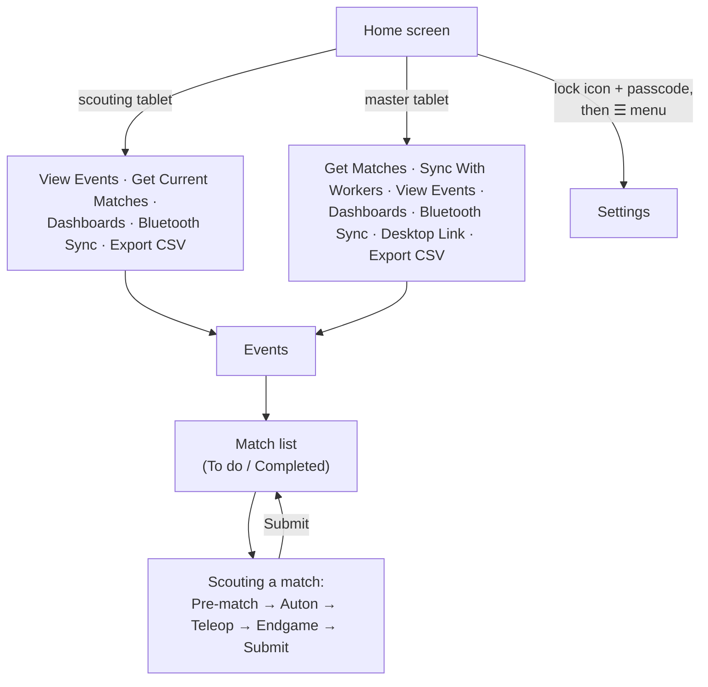

# Using the apps

- [Tablet app](tablet-app.md): every screen scouts and the master tablet use.
- [Dashboards](dashboards.md): the analysis screens for the strategy team.
- [Companion app](companion-app.md): the laptop program.
- [Match day checklist](match-day.md): what to do before, during and after an
  event.

How the screens fit together on the tablet:



```{rubric} Table of contents
```

```{toctree}
:maxdepth: 1

tablet-app
dashboards
companion-app
match-day
```
