# Tablet app

The tablet app runs on six Android tablets. It follows the tablet's light or
dark mode setting; screenshots here are in light mode, with a few dark ones
for comparison.

## Home screen

What you see depends on whether the tablet is the **master** (set in
Settings, below).

**Scouting tablet**


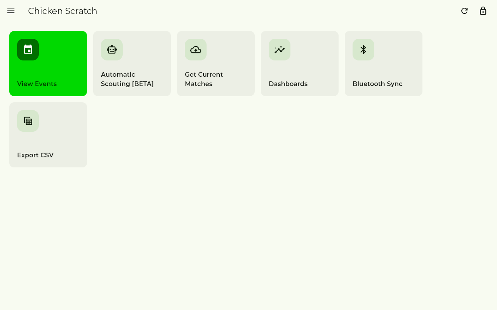

| Tile | What it does |
|---|---|
| **View Events** | Start here to scout: pick the event, then a match. |
| **Automatic Scouting [BETA]** | A joke button. It tells you to get back to scouting. |
| **Get Current Matches** | Downloads the schedule for the *current competition* (set in Settings) from The Blue Alliance. Needs internet. Usually not needed: the laptop pushes schedules (see [Admin settings](../how/admin-settings.md)). |
| **Dashboards** | The analysis screens. See [Dashboards](dashboards.md). |
| **Bluetooth Sync** | Connect to the master and swap data. |
| **Export CSV** | Save the data as a spreadsheet file and share it. |


**Master tablet**


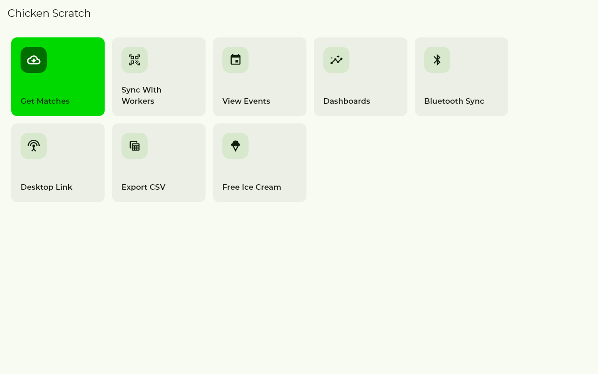

| Tile | What it does |
|---|---|
| **Get Matches** | Downloads every event for the team and year (from Settings) and their schedules, from The Blue Alliance. Needs internet. |
| **Sync With Workers** | Scan scouts' QR codes with the camera (the no-Bluetooth backup). |
| **View Events** | Same as on scouting tablets. |
| **Dashboards** | The analysis screens. |
| **Bluetooth Sync** | Host the sync that the other tablets connect to. |
| **Desktop Link** | Connect to the laptop over LoRa or TCP. |
| **Export CSV** | Spreadsheet export. |
| **Free Ice Cream** | Another joke. |


**Top bar:** ↻ re-reads the settings; the **lock** asks for the admin
passcode and unlocks the **☰ menu**, which has **Settings**.

## Scouting a match

### Events and the match list

**View Events** lists every event that has a schedule on this tablet. Tap
one to see its matches.

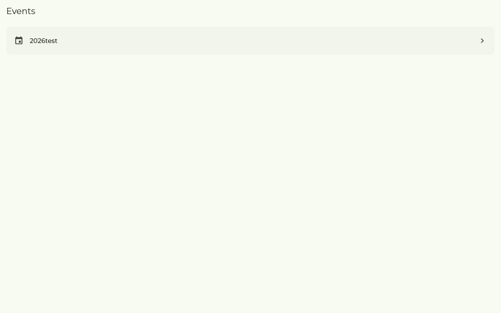

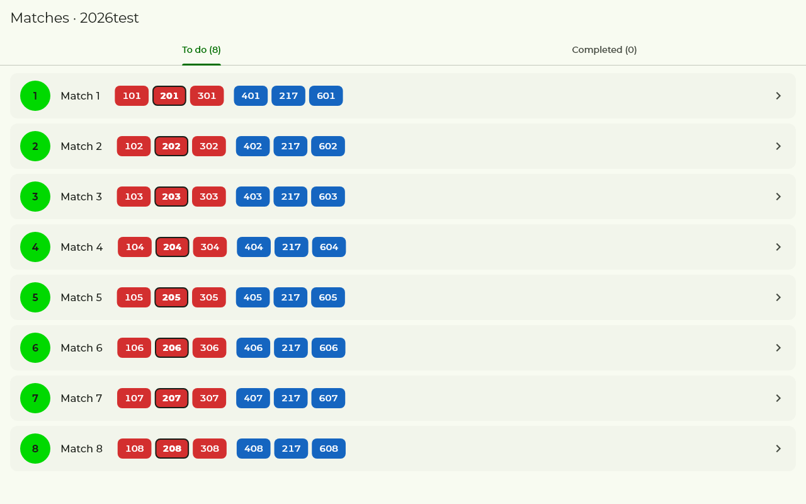

- **To do** holds matches this tablet hasn't scouted yet; **Completed** holds
  the ones it has (including any received by sync).
- Red and blue chips are the alliances. The **outlined** team is the one this
  tablet scouts, based on its station.
- Pull down to refresh. Tap a match, then **Start**.

### Pre-match

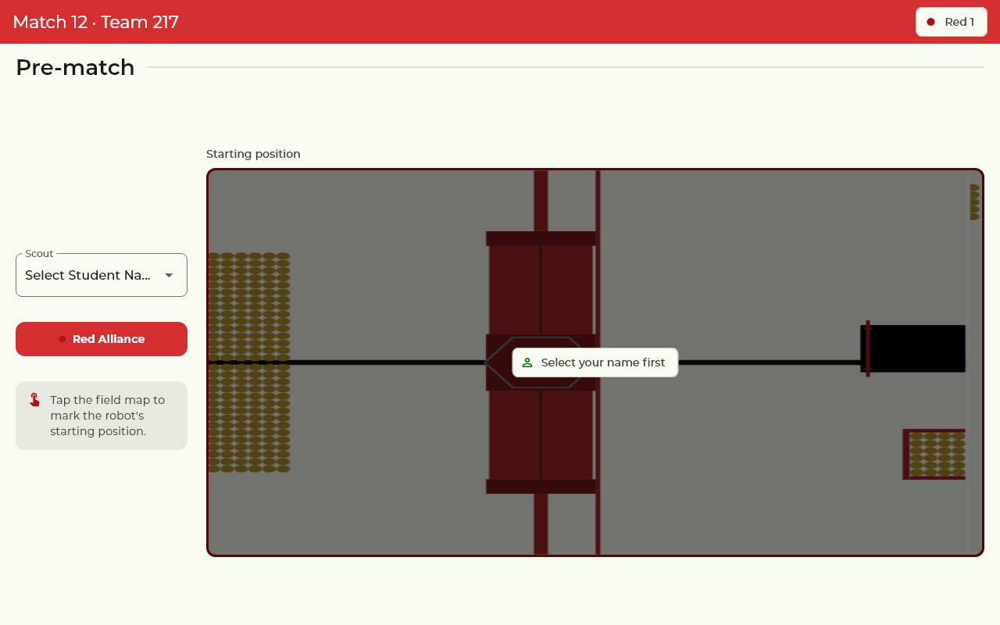

1. Pick your name in **Scout**. (The list comes from the laptop's roster, or
   the list built into the app.)
2. Tap the field where the robot starts.

You **can't swipe to the next page** until both are done. The app bar shows
the match, team and alliance colour; the chip shows your station.

### Auton

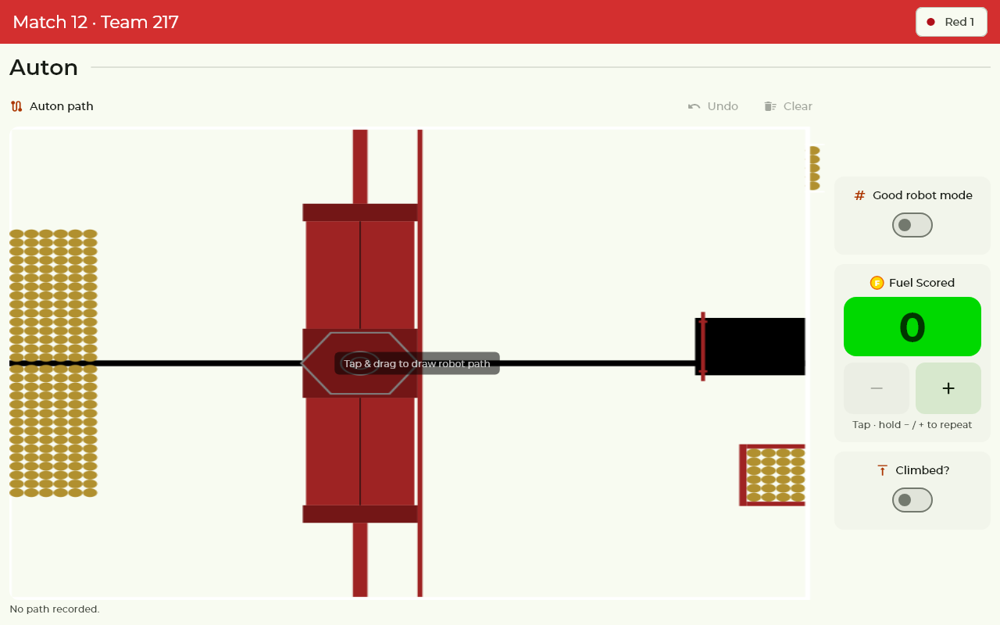

- **Auton path**: press and drag on the field to draw the robot's path. Drag
  a dot to move it. **Undo** removes the last point; **Clear** starts over.
  The first point is the start (shown green).
- **Fuel scored**: tap the big number to add 1, *hold* it to subtract. The
  **−/+** buttons repeat while held.
- **Good robot mode**: shows extra **−5/+5** buttons for high-scoring robots.
- **Climbed?**: did it climb during auton.
- After 20 seconds the page turns **red**: auton is over, swipe on.

### Teleop

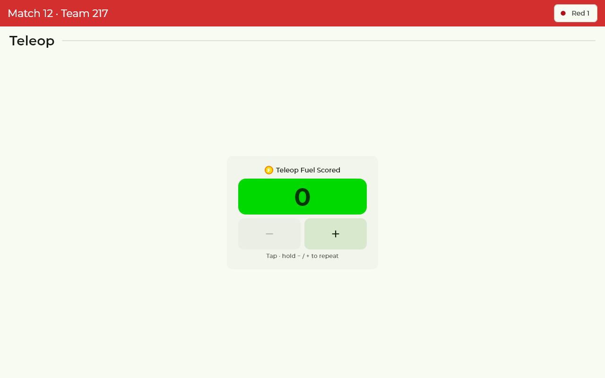

Count the fuel scored during teleop, the same way as in auton.

### Endgame

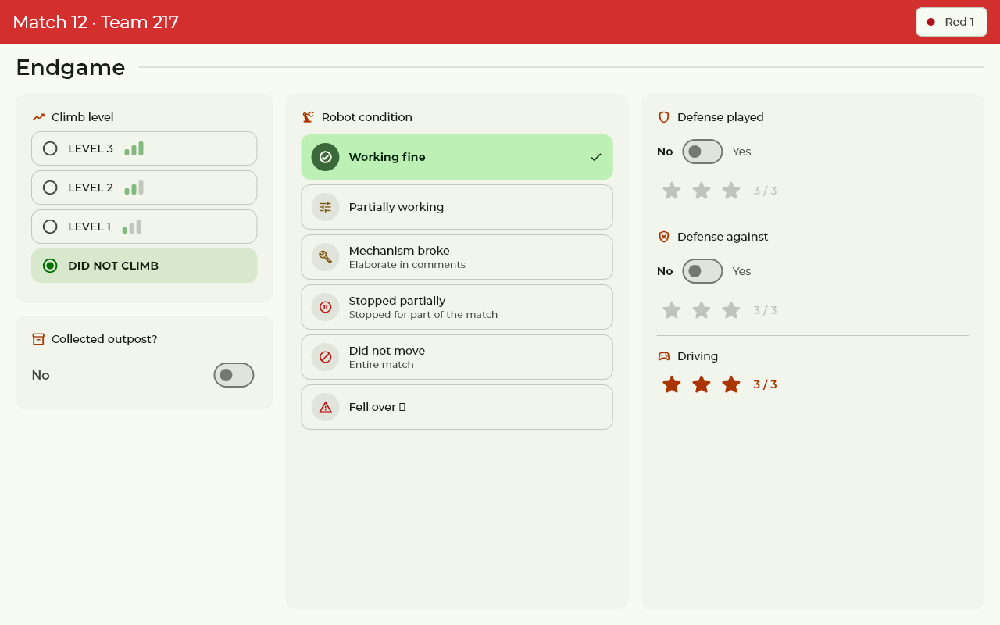

- **Climb level**: Level 1, 2, 3 or Did not climb.
- **Collected outpost?**
- **Robot condition**: working fine, partially working, mechanism broke,
  stopped for part of the match, didn't move, fell over.
- **Defense played / Defense against**: switch on if it happened, then rate
  it 1–3 stars.
- **Driving**: 1–3 stars.

### Submit

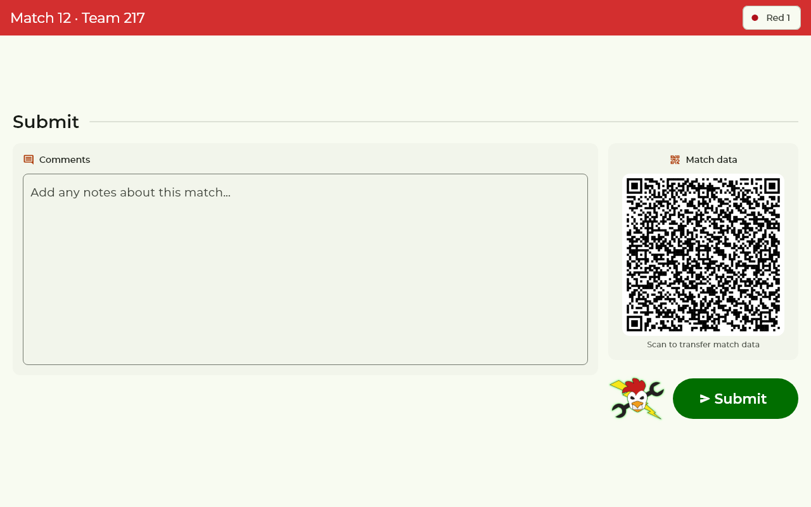

- **Comments**: anything useful that the numbers miss.
- **Match data** QR code: the whole record, for the master to scan if
  Bluetooth isn't working.
- **Submit** saves and returns to the match list.

```{admonition} Data is saved as you go
:class: note
Every swipe between pages saves. Pressing Back asks "Do you want to exit
this match?" and keeps what you've entered. Opening the match again
brings it back.
```

## Bluetooth Sync

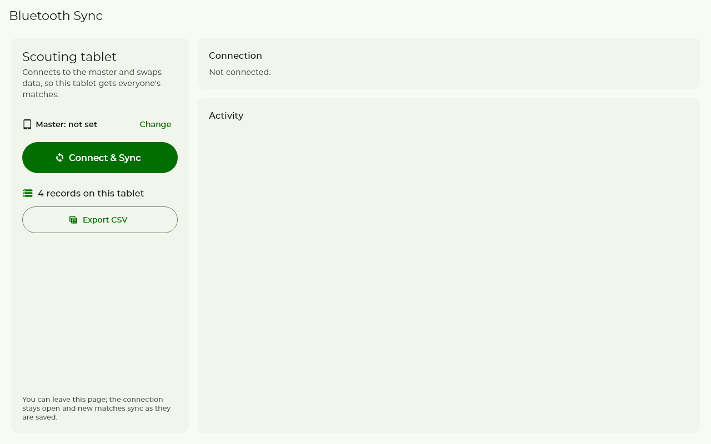

- **Master tablet:** tap **Start Hosting**. It waits for the others.
- **Scouting tablet:** choose the master (it must be *paired* first in
  Android's Bluetooth settings), then **Connect & Sync**.

Tablets swap everything the other is missing. While connected, each new
match is sent as soon as it's submitted, and you can leave the page. The
right side lists connected tablets and an activity log. How it works:
[Bluetooth sync](../how/bluetooth-sync.md).

## Desktop Link (master only)

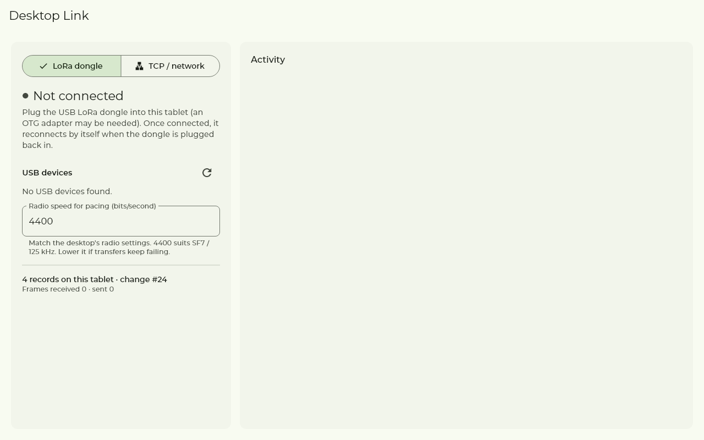

Connects the master tablet to the [companion app](companion-app.md):

- **LoRa dongle**: plug the USB dongle into the tablet (an OTG adapter may be
  needed), allow USB access, tap **Connect**. It reconnects by itself when
  plugged back in.
- **TCP / network**: put the tablet and laptop on the same network, tap
  **Start listening**, and type one of the listed addresses into the
  companion app. It keeps listening when the app restarts.

The tablet only ever *answers* the laptop, so there's nothing else to press
here.

## Sync With Workers (master only)

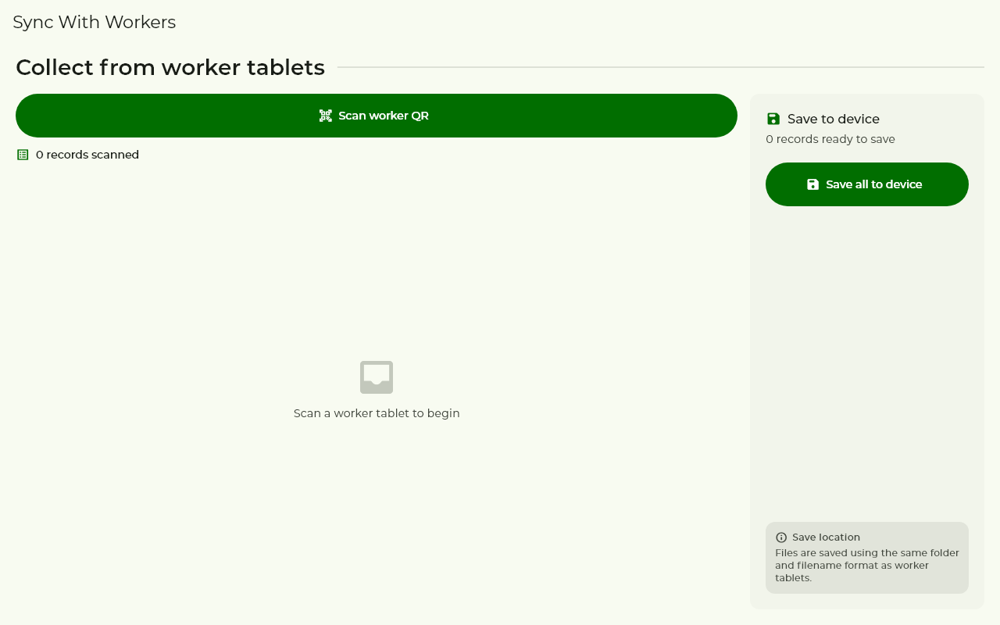

The QR backup. Tap **Scan worker QR**, point the camera at a scout's Submit
screen, repeat, then **Save all to device**. Scanned records also go into
the database, so they're included in Bluetooth sync and exports.

## Export CSV

Pick an event (or all events). The app writes a CSV file and opens Android's
share menu, so you can send it to Drive, email, etc. The columns are
explained in [Scouting data by season](../database/scouting-data.md).

## Settings

Open with the **lock** (enter the passcode), then **☰ → Settings**.

| Setting | What it does | Saved in `settings.json` as |
|---|---|---|
| **Master tablet** | Makes this tablet the master (changes the home screen and sync role). | `master.isMaster` |
| **Team number**, **Year** | Shown here; set from the laptop (or the default file). Used by **Get Matches**. | `master.teamNumber`, `master.year` |
| **Current competition ID** | The event key the dashboards open on and **Get Current Matches** downloads, e.g. `2026mitr2`. | `master.currentCompId` |
| **Station** | Which robot this tablet scouts, e.g. `Red 1`. | `local.station` |
| **Master tablet (Bluetooth sync)** | Which paired tablet to connect to. | `local.masterBtName`, `local.masterBtAddress` |
| **Scoring table side** | Flips the field picture for tablets seated on the scoring table side. | `local.onScoreTableSide` |
| **Settings from the desktop** | When the laptop last sent settings, and which values were changed on this tablet. | — |
| **Reset to desktop settings** | Puts back the laptop's values. | — |

See [Settings reference](../reference/settings.md) for every key, and
[Admin settings](../how/admin-settings.md) for how laptop values and tablet
changes interact.

## Dark mode

The app follows Android's dark theme setting:

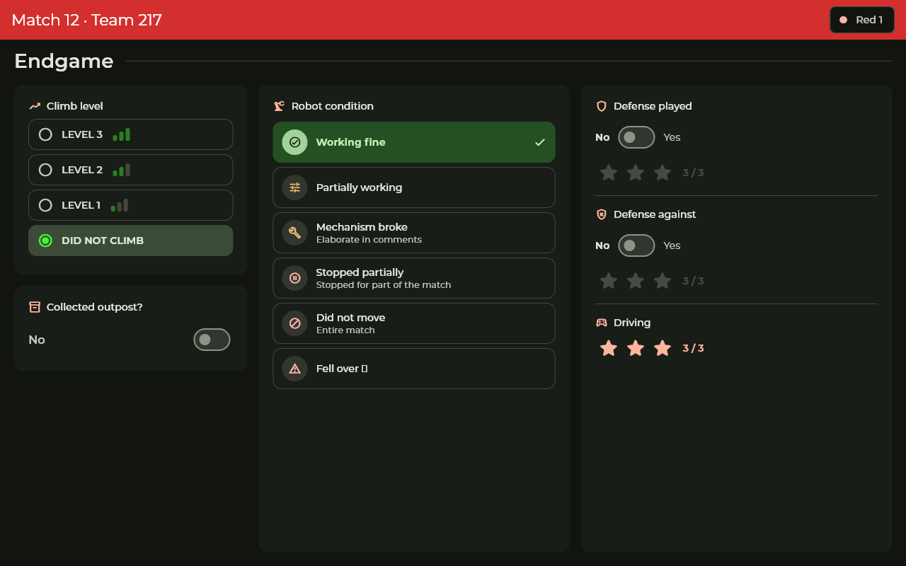
